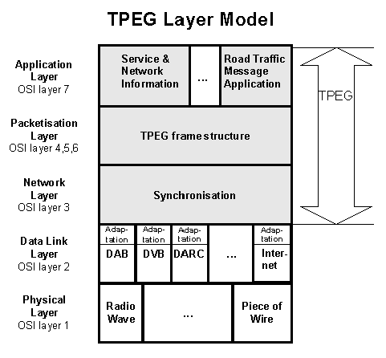
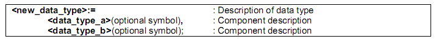
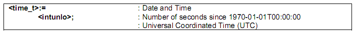
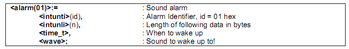
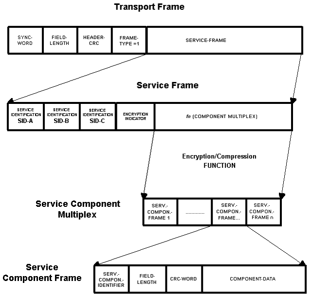

# EXTRAKT z technické specifikace CEN

**Extrakt nenahrazuje samotnou technickou normu, je pouze informativním materiálem o normě.**

**03.220.01, 35.240.60**

**Dopravní telematika – Zprávy TTI předávané označovacím jazykem s možností rozšíření Expertní skupiny protokolů pro dopravu (TPEG) – Část 2: Syntax, sémantika a rámcová struktura (SSF)**

CEN ISO/TS 18234-2

Vydána 2006, 40 stran

**Úvod**

TPEG je technologií, která využívá bajtově orientovaný formát toku dat, využitelný téměř jakýmkoli digitálním nosičem s příslušnou adaptační vrstvou. Zprávy TPEG jsou od poskytovatele služeb doručovány koncovému uživateli a jsou využívány pro přenos dat z databází poskytovatele služeb do zařízení uživatele. Pro usnadnění jsou uživateli prostřednictvím aplikací TPEG SNI sděleny např. název služby, poskytovatel, čas a mnoho dalších. Použitý protokol je rozložen do vrstev (ISO OSI) a zahrnuje obecnou rámcovou strukturu, kterou lze uzpůsobovat a rozšiřovat. Vše bylo vytvořeno s ohledem na flexibilitu, integritu a možnost přizpůsobení a rozšíření protokolu v případě potřeby a to bez vlivu na fungování dekódovacích modelů dosavadních klientů.

Poznámka: Extrakt uvádí vybrané kapitoly popisovaného dokumentu a přejímá původní číslování kapitol.

**Užití**

Technologie TPEG je určena pro poskytovatele služeb, neboť byla navržena pro širokou škálu aplikací, které vyžadují efektivní přenos z jednoho bodu do více bodů přes veskrze nespolehlivé širokopásmové vysílání.

**1 Předmět normy**

Tato norma je 2. část souboru norem věnujících se standardizaci protokolu pro dopravu TPEG. Uvádí plnou specifikaci používaných datových typů (primitives), datových/přenosových rámců, výpočtu časových údajů, použitého číslování a specifických pravidel jako je například výpočet kontrolního součtu CRC.

Je pevně spjata s 3. částí (TPEG SNI) a tyto části by tedy měly být používány společně. Část 3 popisuje aplikaci „informací o službách v síti“ (SNI), poskytuje prostředky informování koncového uživatele o všech dostupných službách a jejich obsahu, které jsou poskytovatelem služeb považovány za relevantní pro udržení kontinuity jeho služeb a pro informování o dalších obdobných službách.

**2 Souvisící normy**

Kromě ostatních částí této specifikace (18234-1 až 6) souvisí také se 13 částmi ISO/IEC 8859, které definují jedním 8-bitovým bytem kódované soubory grafických znaků.

**3 Symboly a zkratky**

Tato kapitola uvádí 22 zkratek, podstatné z nich jsou uvedeny níže a 2 jsou doplněné:

**3.1 AID** application identification – identifikátor aplikace TPEG

**CRC** cyclic redundancy check – kontrolní součet

**3.5 DAB** digital audio broadcasting – digitální audio vysílání

**3.7 DVB** digital video broadcasting – digitální vysílání videosignálu

**3.8 EBU** European broadcasting union – Evropská vysílací unie

**3.14 RTM** road traffic message – zpráva o stavu dopravy

**3.15 SNI** service and network information application – informace o službách v síti

**3.16 SSF** syntax, semantics and framing structure – syntax, sémantika a rámcová struktura

**3.17 TPEG** Transports protocol experts group – forma strukturovaného zápisu informací o dopravě

Další termíny a zkratky z oboru ITS jsou obsaženy ve slovníku ITS terminology (www.ITSterminology.org).

**4 Principy struktury TPEG**

Seznamuje se základními principy použitými při návrhu protokolu TPEG a s jeho strukturou. Je zde stanoveno 11 základních rysů protokolu TPEG, mezi něž mimo jiné patří to že je založen na bajtové struktuře, má hierarchickou strukturu rámců a umožňuje šifrování. V této kapitole jsou znázorněny možnosti přenosu protokolu TPEG prostřednictvím různých médií a je stanoveno, že protokol TPEG obsahuje detekci chyb. Dále je v článku 4.2 znázorněna struktura protokolu TPEG a její vazba na model OSI (viz Ilustrace 1). Aplikační úroveň (7. vrstva OSI) je věnována popisu rozdílných aplikací TPEG (ISO 18234-3,4,5), poté následuje rámcová struktura protokolu, která odpovídá 6-4 vrstvě OSI, jako poslední je síťová (synchronizační) vrstva odpovídající OSI vrstvě 3. Vrstvy OSI 2 a 1 jsou mimo rámec zájmu tohoto souboru norem.

**Obr. 1** Model vrstev protokolu TPEG a jeho vazba na model ISO OSI

**5 Dohodnuté způsoby a značky**

Tato kapitola definuje zvyklosti a symboly, využívané v rámci norem protokolu TPEG. Stanovuje metodu zápisu a interpretace bitového čísla, popisuje jakým způsobem jsou vytvářeny nové datové položky (primitives) a uvádí, že mohou být kombinovány dohromady tak, aby mohly tvořit složitější celky. Zavádí klíčové slovo „UAV“, pro zápis kde specifikace dat není kompletní a je možné že se bude výhledově měnit. Dále jsou zde stanoveny metody zápisu čísel v různých soustavách, proměnných a tzv. implicitních veličin.

**6 Zápis syntaxe**

Tato kapitola popisuje způsob zápisu a definice typů datových struktur používaný v rámci protokolu TPEG. Způsob zápisu dat (typu) je založen na jednotkách o velikosti jednoho bytu (8 bitů), tento zápis je popisný a pochopitelný i pro uživatele bez technického vzdělání, viz Ilustrace 2. článek 6.2 popisuje tvorbu typu dat ze jak ze základních, tak i z odvozených typů TPEG a umožňuje tak vytvářet rozvětvené struktury. TPEG definuje datové struktury takto:

Článek 6.3 popisuje základní i odvozené (složené) datové typy používané ve všech aplikacích TPEG. Mezi tyto typy patří například čísla (malá, velká, se znaménkem a bez), identifikátor znakové sady a CRC, jako zástupce odvozených typů můžeme uvést znakové řetězce, datum a čas a trvání, viz ukázka.

Článek 6.4 popisuje datové struktury (typy) závislé na aplikaci. Dělí je na deklarativní a nedeklarativní. Deklarativní struktury navíc obsahují jednoznačný identifikátor, který určuje způsob použití struktury. Identifikátor je přidělován hierarchicky a jeho jednoznačnost je zaručena POUZE na dané úrovni hierarchie pro daný segment (v případě vložených struktur deklarativního charakteru je možné aby dvě rozdílné struktury vložené do dvou různých „kořenových“ struktur měly stejný identifikátor).

Dále jsou v článku 6.5 popsány principy návrhu aplikací TPEG, které zahrnují použití datových struktur proměnlivé délky, tvorbu znovupoužitelných a rozšiřitelných struktur a ověřitelnost deklarativních datových struktur.

**7 Popis TPEG**

Kapitola 7 obsahuje popis hierarchického uspořádání rámcové struktury protokolu TPEG (viz obrázek 5), a jeho syntaktickou reprezentaci. Dále je v této kapitole podrobně popsána skladba přenosového rámce (transport frame) a servisního (služebního) rámce (service frame) a také zápis syntaxe (například, že každý prvek je uzavřen v ostrých závorkách a že definice prvku je ukončena středníkem).

**Obr. 5** Hierarchické uspořádání rámcové struktury TPEG

## Příloha A (normativní) Tabulka znaků

Jeden ze základních typů TPEG obsahuje odkaz na použitou znakovou sadu pro reprezentaci znaků v definovaných datových strukturách. Tato příloha uvádí výčet možných znakových sad (ISO/IEC 8859-1, ISO/IEC 8859-2, …, Unicode ISO/IEC 10646 UTF-16, …) a přiřazuje jim pro použití v rámci TPEG jednoznačný index.

## Příloha B (normativní) Metoda kódování kvantit objektů

Tato příloha popisuje způsob jak v rámci omezeného čísla popisovat „téměř“ neomezené kvantity. Tento způsob je založen na postupném snižování přesnosti pro vzrůstající hodnoty (tj. pokud počítáme stovky objektů jsou jejich jednotky a desítky nepodstatné).

## Příloha C (normativní) Výpočet kontrolního součtu CRC

Tato příloha obsahuje popis výpočtu kontrolního součtu CRC. Tento součet je zbytkem po dělení předávaných dat určitým pevně stanoveným polynomem. Tento „zbytek“ je pro každou reprezentaci dat jiný a dá se tedy použít na kontrolu správnosti přijatých dat – pokud jsou výsledky operace výpočtu CRC stejné jako předané CRC, je předpoklad, že data jsou správná (nezkreslená chybou při přenosu).

## Příloha D (normativní) Výpočet času

Tato příloha obsahuje výpočet času, kde se hodnota datové struktury „time\_t“, která je reprezentována vysokým celým číslem vyjadřujícím sekundy uplynulé od 1.1. 1970, přepočítává na datum a čas. Příklady uvádí část tabulky D.1 normy.

Tabulka D.1 – Příklady výpočtu času

<table>
<tbody>
<tr class="odd">
<td><strong>Sekundy 
(desítková soustava)</strong></td>
<td><strong>Sekundy 
(šedesátková soustava)</strong></td>
<td><strong>Datum/čas</strong></td>
</tr>
<tr class="even">
<td>0</td>
<td>0x00000000</td>
<td>1970-01-01T00:00:00Z</td>
</tr>
<tr class="odd">
<td>1500</td>
<td>0x000005DC</td>
<td>1970-01-01T00:25:00Z</td>
</tr>
<tr class="even">
<td>2429884</td>
<td>0x002513BC</td>
<td>1970-01-29T02:58:04Z</td>
</tr>
</tbody>
</table>

## Příloha E (informativní) Popis struktur dat v TPEG do programovacího jazyka C

Tato příloha obsahuje přepis zápisu syntaxe použitého pro popis struktur dat v TPEG do programovacího jazyka C.
