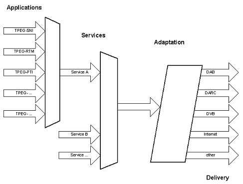
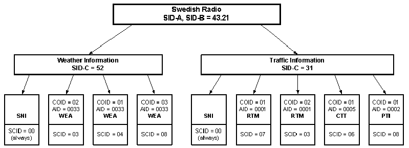
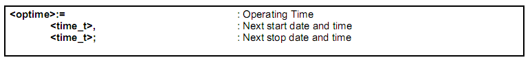
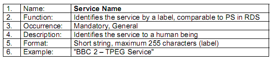
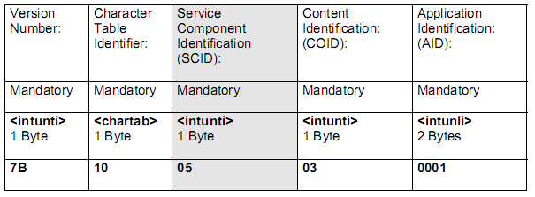
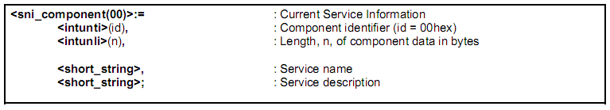

# EXTRAKT z technické specifikace CEN

**Extrakt nenahrazuje samotnou technickou normu, je pouze informativním materiálem o normě.**

**03.220.01, 35.240.60**

**Dopravní telematika – Zprávy TTI předávané označovacím jazykem s možností rozšíření Expertní skupiny protokolů pro dopravu (TPEG) – Část 3: Aplikace služeb a informační sítě (SNI)**

CEN ISO/TS 18234-3

Vydána 2006, 37 stran

**Úvod**

Tato norma je 3. část souboru norem věnujících se standardizaci protokolu pro dopravu TPEG.

V úvodu normy je popsána technologie TPEG a její vývoj. TPEG je formou strukturovaného zápisu informací o dopravě, která používá bajtově orientovaný formát toku dat, který lze použít pro přenos jakýmkoliv digitálním nosičem s příslušnou adaptační vrstvou. Zprávy TPEG jsou přenášeny od poskytovatelů služeb ke koncovým uživatelům a používají se k přenosu dat aplikace z databáze poskytovatele služeb do zařízení koncového uživatele.

Poznámka: Extrakt uvádí vybrané kapitoly popisovaného dokumentu a přejímá původní číslování kapitol.

**Užití**

Technologie TPEG je určena pro poskytovatele služeb, neboť byla navržena pro širokou škálu aplikací, které vyžadují efektivní přenos z jednoho bodu do více bodů prostřednictvím poměrně nespolehlivého příjmu rádiového vysílání.

**1 Předmět normy**

Tato norma popisuje Aplikaci „Informace o službách v síti“ (SNI) protokolu TPEG, která poskytuje prostředky informování koncového uživatele o všech dostupných službách a jejich obsahu, které jsou poskytovatelem služeb považovány za relevantní pro udržení kontinuity jeho služeb a pro informování o dalších obdobných službách. Stanovuje vztahy pro převod informačního obsahu služby (služeb) mezi různými přenosovými médii. Dále uvádí mechanismy „sledování“ určité (vybrané) služby v rámci jednoho přenosového prostředí, například při předávání koncového zařízení mezi vysílači, včetně detailních příkladů. Pro usnadnění jsou uživateli prostřednictvím aplikací TPEG SNI sděleny např. název služby, poskytovatel, čas a mnoho dalších.

Termín „Aplikace“ je v kontextu TPEG použit pro popis služby na nejvyšší úrovni ISO OSI modelu. Každá Aplikace má v TPEG přiřazen jednoznačný identifikátor AID (viz EN ISO 18234-1), tento identifikátor používá Aplikace SNI k informování zařízení koncového uživatele o obsahu přenášené služby (aplikace) TPEG a o tom jakým způsobem a dekodérem přenášený obsah zpracovat.

Aplikace SNI má přiřazen identifikátor AID=0000

**2 Souvisící normy**

Tato 3. část normy CEN ISO/TS 18234 (TPEG-SNI) je pevně spjata s 2. částí (TPEG\_SSF) a tyto části by tedy měly být používány společně. Dále se norma odkazuje na normy pro digitální a rádiové vysílání (ETSI EN 300 401, ETSI TS 101 759, IEC 62106, ETSI EN 300 751 a ETSI EN 300 468).

**3 Termíny a definice**

Tato kapitola uvádí 13 termínů a definicí.

Další termíny a zkratky z oboru ITS jsou obsaženy ve slovníku ITS terminology.

**4 Symboly a zkratky**

Tato kapitola uvádí 28 zkratek, podstatné z nich jsou uvedeny níže:

**4.1 AID** application identification – identifikátor aplikace TPEG

**4.7 DAB** digital audio broadcasting – digitální audio vysílání

**4.9 DVB** digital video broadcasting – digitální vysílání videosignálu

**4.12 GST** guide to the service tables – průvodce tabulkami služeb

**4.10 EBU** European broadcasting union – Evropská vysílací unie

**4.16.OSI** open systems interconnection – Propojení otevřených systémů

**4.18 RTM** road traffic message – zpráva o stavu dopravy

**4.19 SCID** service component identification – identifikace servisní komponenty

**4.21 SNI** service and network information application – informace o službách v síti

**4.22 SSF** syntax, semantics and framing structure – syntax, sémantika a rámcová struktura

**4.25 TPEG** Transports protocol experts group – Expertní skupina dopravních protokolů, forma strukturovaného zápisu informací o dopravě

**4.28 WEA** weather information – informace o počasí (navrhovaná aplikace TPEG)

Další termíny a zkratky z oboru ITS jsou obsaženy ve slovníku ITS terminology (www.ITSterminology.org).

**5 Identifikace aplikace**

Každá aplikace TPEG musí mít přidělen svůj identifikátor AID, ten je přidělen okamžitě po dokončení vývoje aplikace před započetím jejího užití v rámci struktury TPEG. Přidělený identifikátor aplikace je nezbytně nutný pro určení způsobu zpracování strukturované informace a pro směrování (routování) těchto informací k dekodéru náležejícímu dané aplikaci. Výčet identifikátorů všech aplikací je uveden v CEN ISO/TS 18234-1.

Aplikace stanovená v této normě (TPEG-SNI) má přiřazen identifikátor AID = 0000.

**6 Konceptuální model**

V kapitole je uveden seznam využití aplikace SNI, která byla navržena za účelem „navigace“ mezi různými službami v různých přenosových prostředích a umožňuje uživateli vybrat si (najít) požadovanou službu. Z technického hlediska zajišťuje aplikace SNI automatické „ladění“ a sledování vybrané služby TPEG. Jsou zde vyjmenovány hlavní požadavky na aplikaci SNI mezi které mimo jiné patří, krom výše uvedených, i informace o vysílacích časech, opakování a interakci s ostatními aplikacemi TPEG.

**Obr. 1** Sdružené aplikace a služby (aplikace, služby, úprava)

**7 Princip návrhu**

Tato kapitola uvádí příklad odkazování (referencing) proměnného obsahu služeb pomocí k tomu určených identifikátorů SCID, kde každá část obsahu má přiřazen jednoznačný SCID, tyto části mohou být kombinovány a vytvářet tak služby s různým obsahem.

Dále tato kapitola obsahuje příklad aplikace TPEG-SNI v datovém proudu TPEG, koncept alokování služeb (viz obrázek 4) a obecná pravidla pro aplikaci TPEG-SNI. Mezi obecná pravidla patří například nezbytná přítomnost SNI aplikace v každé službě TPEG atd.

**Obr. 4** Příklad alokace služeb v národním radiovém přenosovém médiu

**8 Popis datových typů SNI**

Obsahuje popis základních datových typů aplikace SNI. Tyto typy jsou:

  - typy pro periodické časové funkce (začátek, datum a čas, časový slot, …),

  - typ pro určení času opakování výskytu složky určité služby (viz příklad níže) a

  - složený typ pro určení geografického pokrytí služby.

Příklad typu definujícího čas začátku a konce opakování výskytu složky určité služby:

**9 Popis základních prvků**

Tato kapitola obsahuje popis základních prvků Aplikace SNI rozdělený do tří článků.

**9.1 Informace o službě**

Tento článek popisuje formát informací o službě (název a popis služby, logo, informace pro předplatitele, pomocné informace a volný text). Jako nejvhodnější prostředek popisu je zvolena tabulka následovaná vysvětlivkami.

**Tab. 3** Popis prvku informace o službě/název a popis služby

**9.2 Informace o obsahu služby (komponenty služby)**

Tento článek je poměrně rozsáhlejší a uvádí formát popisu informací o obsahu služby.

Formát popisu informací o obsahu služby je v normě uveden pomocí tzv. tabulek GST – průvodce tabulkami služeb. Tyto tabulky se skládají z 5 částí, které přenášejí informace o obsahu služby/služeb. Hlavní tabulka, GST 1, je nazvaná „rychlé ladění“ a obsahuje informace o všech službách a jejich přidružených komponentách přenášených v datovém proudu TPEG, viz tabulka 10:

**Tab. 10** Velmi jednoduchý příklad tabulky GST 1: „rychlé ladění“

Další tabulky GST jsou na rozdíl od té první nepovinné a obsahují: časový rozvrh služby (GST 2), popis obsahu (GST 3), prostorové pokrytí služby (GST 4) a nastavení/reset komponenty služby (GST 5).

**9.3 Informace o propojení služeb a jejich komponent**

Tento článek obsahuje informace o propojení služeb a jejich komponent. Zavádí tabulku pomocí které je možné propojit:

1)  stejnou službu (stejné SID) v různých přenosových médiích,

2)  různé služby (rozdílné SID) v rámci jednoho přenosového média a

3)  různé služby (rozdílné SID) v různých přenosových médiích.

**10 Struktura kódování základních prvků**

Tato kapitola obsahuje definice a způsob kódování prvků uvedených v předchozí kapitole, tj. informace o službě (název a popis služby, logo, informace pro předplatitele, pomocné informace a volný text), informace o obsahu služby (GST 1 -5) a informace o propojení služeb a jejich komponent. K popisu struktury základních prvků aplikace SNI je použito kódování stanovené v EN ISO 18234-2 SSF. Rámec komponent Sni je uveden níže:

