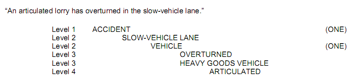
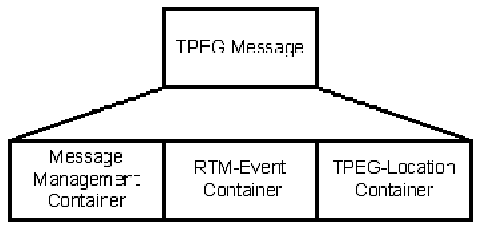
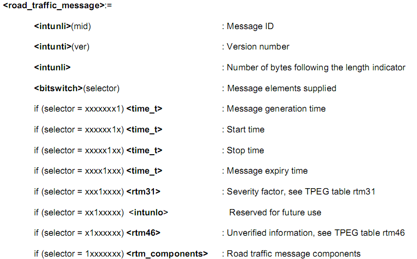
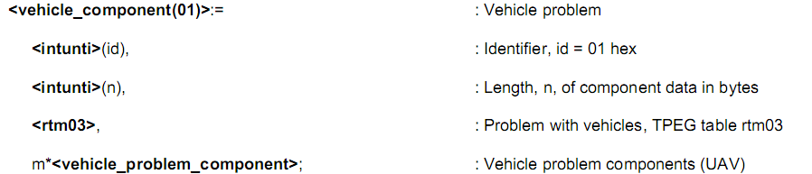
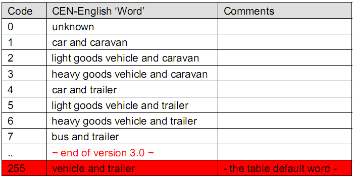

# EXTRAKT z české technické normy

**Extrakt nenahrazuje samotnou technickou normu, je pouze informativním materiálem o normě.**

**03.220.01, 35.240.60**

**Dopravní telematika – Zprávy TTI předávané označovacím jazykem s možností rozšíření Expertní skupiny protokolů pro dopravu (TPEG) – Část 4: Aplikace: Dopravní zpravodajství (RTM)**

ČSN P CEN ISO/TS 18234-4 — třídicí znak 01 8256

Platí od 1.1.2007 106 stran

**Úvod**

V úvodu normy je popsána technologie TPEG a její vývoj. TPEG je formou strukturovaného zápisu informací o dopravě, která používá bajtově orientovaný formát toku dat, který lze použít pro přenos jakýmkoliv digitálním nosičem s příslušnou adaptační vrstvou. Zprávy TPEG jsou přenášeny od poskytovatelů služeb ke koncovým uživatelům a používají se k přenosu dat aplikace z databáze poskytovatele služeb do zařízení koncového uživatele.

Tato norma je 4. část souboru norem věnujících se standardizaci protokolu pro dopravu TPEG. Detailně popisuje aplikaci TPEG RTM: zprávy o silniční dopravě za použití bitové reprezentace.

**Užití**

Technologie TPEG je určena pro poskytovatele služeb, neboť byla navržena pro širokou škálu aplikací, které vyžadují efektivní přenos z jednoho bodu do více bodů přes veskrze nespolehlivé rádiové vysílání.

**Souvisící normy**

Tato norma vychází z předchozí standardizační práce v oblasti poskytování dopravních informací, která vyústila v soustavu norem systému RDS-TMC (např. EN ISO 14819-2), systém RDS-TMC na rozdíl od aplikace TPEG-RTM popisuje nejen informace o dopravě, ale i informace o počasí, parkování, veřejných akcích atd.

**1 Předmět normy**

Aplikace popsaná v této normě se na rozdíl od toho snažila konzistentně popsat pouze část zpráv o silniční dopravě, v některých částech ovšem z důvodu zpětné kompatibility je popis částečně rozšířen i do ostatních oblastí pokrytých normou 14819-2. Plné pokrytí celé problematiky je/mělo by být provedeno v ostatních aplikacích TPEG. Například TPEG-PTI pokrývá problematiku informací o veřejné hromadné dopravě.

Tento dokument popisuje aplikaci TPEG RTM, tedy způsob jakým mohou být přenášeny informace o dopravě v rámci služby TPEG a to nezávisle na jazyce uživatele či poskytovatele služby. Poskytované informace se týkají dopravních událostí a stavových informací na pozemních komunikacích.

Aplikace TPEG-RTM se skládá ze 3 částí: zásobníku řízení zprávy (Message Management Container), zásobníku události (Application Event Container) a zásobníku lokace (TPEG-Location Container). První dva zásobníky (části) jsou plně popsány v rámci této normy, poslední zásobník je popsán v CEN ISO/TS 18234-6.

V první části tohoto souboru norem CEN ISO/TS 18234-1 je popsán tzv. identifikátor aplikace (AID), který přesně určuje, jakým způsobem budou data z konkrétní aplikace zpracovávána, tato aplikace (TPEG-RTM) má přidělen identifikátor AID=0001. Aplikace TPEG-RTM definuje tabulky obsahující slova a fráze z dopravní problematiky, tak aby z nich bylo možné složit informaci o dopravě (mnoho z těchto slov bylo převzato z norem DATEX a RDS-TMC).

**3 Termíny a definice**

Tato kapitola uvádí 16 termínů a definicí popisujících RTM.

**4 Zkratky**

Tato kapitola uvádí 34 zkratek, podstatné z nich jsou uvedeny níže:

**4.22 RTM** road traffic message – zpráva o dopravním provozu

**5 Přehled aplikace RTM**

Aplikace TPEG-RTM podporuje velmi široké využití dekodéry s různou složitostí, kde podle složitosti zařízení může být dekódována jenom „vrchní vrstva“ tj. popisná informace, nebo může být zpráva dekódována celá i s detailním popisem, který je v TPEG-RTM obsažen (viz obrázek níže). Zpráva TPEG-RTM může být použita v přijímačích s digitální mapu, nebo bez ní, či v přístrojích umožňujících pouze textový výstup. Zpráva může být v závislosti na dekodéru prezentována textově, graficky či pomocí syntézy řeči.

Zpráva RTM bude muset zahrnovat některé z následných prvků, aby splnila požadavky uživatele na informaci, vycházející z těchto předpoklad:

- Komu je informace určena

- Geografickou lokaci (popis místa) zprávy,

- Polohu na PK či zasaženou oblast

- Popis události (situace)

- Závažnost informace,

- Pravost informace (jestli byla verifikována a kým),

- Časové omezení platnosti,

- Dopad na dopravní provoz v podobě zdržení,

- Návrh alternativní trasy,

- Návrh změny dopravního prostředku odkazem na jiné aplikace,

- Další přidružené informace.

Díky specifické struktuře zprávy aplikace TPEG-RTM je možno zprávy velmi efektivně filtrovat. Každá zpráva musí dle specifikace v dalších kapitolách obsahovat identifikátor a verzi, to jakým způsobem tato čísla používat popisuje článek 5.1. V článku 5.2 je popsán koncept zprávy RTM, to do jakých zásobníků je rozložena (článek 5.3) a jaký je přesný obsah zásobníků obsažených ve zprávě (článek 5.4).

**Popis zásobníků (čl. 5.5 -5.7)**

Následující články obsahují přesný popis co obsahuje zpráva TPEG-RTM. Článek 5.5 pojednává o zásobníku pro řízení zprávy s popisem toho, jak jsou jednotlivé části tohoto zásobníku skládány dohromady a jakým způsobem je k nim přidán kontrolní součet CRC. Článek 5.6 obsahuje popis zásobníku událostí, toho jakým způsobem se skládá popis události z jednotlivých frází a jakým způsobem se dekóduje (viz ilustrace 1). Článek 5.7 obsahuje pouze velmi stručný popis zásobníku na lokaci spolu s odkazem do CEN ISO TS 18234-6, která se tomuto tématu věnuje detailně.

**6 Zásobník RTM**

Tato kapitola obsahuje definici celkového rámce TPEG-RTM (viz obrázek 7), jsou zde vyčísleny jednotlivé struktury (prvky) obsažené v zásobnících aplikace RTM společně s odkazy na jejich výskyty v rámci normy. Dále tato kapitola obsahuje definici zápisu, který použit v této normě pro zapsání struktur aplikace TPEG-RTM

**Obr. 7** Struktura zásobníků TPEG-RTM

**7 Zásobník pro řízení zprávy – Message Management Container**

Tato kapitola obsahuje definici a syntaxi struktur, které jsou povinnou i volitelnou součástí zásobníku pro řízení zprávy. Mezi hlavní struktury (prvky) tohoto zásobníku patří identifikátor zprávy (message identifier), verze zprávy (version number) a prvky popisující časové parametry či věrohodnost a závažnost zprávy. Syntaxe zásobníku pro zprávy typu RTM je uvedena níže:

**8 Zásobník událostí – Event Container**

Obsahuje všechny potřebné definice pro sestavení hierarchického slovního popisu dopravního problému a je hlavní částí celé normy (čtyři pětiny normy).

Na první úrovni hierarchie je definováno 13 tříd, které jsou dále plně popsány pomocí tabulek obsahující ke každé třídě relevantní fráze a slova. Hlavními třídami jsou nehoda (accident), překážka (obstruction), činnosti (activities), podmínky vozovky (road conditions), výkon sítě (network performance), stav sítě (network conditions), výkon zařízení (facilities performance), nebezpečný náklad (moving hazard), bezpečnostní výstraha (security alert), informace o veřejné dopravě (public transport information), viditelnost (visibility), počasí (weather) a oznámení objížďky (diversion advice). V článku 8.3 je stanovena syntaxe pro všechny typy události definované v aplikaci RTM tak, jak je definováno EN ISO 18234-2, viz příklad níže:

Článek 8.4 obsahuje definice všech tabulek frází a slov používaných v aplikaci RTM. Každá tabulka je zde plně uvedena (viz tabulka 14) a také je zde stanoveno jakým způsobem jsou tabulky mezi sebou propojeny. Tabulka (rtm01) obsahuje definici typů vozidel kde kódem 1 je specifikován obecný typ „auto“, který může být dále zpřesněn tabulkou rtm07 jež obsahuje více detailů o vozidle např. malé auto rodinné auto atd. Tabulky (pojmenované rtm01 až rtm50) obsahují popisy (fráze) týkající se vozidel, aktivit, podmínek vozovky, dopravním omezení, stavu dopravy, atd.

**Tab. 14** tabulka TPEG rtm08: „typ vozidla s přívěsem"

## Příloha A (informativní) Konverze jednotek

Tato příloha obsahuje pouze popis konverze z metrických jednotek SI a na nestandardní jednotky používané v anglosaských zemích.
