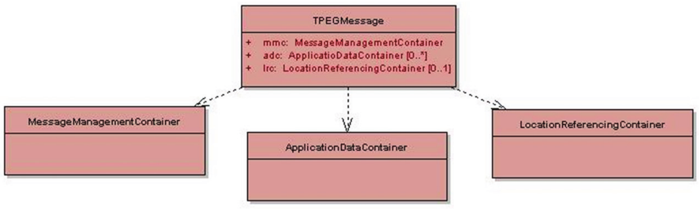
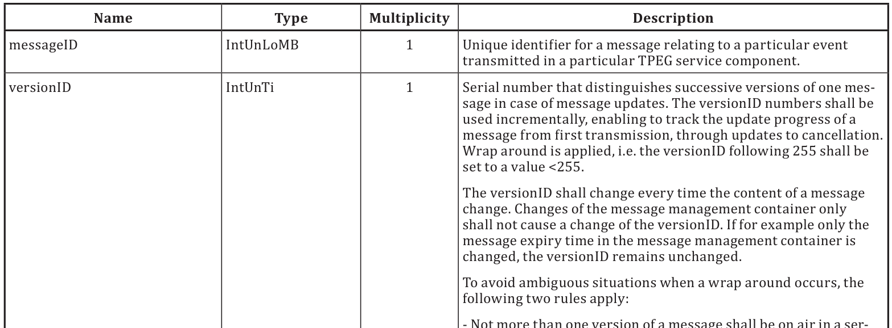
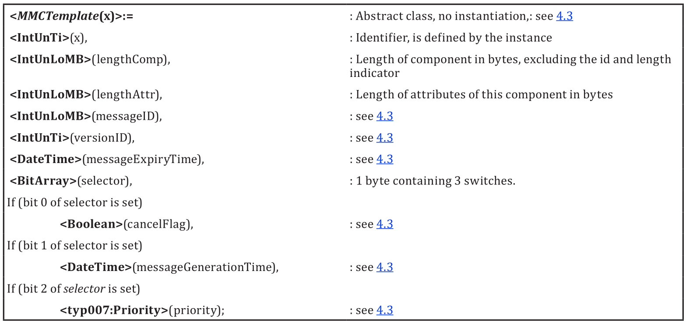
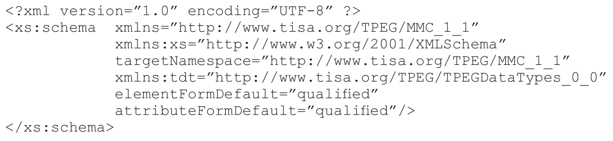

# EXTRAKT z technické specifikace ISO

Extrakt nenahrazuje samotnou technickou normu, je pouze informativním materiálem o normě.

**Inteligentní dopravní systémy – Dopravní a cestovní informace v dopravním protokolu expertní skupiny, druhá generace (TPEG2) – Část 6: Kontejner pro management zpráv**

ISO/TS 21219-6

Vydána 2015, 18 stran

##

## Úvod

Technická specifikace ISO 21219 stanovuje formát a protokol TPEG určený pro poskytování informací o dopravě koncovým uživatelům. TPEG je určen pro média s vysokou přenosovou kapacitou, umožňuje informace členit strukturovaně se zvyšující se mírou detailů a komplexně popisovat polohu.

Jednotlivé oblasti dopravních událostí jsou v TPEG popsány odděleně, pomocí platformě nezávislého modelu (UML) a dvou odvozených platformě závislých modelů (binární a XML). Části specifikace stanovují pravidla tvorby modelu jeho převodu do platformě závislé podoby.

Více informací o kontextu TPEG je obsaženo v úvodu extraktu k části 1 normy TPEG (21219-1).

Technická specifikace ISO 21219 se zabývá druhou generací protokolu TPEG, označovaným zkratkou TPEG2. Rozlišení TPEG/TPEG1/TPEG2 se většinou uvádí pouze v úvodní části norem/specifikací, zatímco ostatní kapitoly již mezi TPEG a TPEG2 nerozlišují - to je implicitní dle kontextu.

Tento extrakt (dále jen “popisovaný dokument”) popisuje část 6 normy TPEG, která specifikuje jednu ze tří důležitých částí zprávy, tzv. Kontejner pro management zpráv a související způsob aktualizace zpráv. Každá zpráva TPEG povinně obsahuje alespoň tento Kontejner (MMC).

Poznámka: Extrakt uvádí vybrané kapitoly popisovaného dokumentu a přejímá původní číslování kapitol.

## Užití

Popisovaný dokument uvádí 2 způsoby, jakými může být realizován Kontejner pro management zpráv, který uvádí verzi, identifikátor, platnost a hlavně způsob aktualizace zpráv. Způsob aktualizace může být jak monolitický (celá zpráva, všechny její kontejnery, je aktualizována najednou), tak i po částech (kdy jsou samostatně aktualizovány kontejnery, ze kterých se skládá zpráva). Kontejner MMC je povinnou součástí všech zpráv, (je jedním ze 3 kontejnerů, ze kterých se správa skládá a jako jediný je povinný). Další části specifikace 21219, ve kterých jsou stanoveny Aplikace TPEG (parkování, ceny paliva, …), již MMC neuvádějí (pouze v některých případech upřesňují jeho použití).

MMC je povinnou součástí předávaných zpráv, proto je tato norma nezbytná pro poskytovatele i příjemce dopravních informací, jejich programátory, kteří pracují se samotným formátem XML či programují datové proudy pro DAB. Identifikátor a verze zprávy, obsažené právě v MMC, jsou zásadní pro její „skládání“ v přijímači a pro prezentaci uživateli.

## 1 Předmět normy

Popisovaný dokument stanoví Kontejner pro management zpráv MMC, který potřebují všechny ostatní aplikace TPEG k poskytnutí informací klientskému zařízení o způsobu nakládání se zprávou (její částí). MMC obsahuje informace umožňující dekodéru správně pracovat se zprávou, skládat ji z částí, aktualizovat, prezentovat uživateli. MMC obsahuje mimo jiné identifikátor zprávy, časovou platnost a verze všech částí zprávy.

## 2 Souvisící normy

Tento dokument uvádí 4 normativní odkazy na normu TPEG2 ISO 21219 části 2 (pravidla modelování), 3 (odvození do binární podoby) a 4 (odvození do XML)  a normu TPEG1 ISO 18234-3 Informace o službách a síti.

## 3 Termíny, definice a zkratky

Popisovaný dokument stanovuje 6 termínů. Klíčovými jsou tyto termíny:

**Management monolitických zpráv** (Monolithic message management) - management zpráv umožňující pouze aktualizaci celých zpráv, a ne jen jejich částí

**Management částí zpráv** (Multipart Message Management) - management zpráv umožňující samostatnou aktualizaci částí zpráv

Tato kapitola dále stanovuje 3 zkratky reprezentující jednotlivé části / kontejnery zprávy:

**MMC** kontejner pro management zpráv (message management container)

**ADC** kontejner pro popis události (Application data container)

**LRC** kontejner pro popis místa (Location referencing container)

V popisované dokumentu nejsou uvedeny všechny třípísmenné zkratky norem TPEG. Nicméně tyto zkratky i jejich vysvětlení uvádíme jako součást výčtu částí specifikace v úvodu tohoto extraktu, proto je zde dále neuvádíme.

Další termíny a zkratky z oboru ITS jsou obsaženy ve slovníku ITS terminology (www.ITSterminology.org).

## 4 Součásti Kontejneru pro management zpráv MMC

Kapitola (rozsah 7 stran) plně specifikuje strukturu MMC a dva způsoby skládání zpráv v klientském zařízení.

V článku 4.1 Přehled se věnuje obecně popisu struktury TPEG zprávy a podrobnému popisu obou způsobů aktualizace (i se schématy). V části popisující strukturu jsou uvedeny třídy Kontejneru pro management zpráv, abstraktní třída MMCTemplate, ze které jsou odvozeny třídy MessageManagementContainer nebo MMCMasterMessage a MMCMessagePart.

Zpráva TPEG se vždy skládá z právě jednoho Kontejneru pro management zpráv MMC, volitelně jednoho či více Kontejnerů dat aplikací ADC a volitelně jednoho Kontejneru pro popis polohy LRC, jak je uvedeno na následujícím obrázku (obrázek 2 normy).

**Obr. 1** Obecná struktura zprávy TPEG (obrázek 2 normy)

Kontejner MMC neobsahuje žádná aplikační data, pouze administrativní informace umožňující sestavení a řízení zprávy v klientském zařízení. MMC umožňuje dva způsoby popisu a aktualizace zpráv:

  - > monolitický způsob aktualizace zpráv a

  - > aktualizaci částí zprávy.

Každý z těchto způsobů má svoje výhody a nevýhody. Monolitický způsob umožňuje aktualizaci zpráv pouze kompletním nahrazením novou zprávou se stejným ID a vyšší verzí. Hodí se tak pro zprávy, kde se mění jak část popisu události i polohy přibližně stejně často a ideálně ve stejný čas. Má nižší režii než druhý způsob aktualizace zpráv po částech, kdy do přijímače „proudí“ od poskytovatele části zpráv identifikované číslem části, verze a ID, tyto zprávy pak přijímač skládá podle informací z tzv. hlavní zprávy (MasterMessage) dohromady.

V článku  4.1.3 Management monolitických zpráv je popsán tento způsob řízení zpráv a ukázán na obrázku. Do přijímače přicházejí pouze celé zprávy a jsou aktualizovány nahrazením staré zprávy novou.

V následujícím článku 4.1.4 je i s příkladem popsán management částí zpráv. Zde do přijímače přicházejí dva typy zpráv, tzv. hlavní zpráva a částečná zpráva. Hlavní zpráva obsahuje pouze MMC (jako MasterMessage) s identifikací zprávy, verze, časem vypršení, adresáře částí (číslo), ze kterých se skládá a jejich typů (volitelnost/povinnost části) a indikátoru zneplatnění zprávy. Druhý typ, část zprávy, obsahuje MMC (jako MessagePart, se stejnými atributy jako hlavní zpráva, až na adresář) společně buď s ADC či LRC. Identifikátory těchto (částečných) zpráv musí být shodné s hlavní zprávou, vše ostatní se může lišit. Přijímač skládá zprávu pouze v případě, že již dostal hlavní zprávu a všechny povinné části. Pokud dojde nová aktualizace, tak ji aplikuje pouze na danou část zprávy. Pokud dojde nová verze hlavní zprávy, zneplatňují se všechny související části a je nutné přijmout jejich nové aktualizace.

V článku 4.2 je popsán způsob nahrazování zpráv podle verzí došlých zpráv (částí zprávy), explicitní zrušení zpráv (cancellation), rušení zpráv vypršením platnosti zprávy a způsob rotace čísla verze (omezeno na 0-255).

V článcích 4.3 až 4.6 jsou podrobně popsány jak šablona Kontejneru MMCTemplate a její atributy tak i její odvozené typy: Kontejner MessageManagementContainer (pro monolitickou aktualizaci) a hlavní zpráva MMCMasterMessage a částečná zpráva MMCMessagePart (pro aktualizaci po částech). Ukázka popis kontejneru MMCTemplate je uveden v následující tabulce (část nečíslované tabulky z článku 4.3 popisovaného dokumentu).

**Obr. 1** Ukázka tabulky v části 4.3 stanovující vlastnosti šablony MMCTemplate

## 5 Datové typy MMC

Tato kapitola (rozsah ⅓ stránky) popisuje datovou strukturu tzv. MultiPartMessageDirectory, která je součástí hlavní zprávy a obsahuje informace o typu a verzi všech částečných zpráv, které jsou potřeba pro sestavení zprávy pro uživatele.

## 6 Tabulky MMC

Tato kapitola (rozsah 0,5 stránky) obsahuje dvě tabulky s údaji/výčtovými typy, tabulky jsou označeny jako: mmc001:PartType (typ části) a mmc002:UpdateMode (způsob aktualizace).

## Příloha A (normativní) –TPEG-binární reprezentace Kontejneru pro management zpráv

Příloha o rozsahu 2,5 stran je, současně s následující přílohou, klíčovou částí normy, obsahuje popis binární reprezentace Kontejneru pro management zpráv.

V části A.1 jsou uvedeny složky zprávy (resp. jejich binární reprezentace). Nejprve je zavedena šablona Kontejneru pro management zpráv a od ní jsou poté odvozeny konkrétní typy, samotný Kontejner, hlavní zpráva Kontejneru a část zprávy Kontejneru. Pro vysvětlení jednotlivých částí výše uvedených datových typů jsou uvedeny odkazy do těla dokumentu, do kapitoly 4. Ukázka zavedení struktury je na následujícím obrázku (obrázek části textu v článku A.1 popisovaného dokumentu).

**Obr. 4** Ukázka binární struktury šablony Kontejneru pro management zpráv \<MMCTemplate(x)\>

Část A.2 uvádí jeden nový datový typ, adresář pro zprávy o více částech.

## Příloha B (normativní) – tpegML reprezentace Kontejneru pro management zpráv

Tato příloha o rozsahu 4 strany je, současně s předcházející přílohou, klíčovou částí normy, obsahuje popis XML reprezentace Kontejneru pro management zpráv.

Opět je jedním ze základních stavebních kamenů identické bezztrátové zobrazení z binární formy do XML podoby (jak uvádí část B.1).

Část B.2 uvádí hlavičku pro XML dokument s odkazy na základní schémata TPEG, tedy schéma definované v tomto dokumentu (MMC) a schéma popisující základní datové typy (TDT, TPEG Data Types), viz následující obrázek (obrázek části textu v článku B.2 popisovaného dokumentu).

**Obr. 3** Ukázka hlavičky XML dokumentu zahrnující odkaz na základní schémata

Část B.3 uvádí schéma XML elementů MMCTemplate, MessageManagementContainer, MMCMasterMessage a MMCMessagePart.

Část B.4 stanovuje schéma datového typu MultiPartMessageDirectory.

Část B.5-6 obsahuje schéma tabulek mmc001\_PartType a mmc002\_UpdateMode.

Část B.7 uvádí příklady tpegML, popisuje přímou a nepřímou instanciaci Kontejneru MMC pomocí ukázky související části schématu a XML dokumentu.

V části B.8 je uvedeno celé XML schéma Kontejneru pro management zpráv.

## Literatura

Tato příloha obsahuje jeden odkaz na definici XML schémat.
