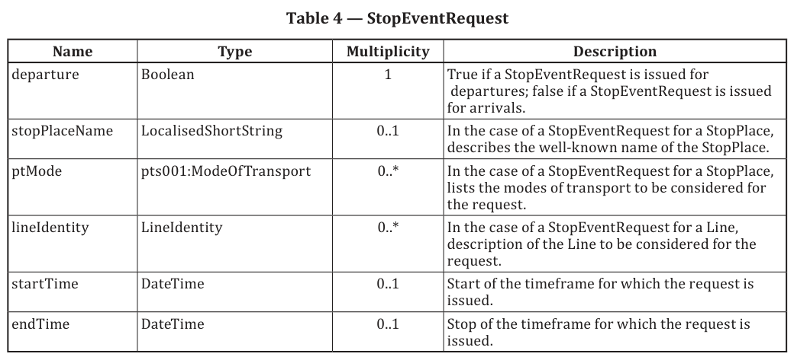

# EXTRAKT z technické specifikace ISO

**Extrakt nenahrazuje samotnou technickou normu, je pouze informativním materiálem o normě.**

**Inteligentní dopravní systémy – Dopravní a cestovní informace (TTI) v dopravním protokolu expertní skupiny, druhá generace (TPEG2) - Část 13: Služba pro informace o veřejné dopravě (TPEG2-PTS)**

ISO/TS 21219-13 — třídicí znak 01 8259

Vydána 2025, 73 stran

Zavedena v ČSN jako ČSN P ISO/TS 21219-13 (vydána 2025-07)

## Úvod

Technická specifikace ISO 21219 stanovuje formát a protokol TPEG určený pro poskytování informací o dopravě koncovým uživatelům. TPEG je určen pro média s vysokou přenosovou kapacitou, umožňuje informace členit strukturovaně se zvyšující se mírou detailů a komplexně popisovat polohu.

Jednotlivé oblasti dopravních událostí jsou v TPEG popsány odděleně, pomocí platformě nezávislého modelu (UML) a dvou odvozených platformě závislých modelů (binární a XML). Části specifikace stanovují pravidla tvorby modelu a jeho převodu do platformě závislé podoby.

Více informací o kontextu TPEG je obsaženo v úvodu extraktu k části 1 normy TPEG (21219-1).

Technická specifikace ISO 21219 se zabývá druhou generací protokolu TPEG, označovaným zkratkou TPEG2. Rozlišení TPEG/TPEG1/TPEG2 se většinou uvádí pouze v úvodní části norem/specifikací, zatímco ostatní kapitoly již mezi TPEG a TPEG2 nerozlišují – to je implicitní dle kontextu.

Tento extrakt popisuje část 13 normy TPEG „Služba pro informace o veřejné dopravě (TPEG2-PTS)“, dále jen “popisovaný dokument”, která specifikuje službu pro informování cestujících veřejné dopravy.

_Poznámka: Extrakt uvádí vybrané kapitoly popisovaného dokumentu a přejímá původní číslování kapitol._

## Užití

Popisovaný dokument stanovuje datovou strukturu aplikace TPEG2-PTS včetně příkazů pro komunikaci se serverem a uvádí praktické příklady. Dokument použijí zejména analytici a vývojáři poskytovatele veřejné dopravy, poskytovatele služby a výrobce koncových uživatelských zařízení při návrhu a výrobě SW.

## Souvisící normy

Popisovaný dokument uvádí normativní odkazy na normy ISO 21219-1 (úvod, číslování a verze), ISO 21219-7 (kontejner pro odkazování na polohu), ISO 21219-9 (informace o službách a sítích), ISO 21219-14 (informace o parkování) a ISO 21219-15 (ucelené informace o dopravních událostech).

## 1 Předmět

Popisovaný dokument TPEG2-PTS (dále jen PTS) se zaměřuje specifikaci služby poskytování informací o veřejné dopravě, jazykově nezávislé a pokrývající všechny druhy meziměstské i městské dopravy. Zaměřuje se na tři hlavní případy užití: **Informace o výstrahách**, **Informace o jízdních řádech**, jak plánovaných, tak v reálném čase a **Individuální požadavky na informace o cestě.** Na rozdíl od prvních dvou vyžaduje poslední případ užití obousměrnou komunikaci vyžadující zpětný kanál. Aplikace PTS neposkytuje informace o jízdném.

POZN: Termíny služba, aplikace a struktura jsou zaměňovány, kontextu TPEG totiž znamenají totéž.

POZN: Normy TPEG jsou strukturovány hierarchicky: nejprve začínají schématem (úroveň 0), poté definují jednotlivé komponenty (úroveň 1), ve kterých jsou použity datové typy a struktury (úroveň 2). Toto se odráží na struktuře kapitol norem, která je pro všechny normy TPEG stejná.

## 3 Termíny a definice

Tato kapitola definuje 15 termínů, jedná se zejména o názvy atributů. Například:

**Trasa** (_Route_) - uspořádaný seznam umístěných bodů, které vymezují jednu trasu v silniční (nebo železniční) síti

**StopPlace** (S_topPlace_) - jedno nebo více míst, kde mohou vozidla zastavit a kde mohou cestující nastoupit nebo vystoupit z vozidel nebo se připravit na cestu, a která budou mít obvykle jeden nebo více známých názvů

**aplikace** (application) - v TPEG specifikacích označuje konkrétní podmnožiny TPEG struktury; definuje slovníky pro určitý typ zpráv, například informace o parkování nebo dopravě; každá TPEG aplikace má unikátní číslo, tzv. AID

## 4 Zkratky

Tato kapitola stanovuje 1 zkratku, OJP, která však není v textu normy použita. Další zkratky uvádí odkazem na další normy (viz souvisící normy). Zkratka důležitá z pohledu tohoto extraktu je:

**PTS** Služba informací o veřejné dopravě _(Public transport information service)_

_Poznámka: Další termíny a zkratky z oboru ITS jsou obsaženy ve slovníku ITS terminology ([www.itsterminology.org](http://www.itsterminology.org))._

## 5 Podmínky a omezení aplikace

Tato kapitola (rozsah 1,5 strany) vymezuje termín aplikace (viz termíny a definice) a to, že identifikátor aplikace PTS je stanovený v TS 21219-1. Kapitola stanovuje **verzi aplikace**, která je klíčová z pohledu dekodéru, jednotlivé verze stejné aplikace se totiž mohou od sebe lišit strukturou či obsahem. Určuje **pořadí kontejnerů**, ze kterých je zpráva složena, tedy z kontejneru pro management zpráv (MMC), pro popis aplikace (ADC) a pro odkazování na polohu (LRC). Uvádí požadavek na **zpětnou kompatibilitu** dekodérů, přeskočením neznámých částí zprávy dekodérem. Vymezuje použití **rámce komponent služby TPEG** dle ISO/TS 21219-5.

## 6 Struktura zprávy PTS

Tato kapitola (rozsah 2 strany, 2 obrázky) obsahuje UML model zprávy aplikace PTS a jedné další součásti.

## 7 Komponenty zprávy PTS

Tato kapitola (rozsah 5 stran, 9 tabulek) popisuje jednotlivé komponenty zprávy PTS. Stanovuje pro zprávu PTS její základní strukturu „PTSMessage“ která obsahuje následující komponenty:

  - > **mmc:** umožňuje flexibilní použití monolitického nebo modulárního řízení zpráv

  - > **ptRequest:** přenos požadavku na informace o veřejné dopravě

  - > **alert:** přenos informací o upozorněn

  - > **stopEvent:** přenos informací o odjezdu/příjezdu (jízdní řád) pro linku či pro zastávky

  - > **tripInfoResponse:** přenos odpovědi na požadavek na informace o cestě

  - > **location:** přenos informací o poloze

Dále následují příklady 2 komponent (celkem je v normě stanoveno 16 komponent či sub-komponent).

PŘÍKLAD 1: Komponenta **location**, typu GeoLocation, popisuje místo, pro kterou jsou informace určeny, např. letiště, železniční stanice, oblast, město, linka.

PŘÍKLAD 2: Komponenta **ptRequest** slouží pro přenos požadavku na informace o veřejné dopravě, může obsahovat AlertRequest, StopEventRequest nebo TripInfoRequest. Struktura StopEventRequest slouží pro přenos požadavku na odjezdy/příjezdy ze zastávky (jízdní řád nebo odjezdová tabule), viz obrázek č 1.


**Obr. 1** snímek celé tabulky specifikující strukturu komponenty StopEventRequest (tabulka 4 normy)

**8 Datové typy PTS**

Tato kapitola (rozsah 5 stran, 14 tabulek) obsahuje definice 13 použitých datových struktur (typů):

  - > **AlertFor**: popisuje objekt, pro který je vydáno upozornění (např. zastávka, linka, trasa)

  - > **LineIdentity**: popis linky, včetně názvu a identifikátoru

  - > **CallAtStopForLine**: informace o událostech odjezdu/příjezdu pro určitou linku

  - > **CallAtStopForPlace**: informace o událostech odjezdu/příjezdu pro určitou zastávku

  - > **CallAtStopInfo**: stav služby, plánované nebo odhadované časy odjezdu/příjezdu

  - > **OperatorContact**: kontaktní informace pro operátora

  - > **PtServiceDescription**: popis veřejné dopravní služby, včetně režimu a operátora

  - > **Route**: seznam zastávek na trase

  - > **StopPlace**: popis místa, kde mohou vozidla zastavit, včetně typu a přístupových funkcí

  - > **StopPoint**: součást StopPlace obsahující typ, název a ID místa

  - > **TimeInfo**: plánované nebo skutečné časy odjezdu/příjezdu

  - > **TripLegStructure**: popis úseku cesty, včetně linky a časových informací

  - > **TripPreferences**: preference uživatele pro výpočet cesty, včetně přístupových požadavků

Datové struktury se skládají ze složitých či jednoduchých datových objektů a tvoří základ komponent, popsaných v kapitole výše.

**9 Tabulky PTS**

Tato kapitola (rozsah 14 stran) obsahuje definice 21 výčtových typů aplikace PTS (v 21 tabulkách), použitých v datových strukturách popsaných v kapitole výše. Následující tabulka jmenovitě uvádí jednotlivé tabulky (výčtové typy) a doplňuje je popisem a příkladem obsahu.

**Tab. 1** Seznam tabulek PTS (výčtů hodnot) (zdroj: autor extraktu)

| **Název tabulky PTS**            | **Definice**                                | **Příklad**                     |
| -------------------------------- | ------------------------------------------- | ------------------------------- |
| pts001: ModeOfTransport          | Typ dopravního prostředku/linky             | Bus service, railway service    |
| pts017: ServiceDeliveryPointType | Typ místa poskytování služby                | Platform number, terminal gate  |
| pts030: ContactType              | Typ kontaktu                                | Internet link, telephone number |
| pts036: AlertForType             | Typ entity, pro kterou je vydáno upozornění | Stopplace, line                 |
| pts037: AlertEvent               | Událost upozornění                          | Closed, delays                  |
| pts038: AlertCause               | Příčina upozornění                          | Security alert, fire            |
| pts039: AdviceType               | Typ pokynu                                  | Use replacement bus             |
| pts040: AccessFeatureType        | Typ přístupového zařízení                   | Single step, elevator           |
| pts041: StopPlaceType            | Typ zastávky                                | Railway station, bus station    |
| pts042: FacilityType             | Typ zařízení                                | Ticket shop, toilets            |
| pts043: ServiceStatus            | Stav služby                                 | Delay, on time                  |
| pts044: StopPlaceUsage           | Použití zastávky                            | Origin, destination             |
| pts045: Occupancy                | Obsazenost                                  | Many seats available, full      |
| pts100: SubmodeOfTransport       | Podtyp dopravního prostředku                | International air service,      |

Následující tabulka obsahuje ukázku tabulky „pts040:AccessFeatureType” z popisovaného dokumentu.

**Tab. 2** Příklad části definice výčtového typu pts040:AccessFeatureType doplněný o překlad frází

| **Kód** | **fráze**      | **překlad**       |
| ------- | -------------- | ----------------- |
| 0       | unknown        | neznámý           |
| 1       | single step    | jeden schod       |
| 2       | stairs         | schody            |
| 3       | escalator      | eskalátor         |
| 4       | moving walkway | pohyblivý chodník |
| 5       | … zkráceno …   |                   |

## Příloha A (normativní) TPEG-bin reprezentace PTS

Tato příloha (rozsah 12 stran) stanovuje binární reprezentaci aplikace PTS pro použití v DAB. Pro popis binární reprezentace je použit pseudokód.



**Obr. 2** Příklad části pseudokódu binární specifikace prvku PTSMessage (článek A.1.2 normy)

Příloha obsahuje samostatně uvedené binární reprezentace rámce TPEG, zprávy PTS a jejích součástí, prvků určených pro budoucí rozšíření a datových typů. Dále obsahuje identifikátory komponent zprávy a vysvětlení použití obecných atributů TPEG. Příklad pseudokódu binární specifikace prvku PTSMessage je uveden na obrázku 3.

## Příloha B (normativní) TPEG-ML reprezentace PTS

Tato příloha (rozsah 6 stran) obsahuje nejprve samostatně uvedené XML schéma rámce TPEG, dále zprávy PTS a jejích součástí, prvků určených pro budoucí rozšíření, datových typů a tabulek PTS, viz příklad na obrázku níže. Následně uvádí vše výše zmíněné v jednom funkčním XML schématu.

```xml
<xs:complexType name="PtRequest">
<xs:sequence>
<xs:choice minOccurs="1" maxOccurs="1">
<xs:element name="optionAlertRequest" type="AlertRequest" minOccurs="1" maxOccurs="1"/>
<xs:element name="optionStopEventRequest" type="StopEventRequest" minOccurs="1"
maxOccurs="1"/>
<xs:element name="optionTripInfoRequest" type="TripInfoRequest" minOccurs="1" maxOccurs="1"/>
</xs:choice>
</xs:sequence>
</xs:complexType>
```

**Obr. 4** Výstřižek schématu XSD stanovujícího strukturu prvku PtRequest (článek B.1.3 normy)

## Příloha C (informativní) Příklady použití PTS

Tato příloha (rozsah 18 stran) obsahuje konkrétní příklady pro 3 hlavní případy užití: **Informace o výstrahách**, **Informace o jízdních řádech**, jak plánovaných, tak v reálném čase a **Individuální požadavky na informace o cestě**, většinou doplněné o schématické znázornění obsahu použitých komponent v daném příkladu.

Článek **C.2 Výstrahy** uvádí příklady výstrah. Příklady zahrnují uzavření stanice metra, zpoždění metra v obou směrech, zrušení příměstské železniční služby a uzavření trasy autobusové linky.

Článek **C.3 Jízdní řády** uvádí příklady pro jízdní řády pro určitou zastávku a pro určitou linku. Příklady zahrnují odjezdový jízdní řád pro stanici metra, příjezdový jízdní řád pro železniční stanici, odjezdový jízdní řád pro letiště a jízdní řád vlaku.

Článek **C.4 Výstraha a jízdní řád** uvádí příklad, kdy je informace o výstrahách a aktualizovaný jízdní řád doručena ve stejné zprávě.

Článek **C.5 Požadavek** uvádí příklad relace požadavku a odpovědi pro všechny případy použití. Pro každý případ použití definuje PTS dedikovaný požadavek.

Článek **C.6 AlertRequest** uvádí příklad požadavku na informace o výstrahách ve veřejné dopravě. Může zahrnovat požadavek na všechny aktuální výstrahy nebo na určité výstrahy pro specifické zastávky, dopravní prostředky nebo linky.

Článek **C.7 StopEventRequest** uvádí příklad požadavku na informace o jízdních řádech. Může zahrnovat požadavek na odjezdový nebo příjezdový jízdní řád pro specifické zastávky nebo jízdní řád pro konkrétní vlak.

Článek **C.8 TripInfoRequest** uvádí příklad požadavku na informace o individuálních cestách. Může zahrnovat požadavek na individuální cestu nebo cestu se speciálními preferencemi, jako je potřeba vozidel s bezbariérovým vstupem a výtahy.

Článek **C.9 Odpověď na TripInfoRequest** uvádí příklad odpovědi na požadavek. Různé cesty (návrhy cest) se objevují v samostatných zprávách. Popisují jednotlivé úseky cesty, včetně informací o veřejné dopravě, identitě linek, trase a časových informacích. Mohou zahrnovat i speciální preference, jako je potřeba vozidel s bezbariérovým vstupem a výtahy.
