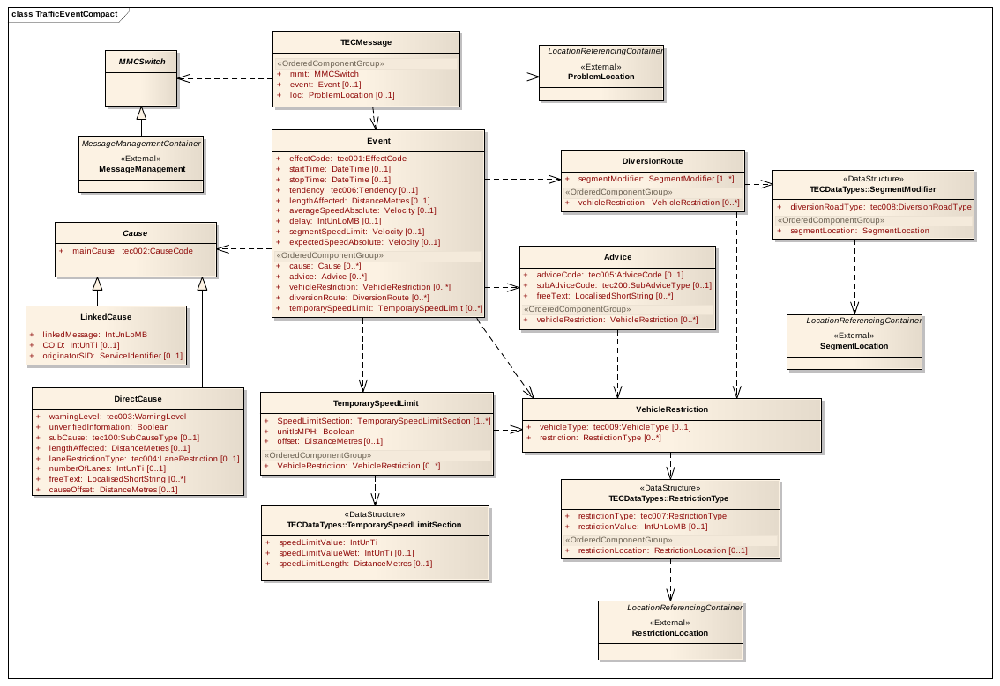
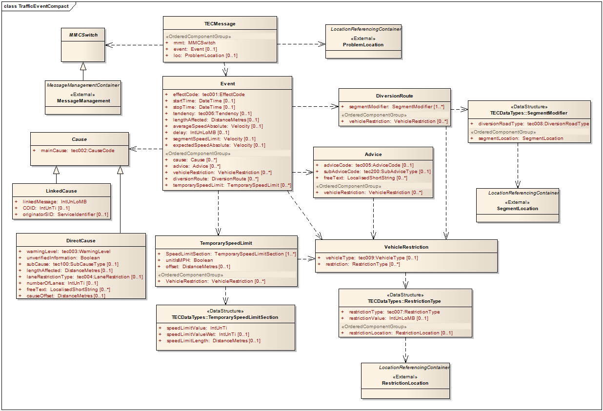

# EXTRAKT z technické specifikace ISO

**Extrakt nenahrazuje samotnou technickou normu, je pouze informativním materiálem o normě.**

**Inteligentní dopravní systémy – Dopravní a cestovní informace v dopravním protokolu expertní skupiny, 2. generace (TPEG2) – Část 15: Aplikace pro vybrané dopravní události (TEC)**

ISO/TS 21219-15 — třídicí znak 01 8388

Vydána 2016, 95 stran

## Úvod

Technická specifikace ISO 21219 stanovuje formát a protokol TPEG určený pro poskytování informací o dopravě koncovým uživatelům. TPEG je určen pro média s vysokou přenosovou kapacitou, umožňuje informace členit strukturovaně se zvyšující se mírou detailů a komplexně popisovat polohu.

Jednotlivé oblasti dopravních událostí jsou v TPEG popsány odděleně, pomocí platformě nezávislého modelu (UML) a dvou odvozených platformě závislých modelů (binární a XML). Části specifikace stanovují pravidla tvorby modelu jeho převodu do platformě závislé podoby.

Více informací o kontextu TPEG je obsaženo v úvodu extraktu k části 1 normy TPEG (21219-1).

Technická specifikace ISO 21219 se zabývá druhou generací protokolu TPEG, označovaným zkratkou TPEG2. Rozlišení TPEG/TPEG1/TPEG2 se většinou uvádí pouze v úvodní části norem/specifikací, zatímco ostatní kapitoly již mezi TPEG a TPEG2 nerozlišují - to je implicitní dle kontextu.

Tento extrakt (dále jen “popisovaný dokument”) popisuje část 15 normy TPEG „Aplikace pro vybrané dopravní události” (TPEG2-TEC), která specifikuje informace o dopravních událostech s vlivem na plynulost provozu.

Poznámka: Extrakt uvádí vybrané kapitoly popisovaného dokumentu a přejímá původní číslování kapitol.

## Užití

Popisovaný dokument stanovuje strukturu aplikace pro **informace** o dopravních událostech s vlivem na plynulost dopravy. Popisovaný dokument je nezbytný pro **poskytovatele i příjemce** dopravních informací, jejich programátory, kteří pracují se samotným formátem XML či programují datové proudy pro DAB.

## 1 Předmět normy

Popisovaný dokument definuje aplikaci TPEG2-TEC „Aplikace pro vybrané dopravní události“. Ta byla speciálně navržena pro podporu informací o dopravních událostech s vlivem na plynulost dopravy a zpracování těchto událostí navigačním zařízením. Soustřeďuje se tedy zejména na kvantifikaci následku události na plynulost dopravy, informaci o příčině a o možné objízdné trase.

Aplikace umožňuje sdílet se zařízením ve vozidle informace, za účelem zajištění bezpečnosti jízdy pro řidiče, výpočtu alternativních tras, zabránění zpoždění, upozornění řidiče na překážky na trase a poskytování informací o problémech na infrastruktuře.

## 2 Souvisící normy

Tento dokument uvádí 8 normativních odkazů na normu TPEG2 ISO 21219 části 1-7 a 9 stanovující sestavení zpráv z kontejnerů, odvození z modelu UML, vysílání zpráv a jejich signalizaci.

## 3 Termíny a definice

Tato kapitola definuje 3 termíny. Jedná se o definici upozornění na místní nebezpečí, kontejner pro odkazy na polohu a odkazování na polohu.

**upozornění na místní nebezpečí** _(local hazard warning)_ – zvláštní forma dopravních událostí týkajících se bezpečnosti, které jsou s vysokou prioritou zasílány řidiči, aby mu pomohly čelit nebezpečným situacím

**odkazování na polohu** _(location referencing)_ – prostředky umožňující systému přesně identifikovat polohu

Další termíny a zkratky z oboru ITS jsou obsaženy ve slovníku ITS terminology.

## 4 Symboly a zkratky

Tato kapitola uvádí 11 zkratek reprezentujících jednotlivé části/kontejnery zprávy a další související obecné zkratky.

**MMC** kontejner pro management zpráv _(Message Management Container)_

**ADC** kontejner pro popis aplikace _(Application Data Container)_

**LRC** kontejner pro odkazování na polohu _(Location Referencing Container)_

**TEC**    aplikace pro vybrané dopravní události _(Traffic event compact)_

Další termíny a zkratky z oboru ITS jsou obsaženy ve slovníku ITS terminology (www.ITSterminology.org).

## 5 Podmínky a omezení aplikace

Tato kapitola (rozsah 2 strany) vymezuje:

  - Identifikátor aplikace, stanovený pro všechny aplikace v TS 21219-1.

  - Verzi aplikace. Verze je klíčová z pohledu dekodéru, jednotlivé verze stejné aplikace se totiž mohou od sebe lišit strukturou, obsahem atp.

  - Pořadí kontejnerů, ze kterých je zpráva složena. Zpráva se skládá z kontejneru pro management zpráv (MMC), kontejneru s dopravní aplikací (ADC) a kontejneru pro odkazování na polohu (LRC).

  - Rozšiřitelnost a zpětnou kompatibilitu, jako požadavek na přeskočení neznámých částí zprávy dekodérem a specifikaci v budoucnu rozšiřitelných částí struktur TPEG zprávy.

  - Rámec komponent služby TPEG dle ISO/TS 21219-5.

Rozšiřitelnost je v kapitole demonstrována na obrázcích 2 a 3, kdy je stávající struktura hypoteticky rozšířena o další komponenty, jednak nahrazující původní komponenty či vložené mezi existující komponenty.

## 6 Struktura TEC

Tato kapitola (rozsah 1 obrázek) obsahuje UML model aplikace TEC.


**Obr. 1** UML model tříd aplikace TEC (obr. 4 normy)

## 7 Komponenty zprávy TEC

Tato kapitola (rozsah 19 stran, obrázky a tabulky) popisuje jednotlivé komponenty zprávy TEC.

Stanovuje 2 různé struktury zprávy TEC, jedna pro založení či změnu informace a druhá pro její zrušení. Stanoveny jsou formy zprávy TEC kde struktura obsahuje:

  - pouze MMC pro rušící zprávy

  - jeden MMC, jeden ADC a jeden LRC

S ohledem na management zpráv podle ISO TS 21219-6 je používán pouze monolitický typ řízení zpráv. Kontejner s odkazy na polohu se v popisovaném dokumentu neřeší, obsah kontejneru LRC je specifikován jinou částí normy.

Zprávy TEC z důvodů pochopitelnosti a čitelnosti pro řidiče důsledně rozdělují následek a příčinu, kdy následek je vždy „pouze“ dopad na plynulost (od „neznámý“, „plynulý provoz“ až po „neprůjezdný“ a „uzavřený“) a příčina poté všechny možné důvody události, např.:

_Uzavřená komunikace (effectCode =7 ), (kvůli) překážkám na silnici (causeCode = 10)._

nebo

_Kolaps dopravy (z důvodu) zúžených jízdních pruhů_

Zpráva TEC se skládá z několika položek, které umožňují přijímači efektivně vypočítat vliv přijaté informace na trasu (**popis následku**), nalézt případnou objízdnou trasu (**popis objížďky**) a zobrazit informaci řidiči (**popis příčiny**). Jedná se o:

  - **popis následku** skládajícího se z 1 povinné a dalších nepovinných položek:

      - \[1..1\] fráze popisující vliv na plynulost dopravy (pomalý provoz) a \[0..1\] tendence

      - \[0..1\] počátku a konce platnosti

      - \[0..1\] ovlivněné délky

      - \[0..1\] rychlosti průjezdu (průměrné, maximální dovolené, očekávané) a zpoždění

  - **popis příčiny** problému sestávající se z nepovinných položek:

      - \[0..\*\] fráze popisující příčinu

      - \[0..\*\] fráze popisující pokyny pro řidiče

  - **popis objízdné trasy a typ ovlivněných vozidel** sestávající se z nepovinných položek:

      - \[0..\*\] charakteristiky a typy ovlivněných vozidel

      - \[0..\*\] strojový popis objízdné trasy

Každá z výše uvedených položek je v této kapitole popisovaného dokumentu podrobněji rozepsána, tak aby bylo zřejmé, co znamená a jak ji interpretovat. Například položka „zdržení“ (delay) je specifikována jako informace týkající se výhradně zdržení na hraničních přechodech.

Příčina (cause) je podrobněji popsána v článcích 7.5-7.8 (rozsah 6 stran). Příčina může být:

  - Přímá příčina = popsaná v předmětné zprávě

<!-- end list -->

  - Odkázaná příčina = odkazující na jinou zprávu v přijímači pomocí jejího identifikátoru

Samotných příčin může být v události několik a mohou se různě kombinovat, zejména s ohledem na:

  - Typ příčiny, závažnost (0-3) a upřesňující frázi s příčinou

  - Délku příčiny a umístění příčiny od začátku polohy události

  - Typu a charakteristik vozidel, kterých se příčina týká a množství ovlivněných pruhů

V článku 7.8 je uvedeno několik grafických příkladů, z nichž jeden uvádíme ve zkrácené podobě níže.

**Př**.: práce na silnici způsobující kolony vozidel s polohou události definovanou v kontejneru pro odkazování polohy.



**Obr. 2** Ukázka k příkladu zprávy (obr. 6 normy)

Výše uvedený obrázek je ve zprávách TEC popsán kódy obsaženými v následující tabulce.

**Tab. 1** Hodnoty atributů v příkladu (tab. 8 normy)

|          |                      |             |                      |
| -------- | -------------------- | ----------- | -------------------- |
|          | **Atribut**          | **Hodnota** | **Význam**           |
| Následek | effectCode           | 6           | “stationary traffic" |
|          | lengthAffected       | 5000        | 5000m                |
|          | averageSpeedAbsolute | 5m/s        | 20kph                |
| Příčina  | causeCode            | 3           | “roadworks"          |
|          | lengthAffected       | 10000       | 10000m               |

Články 7.9 a 7.10 popisují **pokyny pro řidiče** a **charakteristiky vozidel** (1 strana)

Článek 7.11 (rozsah 3 strany, tabulky a obrázky) popisuje **objížďku**, resp. to, jak je zakódovaná do TPEG TEC zprávy. V jedné zprávě může být stanovena žádná, jedna, či více různých objížděk pro různé typy/charakteristiky vozidel či pro různé typy dopravy.

V TEC zprávě je trasa každé objížďky složena ze seznamu segmentů silniční sítě a jejich použitelnosti/vhodnosti pro objížďku. Seznam tedy neobsahuje jen segmenty trasy objížďky ale i části okolních komunikací. Ke každému segmentu sítě ze seznamu je přiřazena použitelnost pro hledání trasy objížďky (od „uzavřeno“, „přístupová cesta“, „trasa objížďky“ po „omezený vjezd“ a „nevhodné pro objížďku“). Vyhodnocením použitelnosti segmentů koncový přijímač řidiče vyhledá správnou trasu.

V článku je také definována rámcová strategie hledání objížďky pro přijímač a 2 příklady s textovým popisem a silničním schématem objížďky.

Článek 7.12 (5 stran, příklady a obrázky) popisuje dočasné omezení rychlosti, kdy poloha události může být rozdělena do několika sekcí pomocí ofsetu a délky a každé takové sekci přiděleno jiné dočasné omezení rychlosti. Pro popis rychlostního omezení přesahujícího lokaci popsanou v dané zprávě se musí použít nová zpráva, která na původní zprávu odkáže pomocí „Odkázané příčiny“.

Články 7.13 až 7.15 uvádí (3 odstavce) jakým způsobem je v aplikaci TEC popsána poloha události (ProblemLocation), poloha segmentů objížďky (SegmentLocation) a poloha segmentů se zvláštními omezeními (RestrictionLocation). Všechny tyto polohy odkazují prostřednictvím unikátního ID do LRC.

## 8 Datové typy TEC

Tato kapitola (rozsah 1 strana) obsahuje **definice** 3 datových struktur (typů), struktury RestrictionType, SegmentModifier a TemporarySpeedLimitSection.

Následující tabulka ukazuje jednu z definicí tříd, skládající se z jednoho výčtového typu (tec008) a polohy segmentu.

**Tab. 2** třída „SegmentModifier“ (tab. 21 normy)

|                    |                          |                  |                                  |
| ------------------ | ------------------------ | ---------------- | -------------------------------- |
| **Name**           | **Type**                 | **Multiplicity** | **Description**                  |
| diversionRoadType  | tec008:DiversionRoadType | 1                | Type of road used as a diversion |
| Ordered Components |                          |                  |                                  |
| segmentLocation    | SegmentLocation          | 1                | Position of the segment          |

## 9 Tabulky TEC

Tato kapitola (rozsah 25 stran) obsahuje definice výčtových typů aplikace TEC (ve 45 tabulkách). Následující tabulky jmenovitě uvádí tyto tabulky doplňují je popisem a příkladem obsahu. Tabulky níže obsahují shrnutí základních typů, obsahujících prvky na nejvyšší hierarchické úrovni zprávy, upřesňujících, stanovujících konkrétní typ příčiny a pokynů řidiči.

**Tab. 3** Seznam základních tabulek TEC (zdroj: autor extraktu)

|                          |                                             |                        |
| ------------------------ | ------------------------------------------- | ---------------------- |
| **Tabulka TEC**          | **Popis výčtu (tabulky)**                   | **Obsah**              |
| tec001:EffectCode        | Vliv na plynulost dopravy (co)              | Př.: 3: heavy traffic  |
| tec002:CauseCode         | Důvod zaslání zprávy (proč)                 | Př.: 2:accident        |
| tec003:WarningLevel      | Úroveň nebezpečí                            | Př: 1: informative     |
| tec004:LaneRestriction   | Blokované jízdní pruhy                      | Př: 1: lane(s) closed  |
| tec005:AdviceCode        | Instrukce, doporučení řidiči                | Př.:15 switch on radio |
| tec006:Tendency          | Tendence plynulosti dopravy                 | Př.: 5 decreasing      |
| tec007:RestrictionType   | Pro jaké vlastnosti vozidla zpráva platí    | Př.: 10 with caravan   |
| tec008:DiversionRoadType | Typ použitého silničního úseku pro objížďku | Př.: 1: bypass         |
| tec009:VehicleType       | Pro jaké vozidla zpráva platí               | Př.: 2 lorry           |

**Tab. 4** Seznam tabulek TEC s upřesněním příčiny (zdroj: autor extraktu)

|                                        |                              |                                   |
| -------------------------------------- | ---------------------------- | --------------------------------- |
| **Tabulka TEC**                        | **Popis výčtu (tabulky)**    | **Obsah**                         |
| tec100:SubCauseType                    | Jen seznam ostatních tabulek | \-                                |
| tec101:TrafficCongestion               | Pouze jedna hodnota          | Př.:1 increased volume of traffic |
| tec102:Accident                        | Typ/upřesnění nehody         | Př.: 1 multi-vehicle accident     |
| tec103:Roadworks                       | Typ/upřesnění uzavírky       | Př.: 1 major roadworks            |
| tec104:NarrowLanes                     | Typ zúžení                   | Př.: 3 slip lane closed           |
| tec105:Impassability                   | Typ/důvod neprůjezdnosti     | Př.: 1 flooding                   |
| tec106:SlipperyRoad                    | Typ/důvod kluzké vozovky     | Př.: 2 fuel on road               |
| tec108:Fire                            | Typ/upřesnění požáru         | Př.: 2 forest fire                |
| tec109:HazardousDrivingConditions      | Typ vlivu prostředí          | Př.: 6 storm damage               |
| _-- redakčně zkráceno o 18 položek --_ |                              |                                   |

**Tab. 5** Seznam doplňkových tabulek TEC s pokyny řidičům (zdroj: autor extraktu)

|                                       |                                            |                                                                                 |
| ------------------------------------- | ------------------------------------------ | ------------------------------------------------------------------------------- |
| **Tabulka TEC**                       | **Popis výčtu (tabulky)**                  | **Obsah**                                                                       |
| tec200:SubAdviceType                  | Jen seznam ostatních tabulek               | \-                                                                              |
| tec202:OvertakingNotAllowed           | Upřesnění místa zákazu předjíždění         | Př.: 2 overtaking not allowed, drive on crawler lane                            |
| tec203:DrivingNotAllowed              | Zákaz jízdy: Pouze jedna hodnota           | Př.: 1 driving not allowed, find a safe place to pull over and stop the vehicle |
| _-- redakčně zkráceno o 4 položky --_ |                                            |                                                                                 |
| tec216:UseTollLanes                   | Upřesnění použití placených jízdních pruhů | Př.: 1 use manual payment toll lanes                                            |

V následující tabulce je ukázka části definice výčtového typu příčiny (causeCode).

**Tab. 6** Příklad části definice výčtového typu TEC002:CauseCode (nečíslovaná část)

|         |                    |                                                                                                                                                        |
| ------- | ------------------ | ------------------------------------------------------------------------------------------------------------------------------------------------------ |
| **Kód** | **Fráze**          | **Komentář**                                                                                                                                           |
| 1       | traffic congestion | The event is signalled due to the amount of traffic on the road causing, queues delays, or increase travel time.                                       |
| 2       | accident           | An accident is affecting normal traffic movement.                                                                                                      |
| 3       | roadworks          | Roadworks are affecting normal traffic movement.                                                                                                       |
| 4       | narrow lanes       | The width of a road lane is smaller than usual.                                                                                                        |
| 5       | impassability      | The road is affected by an obstacle that may make it impassable. (actual impassable road should be signalled with TrafficFlowEffect=no\_traffic\_flow) |

## Příloha A (normativní) TPEG-bin reprezentace TEC

Tato příloha (rozsah 16 stran) stanovuje binární reprezentaci aplikace pro vybrané dopravní události (TEC) TPEG pro použití v DAB. Pro popis binární reprezentace je použit pseudokód, kde pro každé klíčové slovo zapsané struktury je definován jeho binární tvar.

Příloha obsahuje samostatně uvedené binární reprezentace rámce TPEG, zprávy TEC a jejích součástí, prvků určených pro budoucí rozšíření a datových typů. Dále obsahuje identifikátory komponent zprávy a vysvětlení použití obecných atributů TPEG.

**Tab. 7** Výstřižek pseudokódu binární specifikace prvku Event (nečíslovaná část)

<table>
<thead>
<tr class="header">
<th>kód</th>
<th>komentář</th>
</tr>
</thead>
<tbody>
<tr class="odd">
<td>&lt;Event(3)&gt;:=</td>
<td></td>
</tr>
<tr class="even">
<td>&lt;IntUnTi&gt;(3),</td>
<td>: id of this component</td>
</tr>
<tr class="odd">
<td>&lt;IntUnLoMB&gt;(lengthComp),</td>
<td>: number of bytes in component</td>
</tr>
<tr class="even">
<td>&lt;IntUnLoMB&gt;(lengthAttr),</td>
<td>: number of bytes in attributes</td>
</tr>
<tr class="odd">
<td>&lt;tec001:EffectCode&gt;(effectCode),</td>
<td>-- redakčně zkráceno --</td>
</tr>
<tr class="even">
<td>BitArray(selector),</td>
<td></td>
</tr>
<tr class="odd">
<td>if (bit 0 of selector is set)</td>
<td></td>
</tr>
<tr class="even">
<td>   &lt;DateTime&gt;(startTime),</td>
<td>-- redakčně zkráceno --</td>
</tr>
<tr class="odd">
<td>   &lt;DateTime&gt;(stopTime),</td>
<td>-- redakčně zkráceno --</td>
</tr>
<tr class="even">
<td>if (bit 7 of selector is set)</td>
<td></td>
</tr>
<tr class="odd">
<td>   &lt;Velocity&gt;(expectedSpeedAbsolute),</td>
<td>-- redakčně zkráceno --</td>
</tr>
<tr class="even">
<td>ordered {</td>
<td></td>
</tr>
<tr class="odd">
<td>   n * &lt;Cause&gt;(cause),</td>
<td>: Reason for the traffic problem</td>
</tr>
<tr class="even">
<td><em>-- redakčně zkráceno --</em></td>
<td></td>
</tr>
<tr class="odd">
<td><p>   n * &lt;TemporarySpeedLimit&gt;</p>
<p>(temporarySpeedLimit)</p></td>
<td>: This is the temporary speed limit displayed on road signs.</td>
</tr>
<tr class="even">
<td>};</td>
<td></td>
</tr>
</tbody>
</table>

## Příloha B (normativní) TPEG-ML reprezentace TEC

Tato příloha (rozsah 25 stran) obsahuje nejprve samostatně uvedené XML schéma rámce TPEG, dále zprávy TEC a jejích součástí, prvků určených pro budoucí rozšíření, datových typů a tabulek PKI (definovaných jako xs:complexType). Následně uvádí vše výše zmíněné v jednom funkčním XML schématu.

```xml
<xs:complexType name="Event">
 <xs:sequence>
 <xs:element name="effectCode" type="tec001_EffectCode"/>
 <xs:element name="startTime" type="tdt:DateTime" minOccurs="0"/>
```

\-- redakčně zkráceno --

```xml
 <xs:element name="vehicleRestriction" type="VehicleRestriction" minOccurs="0" maxOccurs="unbounded"/>
<xs:element name="diversionRoute" type="DiversionRoute" minOccurs="0" maxOccurs="unbounded"/>
 <xs:element name="temporarySpeedLimit" type="TemporarySpeedLimit" minOccurs="0" maxOccurs="unbounded"/>
 </xs:sequence>
</xs:complexType>
```

**Obr. 4** Výstřižek schématu XSD stanovujícího strukturu prvku Event (nečíslovaná část)

## Literatura

Tato kapitola uvádí 5, v textu použitých, odkazů na normy, na definici XML schématu a na TPEG1-TEC (CEN ISO/TS 18234-9:2013), tedy aplikace pro vybrané dopravní události první generace TPEG, dále jsou odkázány všechny 3 části (1-3) normy ALERT-C ISO 14819.
