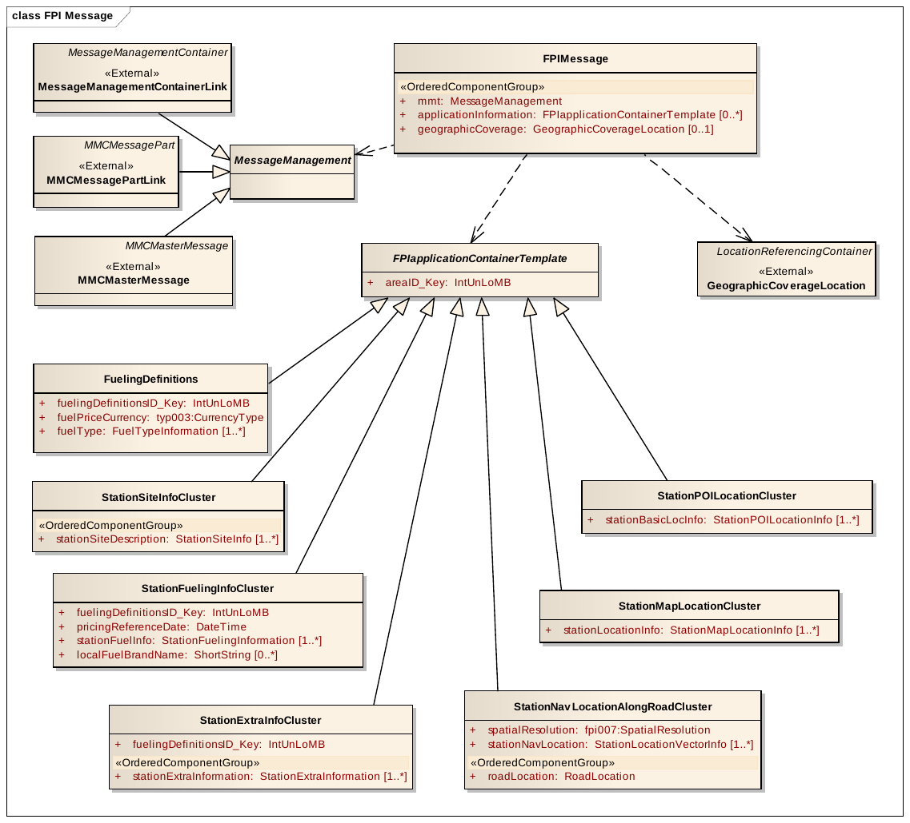

# EXTRAKT z technické specifikace ISO

**Extrakt nenahrazuje samotnou technickou normu, je pouze informativním materiálem o normě.**

**Inteligentní dopravní systémy – Dopravní a cestovní informace v dopravním protokolu expertní skupiny, 2. generace (TPEG2) – Část 16: Aplikace pro informace o cenách pohonných hmot (FPI)**

ISO/TS 21219-16 — třídicí znak 01 8388

Vydána 2016, 76 stran

## Úvod

Technická specifikace ISO 21219 stanovuje formát a protokol TPEG určený pro poskytování informací o dopravě koncovým uživatelům. TPEG je určen pro média s vysokou přenosovou kapacitou, umožňuje informace členit strukturovaně se zvyšující se mírou detailů a komplexně popisovat polohu.

Jednotlivé oblasti dopravních událostí jsou v TPEG popsány odděleně, pomocí platformě nezávislého modelu (UML) a dvou odvozených platformě závislých modelů (binární a XML). Části specifikace stanovují pravidla tvorby modelu jeho převodu do platformě závislé podoby.

Více informací o kontextu TPEG je obsaženo v úvodu extraktu k části 1 normy TPEG (21219-1).

Technická specifikace ISO 21219 se zabývá druhou generací protokolu TPEG, označovaným zkratkou TPEG2. Rozlišení TPEG/TPEG1/TPEG2 se většinou uvádí pouze v úvodní části norem/specifikací, zatímco ostatní kapitoly již mezi TPEG a TPEG2 nerozlišují - to je implicitní dle kontextu.

Tento extrakt (dále jen “popisovaný dokument”) popisuje část 16 normy TPEG „Aplikace pro informace o cenách pohonných hmot” (TPEG2-FPI), která specifikuje informace o čerpacích stanicích, jejich umístění, nabízených druzích paliva a informacích o cenách a dostupnosti paliva.

_Poznámka: Extrakt uvádí vybrané kapitoly popisovaného dokumentu a přejímá původní číslování kapitol._

## Užití

Popisovaný dokument stanovuje strukturu aplikace pro informace o čerpacích stanicích, jejich umístění, nabízených druzích paliva a informacích o cenách a dostupnosti paliva. Popisovaný dokument je nezbytný pro **poskytovatele i příjemce** dopravních informací, jejich programátory, kteří pracují se samotným formátem XML či programují datové proudy pro DAB.

## 1 Předmět

Popisovaný dokument definuje aplikaci TPEG2-FPI „Aplikace pro informace o cenách pohonných hmot“. Ta umožňuje předávat aktuální informace o čerpacích stanicích, jejich umístění, nabízené druhy paliva a ceny a dostupnost paliva (i nových druhů paliv a typů konektorů).

Aplikace TPEG FPI je navržena jako doplňková služba s nízkými nároky na přenosovou kapacitu.

## 2 Souvisící normy

Tento dokument uvádí 9 normativních odkazů na normu TPEG2 ISO 21219  části 1-6 a 9 stanovující sestavení zpráv z kontejnerů, odvození z modelu UML, vysílání zpráv a jejich signalizaci. Dále jsou to dvě normy na popis polohy. Norma TPEG1 ISO/TS 18234-11 kontejner pro popis polohy a norma ISO 17572-2 popis polohy pomocí sdílených číselníků (pre-coded).

## 3 Termíny a definice

Tato kapitola definuje 1 termín. Jedná se o definici čerpací stanice i s jejími alternativními anglickými názvy.

## 4 Zkratky

Tato kapitola stanovuje 16 zkratek reprezentujících jednotlivé části/kontejnery zprávy a další související obecné zkratky.

**MMC** kontejner pro management zpráv _(Message Management Container)_

**ADC** kontejner pro popis aplikace _(Application Data Container)_

**LRC** kontejner pro odkazování na polohu _(Location Referencing Container)_

**FPI** aplikace pro informace o cenách pohonných hmot _(Fuel Price Information)_

## 5 Podmínky a omezení aplikace

Tato kapitola (rozsah 1,5 strany) vymezuje:

  - Identifikátor aplikace, stanovený pro všechny aplikace v TS 21219-1.

  - Verzi aplikace. Verze je klíčová z pohledu dekodéru, jednotlivé verze stejné aplikace se totiž mohou od sebe lišit strukturou, obsahem atp.

  - Pořadí kontejnerů, ze kterých je zpráva složena. Zpráva se skládá z kontejneru pro management zpráv (MMC), kontejneru s dopravní aplikací (ADC) a kontejneru pro odkazování na polohu (LRC).

  - Rozšiřitelnost a zpětnou kompatibilitu, jako požadavek na přeskočení neznámých částí zprávy dekodérem a specifikaci, v budoucnu, rozšiřitelných částí struktur TPEG zprávy.

  - Rámec komponent služby TPEG dle ISO/TS 21219-5.

## 6 Struktura FPI

Tato kapitola (rozsah 11 stránek, obrázky) popisuje strukturu FPI a vlastnosti na kterých je tato aplikace postavena, jako je velké množství stejných prvků, nízká rychlost obnovy a očekávané velké množství vyměňovaných dat.

V článku 6.2 jsou popsány koncepty tvorby modelu FPI mající vliv na velikost přenášených dat. Jedná se o osamostatnění mnohokrát se opakujících a obsahově shodných struktur (např. fuelingDefinitions) od ostatního proměnlivého obsahu, či o dva způsoby přenosu TPEG FPI zprávy.

Aplikace stanovuje dvě různé varianty (A a B) zprávy FPI. Obě varianty obsahují standardní kontejnery MMC a LRC pro geografické filtrování obsahu v ADC. ADC může obsahovat buď:

  - varianta A: Ucelenou informaci o jedné čerpací stanici,

  - varianta B: Částečnou informaci o skupině (cluster) několika čerpacích stanic

S ohledem na management zpráv podle ISO TS 21219-6 je možné použít jak monolitický typ řízení zpráv, tak typ řízení skládaných (multi-part) zpráv.

Kontejner s odkazy na polohu se v popisovaném dokumentu neřeší, obsah kontejneru LRC je specifikován jinou částí normy.

Článek 6.3 Struktura zprávy FPI detailně specifikuje rámcovou strukturu zprávy. Stanovuje šest typů informací, které lze přenášet uvnitř zprávy FPI:

  - **Definice typu paliva, názvu a struktury cen**

  - **Primární informace pro skupinu čerpacích stanic** (značka paliva, typy paliva a ceny).

  - Další informace pro skupinu čerpacích stanic (obvykle problémy s dostupností, propagační nabídky).

  - Podrobné informace o místě pro skupinu čerpacích stanic (obvykle kontaktní informace, otevírací doba atd.).

  - Informace o poloze pro skupinu čerpacích stanic.

<!-- end list -->

  - Geografické pokrytí (tj. Rozsah) obsahu této zprávy FPI v referenčním kontejneru umístění na nejvyšší úrovni. V FPI musí být tento zeměpisný odkaz na umístění pokrytí odkazem na umístění oblasti.

Tři výše zvýrazněné položky jsou minimální sada nezbytná pro prezentaci konsolidované informace.

S ohledem na šířku pásma a rychlou obnovu základních informací umožňuje Aplikace poskytovateli rozčlenit zprávy s rychlou a pomalou obnovou, podle typu obsahu, na  na 6 variant, kdy v „rychlých“ variantách je například informace o ceně PHM, jednoduché poloze (XY souřadnice) a vybavení a v „pomalých“ variantách pak detailní (extra) informace o stanici. Kompletní informace o čerpacích stanicích se pak v přijímači složí postupně pomocí propojovacích klíčů jednotlivých variant.



**Obr. 1** UML model tříd aplikace FPI (obr. 2 normy)

Každá struktura obsahuje UML model a následně textový popis obsahu, jeho variant a způsobu kombinace s dalšími strukturami, tak aby bylo možné z nich v přijímači sestavit zprávu pro řidiče. Většina struktur se propojuje prostřednictvím jednoznačného identifikátoru (klíče) stanice.

## 7 Komponenty zprávy FPI

Tato kapitola (rozsah 7 stran, tabulky) popisuje jednotlivé komponenty zprávy FPI. Struktury zavedené v předchozí kapitole jsou zde prezentovány formou tabulek, kde každý atribut je podrobně vysvětlen.

Následující tabulka jmenovitě uvádí tyto struktury a doplňuje je popisem.

**Tab. 1** Sumarizace datových struktur  (zdroj: autor extraktu)

|                                                                                          |                                                                           |
| ---------------------------------------------------------------------------------------- | ------------------------------------------------------------------------- |
| Datová struktura                                                                         | Co struktura specifikuje                                                  |
| FPIMessage                                                                               | Zpráva skládající se z jednoho MMC a LRC a několika ADC                   |
| FPIapplicationContainerTemplate                                                          | Definice abstraktního kontejneru ADC (id oblasti)                         |
| FuelingDefinitions                                                                       | Definice typů paliv, jednotek a měny a přesnosti (id oblasti, id tabulky) |
| MessageManagement                                                                        | Definice abstraktního kontejneru MMC                                      |
| \-- redakčně zkráceno o 8 položek popisujících informace o skupinách stanic (klastry) -- |                                                                           |
| GeographicCoverageLocation                                                               | Obsah LRC: pouze oblast (odkázané do ISO TS 18234-11)                     |
| MessageManagementContainerLink                                                           | Pouze odkaz na ISO TS 21219-6                                             |
| MMCMasterMessageLink                                                                     | Pouze odkaz na ISO TS 21219-6                                             |
| MMCMessagePartLink                                                                       | Pouze odkaz na ISO TS 21219-6                                             |
| StationEntryLocation                                                                     | Vjezd na čerpací stanici, odkaz na ISO TS 18234-11                        |
| StationMapLocation                                                                       | poloha na čerpací stanice, odkaz na ISO TS 18234-11                       |
| RoadLocation                                                                             | Poloha silnice, odkaz na ISO TS 18234-11                                  |
| StationExitLocation                                                                      | Výjezd z čerpací stanice, odkaz na ISO TS 18234-11                        |

## 8 Datové typy FPI

Tato kapitola (rozsah 5,5 strany, tabulky) obsahuje definice 12 jednoduchých datových typů. Následující tabulka jmenovitě uvádí tyto struktury a doplňuje je popisem.

**Tab. 2** Sumarizace datových typů (zdroj: autor extraktu)

|                             |                                                                                                                   |
| --------------------------- | ----------------------------------------------------------------------------------------------------------------- |
| Datový typ                  | Datový typ specifikuje                                                                                            |
| FuelDeliveryRestrictionType | Minimální a maximální možné čerpání množství paliva                                                               |
| FuelTypeInformation         | specifikace názvu a typu paliva, včetně rozlišení cen a jednotek                                                  |
| FuelTypePrice               | informace o cenách pro konkrétní typ paliva, a to jak v rozlišení cen, měně, tak v jednotkách                     |
| StationContactInformation   | obecné kontaktní informace (telefon, fax, e-mail, web) pro čerpací stanici                                        |
| POILinkType                 | křížový odkaz na konkrétní POI identifikátor dodavatele POI                                                       |
| SizeRestrictions            | omezení velikosti vozidel, která mají povolen vstup na čerpací stanici                                            |
| StationBrandAndRating       | Značku paliva dostupného na čerpací stanici a subjektivní cenové hodnocení této stanice                           |
| StationFuelingInformation   | druhy paliva, ceny a značka paliva a subjektivní cenové hodnocení této čerpací stanice (viz struktura výše)       |
| StationMapLocationInfo      | mapové referenční informace o poloze čerpací stanice a případné polohy vjezdů a výjezdů                           |
| StationLocationVectorInfo   | umístění pro jednotlivou čerpací stanici podél dané RoadLocation, určené jako offset od začátku této RoadLocation |
| StationPOILocationInfo      | Poloha čerpací stanice ve tvaru POI (souřadnice WGS84)                                                            |
| WGS84coordinate             | WGS-84 souřadnice v metrovém rozlišení                                                                            |

Následující tabulka ukazuje jednu z definicí tříd, skládající se ze dvou výčtových typů dvou celých čísel.

**Tab. 3** třída „StationBrandAndRating“ (tab. 21 normy)

|                         |                     |                  |                                                                        |
| ----------------------- | ------------------- | ---------------- | ---------------------------------------------------------------------- |
| **Name**                | **Type**            | **Multiplicity** | **Description**                                                        |
| globalFuelBrand         | fpi008:FuelBrand    | 0..1             | Reference to a global fuel brand in the table fpi008: FuelBrand.       |
| altGlobalFuelBrand      | fpi009:AltFuelBrand | 0..1             | Reference to a global fuel brand in the table fpi009: AltFuelBrand.    |
| localFuelBrandReference | IntUnTi             | 0..1             | Optional reference to a local fuel brand name. -- redakčně zkráceno -- |
| subjectivePriceRating   | IntUnTi             | 0..1             | Subjective Price Rating of Station. -- redakčně zkráceno --            |

## 9 Tabulky FPI

Tato kapitola (rozsah 10 stran) obsahuje definice výčtových typů aplikace FPI (v 9 tabulkách). Níže v textu je uveden seznam tabulek i s popisem obsahu a ukázka jedné tabulky.

**Tab. 4** Seznam použitých základních tabulek FPI (nečíslovaná část)

|                                      |                                                                        |                   |
| ------------------------------------ | ---------------------------------------------------------------------- | ----------------- |
| **Tabulka FPI**                      | **Popis výčtu (tabulky)**                                              | **Obsah**         |
| fpi001:DeliveryUnitType              | Jednotka účtování paliva                                               | Př.: 1: Litre     |
| fpi003:FuelKindType                  | Dostupný typ paliva                                                    | Př.: 15: electric |
| fpi004:PaymentMethodType             | Možný způsob platby                                                    | Př: 4: tank card  |
| \-- redakčně zkráceno o 4 položky -- |                                                                        |                   |
| fpi009:AltFuelBrand                  | Obchodní značky dalších řetězců/stanic, až 255, stanovené jsou pouze 2 | Př.: 0: unknown   |

V následující tabulce je ukázka části definice výčtového typu DeliveryUnitType.

**Tab. 5** Příklad části definice výčtového typu fpi001:DeliveryUnitType (nečíslovaná část)

|                          |           |                                                         |
| ------------------------ | --------- | ------------------------------------------------------- |
| **Kód**                  | **Fráze** | **Komentář**                                            |
| 0                        | unknown   |                                                         |
| 1                        | Litre     |                                                         |
| \-- redakčně zkráceno -- |           |                                                         |
| 6                        | Kg        |                                                         |
| 7                        | gge       | Gas gallon equivalent, jednotka pro CNG používaná v USA |
| 255                      | undefined |                                                         |

## Příloha A (normativní) TPEG-bin reprezentace FPI

Tato příloha (rozsah 13 stran) stanovuje binární reprezentaci aplikace pro informace o cenách pohonných hmot (FPI) TPEG pro použití v DAB. Pro popis binární reprezentace je použit pseudokód, kde pro každé klíčové slovo zapsané struktury je definován jeho binární tvar.

Příloha obsahuje samostatně uvedené binární reprezentace rámce TPEG, zprávy FPI a jejích součástí, prvků určených pro budoucí rozšíření a datových typů. Dále obsahuje identifikátory komponent zprávy a vysvětlení použití obecných atributů TPEG.

**Tab. 6** Výstřižek pseudokódu binární specifikace prvku StationSiteInfo (nečíslovaná část)

| kód                                     | poznámka                                                              |
| --------------------------------------- | --------------------------------------------------------------------- |
| \<StationSiteInfo(11)\>:=               |                                                                       |
| \<IntUnTi\>(11),                        | : id of this component                                                |
| \<IntUnLoMB\>(lengthComp),              | : number of bytes in component                                        |
| \<IntUnLoMB\>(lengthAttr),              | : number of bytes in attributes                                       |
| \<IntUnLoMB\>(stationID\_Key),          | : together with areaID\_Key, uniquely identifies a particular station |
| BitArray(selector),                     |                                                                       |
| if (bit 0 of selector is set)           |                                                                       |
| \<ShortString\>(stationName),           | : Name of individual station.                                         |
| \-- redakčně zkráceno --                |                                                                       |
| if (bit 11 of selector is set)          |                                                                       |
| \<SizeRestrictions\>(sizeRestrictions); | : Applicable size restrictions on vehicles                            |

## Příloha B (normativní) TPEG-ML reprezentace FPI

Tato příloha (rozsah 13 stran) obsahuje nejprve samostatně uvedené XML schéma rámce TPEG, dále zprávy FPI a jejích součástí, prvků určených pro budoucí rozšíření, datových typů a tabulek PKI (definovaných jako xs:complexType). Následně uvádí vše výše zmíněné v jednom funkčním XML schématu.

```xml
<xs:complexType name="StationSiteInfo">
 <xs:sequence>
 <xs:element name="stationID_Key" type="tdt:IntUnLoMB"/>
 <xs:element name="stationName" type="tdt:ShortString" minOccurs="0"/>
```

\<\!-- redakčně zkráceno --\>\<xs:element name="POILink" type="POILinkType" minOccurs="0" maxOccurs="unbounded"/\>

```xml
 <xs:element name="sizeRestrictions" type="SizeRestrictions" minOccurs="0"/>
 </xs:sequence>
</xs:complexType>
```

**Obr. 2** Výstřižek schématu XSD stanovujícího strukturu prvku StationSiteInfo (nečíslovaná část)

## Literatura

Tato kapitola uvádí jeden v textu použitý odkaz na definici XML schématu.
