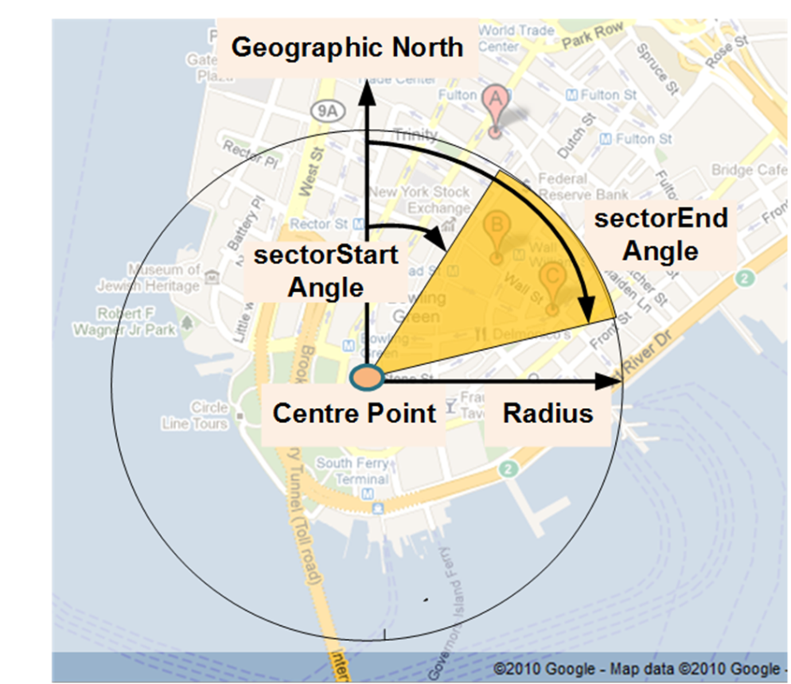

# EXTRAKT z technické specifikace ISO

**Extrakt nenahrazuje samotnou technickou normu, je pouze informativním materiálem o normě.**

|     |     |
| --- | --- |
| **Inteligentní dopravní systémy –  **Extrakt nenahrazuje samotnou technickou normu, je pouze informativním materiálem o normě.**Dopravní a cestovní informace předávané prostřednictvím expertní skupiny pro protokoly v dopravě 2. generace (TPEG 2) – Část 21: Geografické odkazování na polohu** | **ISO/TS 21219-21** <br>01 8388 |

Vydána 2018, 26 stran

## Úvod

Technická specifikace ISO 21219 stanovuje formát a protokol TPEG určený pro poskytování informací o dopravě koncovým uživatelům. TPEG je určen pro média s vysokou přenosovou kapacitou, umožňuje informace členit strukturovaně se zvyšující se mírou detailů a komplexně popisovat polohu. 

Jednotlivé oblasti dopravních událostí jsou v TPEG popsány odděleně, pomocí platformě nezávislého modelu (UML) a dvou odvozených platformě závislých modelů (binární a XML). Části specifikace stanovují pravidla tvorby modelu jeho převodu do platformě závislé podoby. 

Více informací o kontextu TPEG je obsaženo v úvodu extraktu k části 1 normy TPEG (21219-1).

Technická specifikace ISO 21219 se zabývá druhou generací protokolu TPEG, označovaným zkratkou TPEG2. Rozlišení TPEG/TPEG1/TPEG2 se většinou uvádí pouze v úvodní části norem/specifikací, zatímco ostatní kapitoly již mezi TPEG a TPEG2 nerozlišují – to je implicitní dle kontextu. 

Tento extrakt (dále jen “popisovaný dokument”) popisuje část 21 normy TPEG „Geografické odkazování na polohu (GLR)”, která specifikuje použití metody GLR ve zprávách TPEG.

_Poznámka: Extrakt uvádí vybrané kapitoly popisovaného dokumentu a přejímá původní číslování kapitol._

## Užití

Popisovaný dokument stanovuje strukturu pro **geografické odkazování na polohu** pomocí geometrických objektů: bod, lomená linie a polygon a pravidla pro tvorbu obsahu těchto struktur. Je nezbytný pro analytiky poskytovatele i příjemce dopravních informací, kteří mají na starost návrh datového modelu systému a návrh pravidel se kterými systém pracuje. Použije se při návrhu systému.

## Souvisící normy

Popisovaný dokument uvádí 6 normativních odkazů na normu TPEG2 ISO 21219 části 1-5,7. Klíčovou je zejména norma na kontejner pro odkazování na polohu (21219-7, TPEG2-LRC). Pro sestavení zpráv z kontejnerů, odvození z modelu UML, vysílání zpráv a řízení toku jsou použity další části normy TPEG (1-5).

## 1 Předmět

Popisovaný dokument stanoví datový formát pro geografické odkazování na polohu, její obecné požadavky a stanoví strukturu zpráv TPEG pro odkazování na polohu touto metodou. 

GLR je metoda využívaná výhradně normami TPEG pro aplikace poskytující informace o geografických polohách, např. informace o počasí. Použití metody GLR umožňuje zobrazení polohy na mapě, není určena pro navigační přístroje či pro přímé propojení do mapy. Popisovanými místy mohou být body, linie či polygony.

## 3 Termíny a definice

Tato kapitola definuje 1 termín “**bod zájmu”** _(point of interest)_ pro který vytváříme geografický popis.

## 4 Zkratky

Tato kapitola stanovuje 14 zkratek z nichž důležitá je:

**GLR** geografické odkazování na polohu _(Geographic Location Reference)_

_Poznámka: Další termíny a zkratky z oboru ITS jsou obsaženy ve slovníku ITS terminology (_[_www.itsterminology.org_](http://www.itsterminology.org)_)._

## 5 Podmínky a omezení aplikace

Tato kapitola (rozsah 0,5 strany) vymezuje:

- Verzi odkazování na polohu. Verze je klíčová z pohledu dekodéru, jednotlivé verze se totiž mohou od sebe lišit strukturou, obsahem atp. 
- Rozšiřitelnost a zpětnou kompatibilitu, jako požadavek na přeskočení neznámých částí zprávy dekodérem a specifikaci v budoucnu rozšiřitelných částí struktur TPEG zprávy.

## 6 Struktura GLR

Tato kapitola (rozsah 4 strany, 5 obrázků) obsahuje obecný popis metod GLR.

Nejprve je uveden UML model celé struktury GLR, která používá referenční systém WGS84.

Jednotlivé metody geografického popisu jsou uvedeny v podkapitolách:

- Obdélníkový geografický výřez ohraničující určité body zájmu (bounding box)
- Kruhová geografická oblast či její výřez ohraničující určité body zájmu
- Bodová geografická poloha stanovující konkrétní bod zájmu
- Liniová geografická poloha stanovující konkrétní linii zájmu, nejedná se o silnici
- Geografická oblast vymezená polygonem s možností uvedení podřízených oblastí


**Obr. 1** Kruhová výseč ohraničující body zájmu (obrázek 4 normy)

## 7 Komponenty zprávy GLR

Tato kapitola (rozsah 0,5 stran, 1 tabulka) obsahuje popis jedné komponenty GLR. Ta umožňuje použití jedné z 5 výše zmíněných geografických popisů polohy.

## 8 Datové typy GLR

Tato kapitola (rozsah 4 strany) obsahuje **definice** 8 datových struktur (typů), viz následující 3 tabulky.

**Tab. 1** komplexní datové typy definované v kapitole 8 (zdroj: autor extraktu)

| Datový typ | popis |
| --- | --- |
| GeographicAreaReference ... | polygon složený z bodů a další atributy, jako např. výška, jméno, odkaz do hierarchické struktury |
| GeographicBoundingBox .. | obdélníkově ohraničená oblast |
| GeographicBoundingCircleSector | výsek z kruhu a další atributy, jako např. výška, jméno |
| GeographicLineReference ... | linie složená z bodů a další atributy, jako např. výška, jméno |
| GeographicPointReference .. | bodová poloha a další atributy, jako např. výška, jméno. |

**Tab. 2** základní datové typy definované v kapitole 8 (zdroj: autor extraktu)

| Datový typ | popis |
| --- | --- |
| CircleSector | výsek z kruhu (základní datový typ) |
| Coordinate | pár souřadnic (základní datový typ) |
| Hierarchical Area Name .. | název podřízené oblasti (základní datový typ) |

Následující tabulka uvádí příklad tabulky 9 HierarchicalAreaName z normy

**Tab. 3** typ HierarchicalAreaName (Tabulka 9 normy)

| Název | Typ | násobnost | popis |
| --- | --- | --- | --- |
| languageCode | typ001:LanguageCode | 1   | Určuje místní jazyk používaný pro názvy tvořící název hierarchické oblasti.. |
| areaName | ShortString | 1   | Celkový název funkce odkazu na oblast |
| detailAreaName | ShortString | 1..\* | Jeden nebo více podrobných názvů oblastí odkazu na oblast |

## 9 Tabulky GLR

Tato prázdná kapitola pouze uvádí, že specifikace GLR nestanovuje žádné vlastní výčtové typy (tabulky).

## Příloha A (normativní) – TPEG-bin reprezentace GLR

Tato příloha (rozsah 7 stran) stanovuje binární reprezentaci aplikace pro geografické odkazování na polohu (GLR) TPEG pro použití v DAB. Pro popis binární reprezentace je použit pseudokód, kde pro každé klíčové slovo zapsané struktury je znám jeho binární tvar.

Příloha obsahuje samostatně uvedené binární reprezentace rámce TPEG, zprávy GLR a jejích součástí, prvků určených pro budoucí rozšíření a datových typů. Dále obsahuje identifikátory komponent zprávy a vysvětlení použití obecných atributů TPEG. V následující tabulce je uveden příklad pseudokódu binární specifikace prvku CircleSector.

**Tab. 4** Příklad pseudokódu binární specifikace elementu CircleSector (nečíslovaná část)

|  kód   | komentář    |
| --- | --- |
| &lt;CircleSector()&gt;:= |     |
| <**IntUnTi**\>(sectorStartAngle), | : Úhel azimutu pro začátek zájmového sektoru kruhu.<br><br>sektorStartAngle se měří ve směru hodinových ručiček od zeměpisného severu, vyjádřený v jednotkách 360/256 stupňů. |
| <**IntUnTi**\>(sectorEndAngle); | : Úhel azimutu ke konci zájmového sektoru kruhu.<br><br>SektorEndAngle se měří ve směru hodinových ručiček od zeměpisného severu, vyjádřený v jednotkách 360/256 stupňů. |

## Příloha B (normativní) – TPEG-ML reprezentace GLR

Tato příloha (rozsah 5 stran) obsahuje nejprve samostatně uvedené XML schéma rámce TPEG, zprávy GLR a jejích součástí, prvků určených pro budoucí rozšíření a datových typů GLR (definovaných jako xs:complexType). Následně uvádí výše zmíněné samostatně uvedené XML schémata v jednom funkčním XML schématu.

```xml
<xs:complexType name="GeographicPointReference">
  <xs:sequence>
    <xs:element name="point" type="Coordinate" />
    <xs:element name="isFuzzyPoint" type="tdt:Boolean" />
    <xs:element name="altitudeMSL" type="tdt:IntSiLoMB" minOccurs="0" />
    <xs:element name="pointFeatureName" type="tdt:LocalisedShortString" minOccurs="0" maxOccurs="unbounded" />
    <xs:element name="adjacentRoadDescriptor" type="tdt:LocalisedShortString" minOccurs="0" maxOccurs="unbounded" />
    <xs:element name="adjacentRoadSideTravelDirection" type="tdt:IntUnTi" minOccurs="0" />
  </xs:sequence>
</xs:complexType>
```
**Obr. 2** Výstřižek schématu XSD stanovujícího strukturu prvku GeographicPointReference

## Literatura

Tato kapitola uvádí jeden (nečíslovaný) odkaz na v textu použité koncepty, XML schéma.