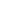
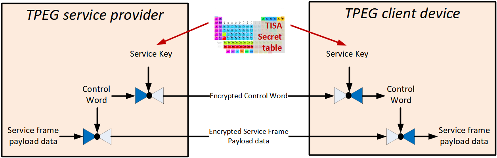

# EXTRAKT z technické specifikace ISO

**EXTRAKT z technické specifikace ISO**

**Extrakt nenahrazuje samotnou technickou normu, je pouze informativním materiálem o normě.**

<table>
<colgroup>
<col style="width: 71%" />
<col style="width: 28%" />
</colgroup>
<thead>
<tr class="header">
<th><strong>Inteligentní dopravní systémy –<br />
</strong>Dopravní a cestovní informace (TTI) v dopravním protokolu expertní skupiny, druhá generace (TPEG2) <strong>– Část 24: Jednoduché šifrování (TPEG2-LTE)</strong></th>
<th><p>ISO/TS 21219-24</p>
<p>01 8388</p></th>
</tr>
</thead>
<tbody>
</tbody>
</table>

Vydána 2017, 36 stran

## Úvod

Technická specifikace ISO 21219 stanovuje formát a protokol TPEG určený pro poskytování informací o dopravě koncovým uživatelům. TPEG je určen pro média s vysokou přenosovou kapacitou, umožňuje informace členit strukturovaně se zvyšující se mírou detailů a komplexně popisovat polohu.

Jednotlivé oblasti dopravních událostí jsou v TPEG popsány odděleně, pomocí platformě nezávislého modelu (UML) a dvou odvozených platformě závislých modelů (binární a XML). Části specifikace stanovují pravidla tvorby modelu jeho převodu do platformě závislé podoby.

<u>Více informací o kontextu TPEG je obsaženo v úvodu extraktu k části 1 normy TPEG (21219-1).</u>

Technická specifikace ISO 21219 se zabývá druhou generací protokolu TPEG, označovaným zkratkou TPEG2. Rozlišení TPEG/TPEG1/TPEG2 se většinou uvádí pouze v úvodní části norem/specifikací, zatímco ostatní kapitoly již mezi TPEG a TPEG2 nerozlišují – to je implicitní dle kontextu.

Tento extrakt (dále jen “popisovaný dokument”) popisuje část 24 normy TPEG „Jednoduché šifrování (TPEG2-LTE)”, která specifikuje použití metody LTE ve zprávách TPEG.

_Poznámka: Extrakt uvádí vybrané kapitoly popisovaného dokumentu a přejímá původní číslování kapitol._

## Užití

Popisovaný dokument stanovuje strukturu pro **jednoduché šifrování** pomocí geometrických objektů: bod, lomená linie a polygon a pravidla pro tvorbu obsahu těchto struktur. Je nezbytný pro analytiky poskytovatele i příjemce dopravních informací, kteří mají na starost návrh datového modelu systému a návrh pravidel, se kterými systém pracuje. Použije se při návrhu systému.

## Souvisící normy

Popisovaný dokument uvádí 6 normativních odkazů na normu TPEG2 ISO 21219 části 1-5, 9. Klíčovou je zejména norma na kontejner pro odkazování na polohu (21219-7, TPEG2-LRC). Pro sestavení zpráv z kontejnerů, odvození z modelu UML, vysílání zpráv a řízení datového toku jsou použity další části normy TPEG (1-5).

## 1 Předmět

Popisovaný dokument definuje šifrovací mechanismy LTE pro datové rámce služby TPEG. Navrhuje šifrování symetrickým sdíleným klíčem, který je podle pravidel daných touto normou pozměňován, aby nebylo příliš snadné zprávu rozšifrovat. Specifikace byla navržena pro použití v business modelu B2B.

## 3 Termíny a definice

Tato kapitola definuje 15 termínů některé z kryptografie.

**bloková šifra** _(block cipher)_ - skupina funkcí a jejich inverzních funkcí parametrizovaných kryptografickými klíči

**kryptografický klíč** _(cryptographic key)_ - parametr užívaný v blokovém šifrovacím algoritmu, který slouží k šifrovací operaci

**šifrování** _(encryption)_ - proces kódování zpráv (nebo informací) způsobem, který je čitelný pouze pro autorizované subjekty

**klíč služby** _(service key)_ - kryptografický klíč k zašifrování přenosu „kódového slova“

**kódové slovo** (_control word_) - kryptografický klíč k zašifrování a dešifrování přenášeného užitečného obsahu, pro zašifrování je použita metoda symetrického šifrování AES.

## 4 Zkratky

Tato kapitola stanovuje 18 zkratek z nichž důležité jsou:

**TPEG** framework poskytující formáty a protokoly pro poskytování dopravních informací, optimalizovaných na šíření prostřednictvím digitálního rozhlasu či Internetu

**CRC** Cyklický redundantní součet

**ECB** režim kódové knihy (provozní režim blokové šifry) _(Electronic Code Book (a block cipher mode of operation))_

**EMM** instrukce EMM _(Entitlement Management Message)_

**LTE** jednoduché šifrování _(LighT Encryption)_

**ServEncID** ukazatel šifrování služby (signalizovaný v datovém rámci služby TPEG) _(Service encryption indicator (signalled in a TPEG Service Data Frame))_

**SID** identifikátor služby TPEG _(TPEG Service ID)_

_Poznámka: Další termíny a zkratky z oboru ITS jsou obsaženy ve slovníku ITS terminology ([www.itsterminology.org](http://www.itsterminology.org))._

## 5 Podmínky a omezení aplikace

Tato kapitola (rozsah 3 strany) vymezuje:

- **Identifikátor aplikace**, který je stanovený pro všechny aplikace v TS 21219-1.

- **Verzi aplikace**. Verze je klíčová z pohledu dekodéru, jednotlivé verze stejné aplikace se totiž mohou od sebe lišit strukturou, obsahem atp.

- **Rozšiřitelnost a zpětnou kompatibilitu**, jako požadavek na přeskočení neznámých částí zprávy dekodérem a specifikaci v budoucnu rozšiřitelných částí struktur TPEG zprávy.

Nad běžný rámec tato kapitola stanovuje

- **Použití ukončujících znaků**

<!-- -->

- **Podporované obchodní modely**, popsané v několika odstavcích. jedná se o režim 1: volný, ale šifrovaný přenos dat TPEG a režim 2: řízený přístup, šifrovaný přenos dat TPEG na základě smlouvy mezi podniky.

- **Výkonové požadavky** na frekvenci opakování parametrů LTE a míru aktualizace parametrů LTE

- **Požadavky na zabezpečení a licenční ujednání** z pohledu poskytovatelů služeb a výrobců zařízení ve dvou časových rovinách, vývoji a provozu.

## 6 Metoda šifrování a provoz LTE

Tato kapitola (rozsah 8 stran, 5 obrázků) obsahuje obecný popis jednoduchého šifrování (LTE).

Článek 6.1 popisuje principy provozu LTE, kdy cílem je poskytnout jednoduchou metodu šifrování s efektivní kompresí, kdy se šifruje celý rámec služby. Uvádí, že šifrování probíhá na úrovni služby.

Článek 6.2 poskytuje přehled funkce šifrovací metody, viz následující obrázek, kdy zařízení a služba obsahuje předem sdílené informace, které se použijí k šifrování dat. Data jsou zašifrována kódovým slovem, šifrovaná kódová slova jsou klientům šířena ve speciálních zprávách zašifrovaná pomocí klíče služby.



**Obr. 1** princip šifrování v režimu 1 (obrázek 1 normy)

Pro zašifrování kontrolního slova norma poskytuje 2 režimy. Při režimu 1 se použije standardní předsdílená tabulka TISA ke generování klíčů a při režimu 2 se použije specifická tabulka, kterou výrobce a poskytovatel na základě podepsané smlouvy mezi sebou nasdílí. Pro generování klíče služby v režimu 1 specifikace využívá 2 předsdílených tajemství, tabulku klíčů TISA a tabulku 16 krátkých náhodných čísel.

Článek 6.3 popisuje zašifrování a rozšifrování užitečného obsahu rámce služeb. Je popsán “režim blokové šifry", jedná se o způsob provázání bloků, aby se symetrická šifra dala použít na šifrování proudu dat. Článek odkazuje konkrétní normy které se mají pro daný účel použit a které k šifrovacím metodám obsahují více informací. Také je popsána struktura a účel tzv. inicializačního vektoru.

Článek 6.4 popisuje zašifrování a rozšifrování kódových slov (CW), kódová slova jsou při přenosu zašifrována klíčem služby, používá se režim ECB podle specifikace NIST 800-38A.

Článek 6.5 popisuje složení klíče služby určeného k šifrování CW. Klíče nejsou přenášeny, ale jsou nakombinovány z již existujících informací a přijaté konfigurace. <u>Je přesně popsán způsob složení klíče</u> pro oba režimy. Tento popis je doplněn konkrétním příkladem (1 strana).

## 7 Struktura LTE a zahrnutí do rámce služby TPEG

Tato kapitola (rozsah 3 strany, 3 obrázky) popisuje struktury LTE obrázkem a UML modelem.

Nejprve je uvedeno, jak je šifrování zahrnuto do rámce služby (článek 7.2), a poté je představen UML model celé struktury LTE (článek 7.3).


**Obr. 2** Složení, komprese, šifrování a rámec pro TPEG LTE (obrázek 7 normy)

Článek 7.4 uvádí jedním obrázkem v normě stanovené tabulky (viz kap 10). Článek 7.5 (odstavec a 5 odrážek) popisuje přesný postup složení inicializačního vektoru a článek 7.6 (4 odrážky) popisuje přesný postup složení klíče služby.

## 8 Komponenty zprávy LTE

Tato kapitola (rozsah 3 stran, 5 tabulek) obsahuje popis komponent LTE.

Struktury se skládají ze složitých či jednoduchých datových objektů, výskyt každé položky datové struktury (tj. její multiplicita) je doplněn datovým typem a popisem. Tabulka níže uvádí datové struktury stanovené v této kapitole.

**Tab. 1** Seznam stanovených datových typů (zdroj: autor extraktu)

<table>
<colgroup>
<col style="width: 32%" />
<col style="width: 67%" />
</colgroup>
<thead>
<tr class="header">
<th><blockquote>
<p><strong>Komponenta LTE</strong></p>
</blockquote></th>
<th><blockquote>
<p><strong>popis</strong></p>
</blockquote></th>
</tr>
<tr class="odd">
<th><blockquote>
<p>LteInformation</p>
</blockquote></th>
<th><blockquote>
<p>verze, režim, indikátor metody komprese a parametry rámce</p>
</blockquote></th>
</tr>
<tr class="header">
<th><blockquote>
<p>LteParameters</p>
</blockquote></th>
<th><blockquote>
<p>verze kódového slova (CW) použitého pro zašifrování rámce</p>
</blockquote></th>
</tr>
<tr class="odd">
<th><blockquote>
<p>LteMode2Parameters</p>
</blockquote></th>
<th><blockquote>
<p>viz výše + inicializační kód “nonce”, počet zákazníků a informace o oprávněních jednotlivých zákazníků v režimu 2.</p>
</blockquote></th>
</tr>
<tr class="header">
<th><blockquote>
<p>Mode1EMMessage</p>
</blockquote></th>
<th><blockquote>
<p>informace o oprávněních v režimu 1, index klíče z tabulky klíčů TISA, zašifrované kódové slovo CW.</p>
</blockquote></th>
</tr>
<tr class="odd">
<th><blockquote>
<p>Mode2EMMessage</p>
</blockquote></th>
<th><blockquote>
<p>identifikace zákazníka, verze kódového slova, režim šifrování a zašifrované kódové slovo CW.</p>
</blockquote></th>
</tr>
</thead>
<tbody>
</tbody>
</table>

## 9 Datové typy LTE

Tato kapitola (rozsah 0,5 strany) obsahuje **definice** 2 datových položek typu Int, kódového slova (ControlWord) a inicializace (Nonce).

## 10 Tabulky LTE

Tato kapitola (rozsah 1 strana, 2 tabulky) obsahuje definice jedné struktury a 1 výčtového typu. Struktura LteMode1Parameters stanovuje použití konkrétní verze kódového slova, inicializačního slova a režimu zprávy.

Jeden výčtový typ lte001:LightEncryptionMode, obsahuje hodnoty “režim 1” a “režim 2”

## Příloha A (normativní) – TPEG-bin reprezentace LTE

Tato příloha (rozsah 6 stran) stanovuje binární reprezentaci obsahu datového rámce služby při použití režimů Light Encryption 1 nebo 2 pro použití v digitálním rozhlase (DAB). Pro popis binární reprezentace je použit pseudokód, kde pro každé klíčové slovo zapsané struktury je znám jeho binární tvar.

Příloha nejprve popisuje specifikaci rámce s LTE poté atributy a následně obsahuje samostatně uvedené binární reprezentace zprávy LTE a jejích součástí, prvků určených pro budoucí rozšíření a datových typů.

Specifikace rámce vychází z CEN TS 21219-5 a stanoví použití identifikátoru služby, který musí obsahovat ServEncID a indikaci režimu, dále stanoví, jak přenášet (resp. s jakými údaji) zašifrované složky služby.

Atributy stanoví velikost a způsob výpočtu CRC, použití kryptografické funkce AES128 a použití komprese.

V následující tabulce je uveden příklad pseudokódu binární specifikace prvku LteInformation.

**Tab. 2** Příklad pseudokódu binární specifikace prvku LteInformation (článek A.3.2 normy)

| \<LteInformation(0)\>:=                  |                                                                                                                                                                                                                                                                              |
|------------------------------------------|------------------------------------------------------------------------------------------------------------------------------------------------------------------------------------------------------------------------------------------------------------------------------|
| \<IntUnTi\>(0),                          | : id této komponenty                                                                                                                                                                                                                                                         |
| \<IntUnLoMB\>(lengthComp),               | : počet bajtů v komponentě                                                                                                                                                                                                                                                   |
| \<IntUnLoMB\>(lengthAttr),               | : počet bajtů v atributech                                                                                                                                                                                                                                                   |
| \<MajorMinorVersion\>(specVersionID),    | : Major a Minor verze specifikace Light Encryption, která se používá k šifrování (a případně kompresi) multiplexu komponenty služby.                                                                                                                                         |
| \<lte001:LightEncryptionMode\>(lteMode), | : Aktivní režim šifrování používaný poskytovatelem služby pro tuto službu. Používaný šifrovací režim se může pro službu v průběhu času měnit, ale po každé změně šifrovacího režimu musí všechny rámce používat stejný šifrovací režim až do další změny šifrovacího režimu. |
| ...                                      | ...                                                                                                                                                                                                                                                                          |

## Příloha B (normativní) – TPEG-ML reprezentace LTE

Tato příloha (rozsah 5 stran) obsahuje nejprve samostatně uvedené XML schéma rámce TPEG, zašifrované zprávy a jejích součástí, prvků určených pro budoucí rozšíření a datových typů LTE (definovaných jako xs:complexType). Následně uvádí výše zmíněné samostatně uvedené XML schémata v jednom funkčním XML schématu.

```xml
<xs:element name="LteInformation" type="LteInformation"/>
<xs:complexType name="LteInformation">
<xs:complexContent>
<xs:extension base="tsf:ApplicationRootMessageML">
<xs:sequence>
<xs:element name="specVersionID" type="tdt:MajorMinorVersion"/>
<xs:element name="lteMode" type="lte001_LightEncryptionMode"/>
<xs:element name="payloadCompressionServEncID" type="tdt:IntUnTi"/>
<xs:element name="lteParamsForFrame" type="LteParameters"/>
</xs:sequence>
</xs:extension>
</xs:complexContent>
</xs:complexType>
```

**Obr. 3** Výstřižek XML schématu stanovujícího strukturu prvku LteInformation (část B.2.1 normy)

## Příloha C (informativní) – Pokyny pro jednoduché šifrování

Tato příloha (rozsah 4 strany) popisuje pravidla pro použití jednoduchého šifrování klientem a serverem služby TPEG.

Článek 2 přílohy popisuje 2 režimy provozu, kdy je šifrování použito za účelem omezení přístupu k právě testované, aktualizované službě či ryze komerční režim, pro omezení přístupu některým zákazníkům (b2b). Výčtem jsou popsány případy užití jednoho či druhého režimu.

Článek 3 popisuje pravidla pro poskytovatele služby, jsou popsány (odstavec textu) 4 případy užití od použití komprese, přes změnu kódového slova až po změnu oprávnění zákazníka v režimu 2.

Článek 4 popisuje pravidla pro uživatele (výrobce terminálů), je popsáno (odstavec textu) 7 případů užití od “Zjištění služby LTE v režimu 1” přes monitorování a kešování kódových slov po povinnosti výrobce pro autorizovaný přístup ke službě.
