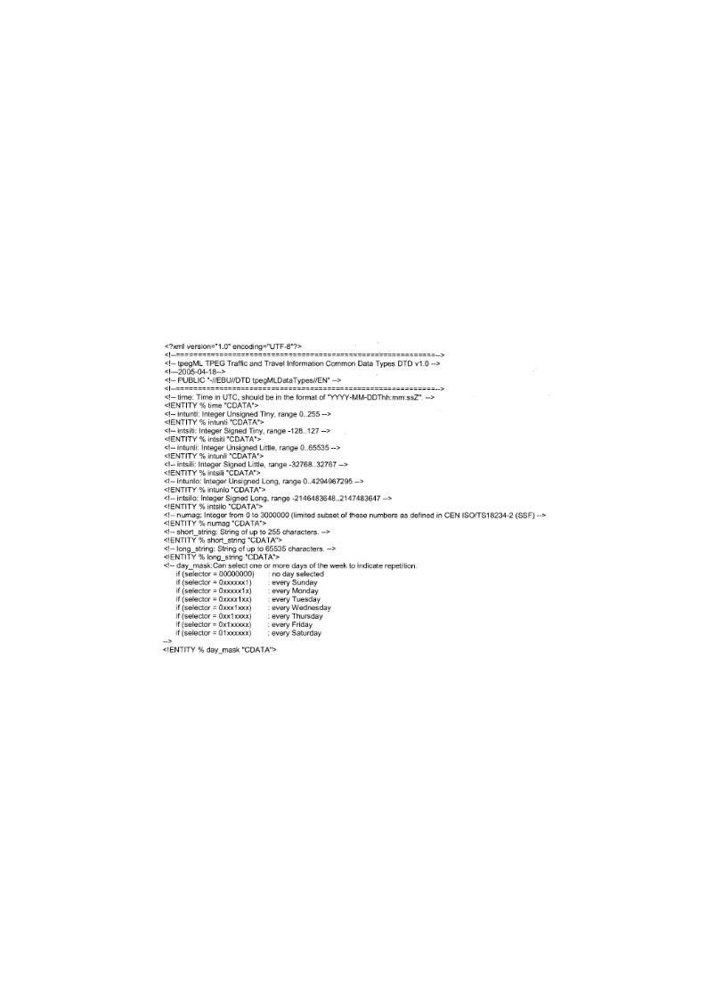
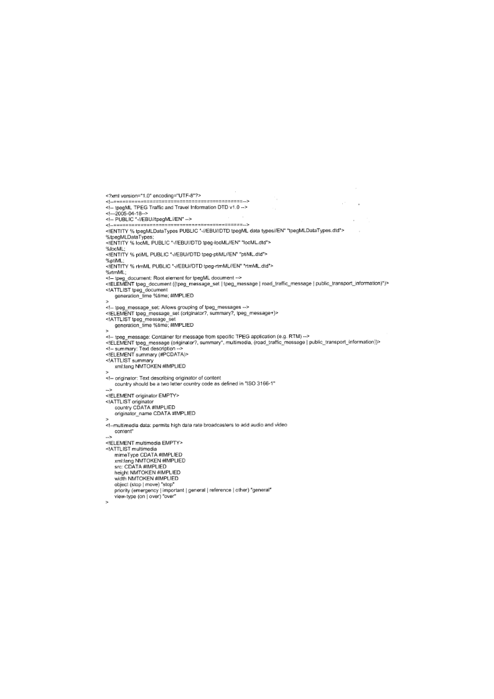

# EXTRAKT z české technické normy

**Extrakt nenahrazuje samotnou technickou normu, je pouze informativním materiálem o normě.**

**ICS 35.240.60;03.220.20**

**Dopravní a cestovní informace (TTI) – TTI předávané rozšiřitelným označovacím jazykem (XML) – Expertní skupiny protokolů pro dopravu (TPEG) – Část 1: Představení, obecný datový typ a tpegML**

ČSN P CEN ISO TS 24530-1 — třídicí znak 01 8257

Platí od 1.1.2007 12 stran

**Úvod**

Tato norma je 1. částí souboru norem věnující se standardizaci protokolu pro dopravu TPEG. Detailně popisuje nejvyšší úroveň TPEG v jazyku XML využívající aplikace tpegML. Aplikace tpegML je navrhována do zprávy o stavu dopravy na dopravní síti. Umožňuje propojením do infrastruktury a tím ovlivnění trasy například nadměrného nákladu apod. Poskytované informace zahrnují hierarchicky uspořádané informace o událostech, informace o stavu na silnici a případně o infrastruktuře ovlivňující dopravu.

Pro správné porozumění textu je vhodné se seznámit se specifikací binárního TPEG (soubor norem ISO/TS 18234).

Součástí normy jsou tři přílohy, jejichž příklady jsou uvedeny v závěru extraktu. Příloha A obsahuje normativ DTD pro tpegMLDataTypes.dtd. Příloha B obsahuje normativ pro tpegML.dtd a příloha C popisuje možnosti a pravidla budoucí nadstavby a rozšíření DTDs.

**Užití**

TPEG aplikace byly prvotně vytvořeny za účelem poskytování dopravních informací tak, aby bylo umožněno jejich kódování, dekódování, filtrování a následná interpretace jak vizuální, tak hlasová. Původní technologie TPEG využívá bitový formát. Vývoj této původní binární technologie TPEG byl určen především pro přenos prostřednictvím digitálního rádia (DAB) a případně internetem s přenosovou rychlostí do 10 kbit/s.

Jazyková nezávislost XML dat je řešena pomocí DTD, ve kterých jsou definovány kódy atributů a jejich konkrétní textová reprezentace pro určitý jazyk. Samotné XML pak využívá jen kódů, které se dají pomocí jazykově závislého DTD převést do textu ve zvoleném jazyce.

**Související normy**

Čtenářům se doporučuje seznámit se s technickými specifikacemi ISO/TS 24530-2, ISO/TS 24530-3, ISO/TS 24530-4 případně s dalšími publikovanými pracemi na téma TPEG. Vhodnými specifikacemi jsou i ISO/TS 18234-1, ISO/TS 18234-2, ISO/TS 18234-4, ISO/TS 18234-5 a ISO/TS 18234-6.

**3 Zkratky**

Norma pracuje zejména s těmito zkratkami: ARIB, ATSC, DAB, DTD, DVB, EBU, IPR, PTI, RTM, SSF, TPEG.

**4 Formát technické specifikace**

Každá kapitola normy popisuje použití tpegML v XML. Po představení a vysvětlení, co kapitola obsahuje a popisuje, stanovuje příslušnou typovou definici dokumentu (DTD) a uvádí příklad. Úplný seznam souborů DTD je uveden v přílohách A a B.

Seznamy atributů jednotlivých prvků používaných v tpegML najdeme v tabulkách specifikací TPEG. V XML struktuře jsou jednotlivé vstupy kódovány. Atributy prvků v této technické specifikaci jsou převzaté z příslušné části CEN ISO/TS 18234.

Pro kódování prvků je používán formát rtmX\_Y, kde X vyjadřuje číslo tabulky a Y číslo řádku v dané tabulce (například rtm01\_1).

V kapitole je uveden příklad kódu napsaného v jazyce XML na pozemní komunikaci z důvodu nehody na A12 a na následné přesměrování na objízdnou trasu.

**5 Pojmy a zápisy souboru tpegMLDATAQTypes.dt. pro jazyk XML**

Kapitola definuje pojmy a zápisy souboru tpegMLDATAQTypes.dt. pro jazyk XML. Kompletní seznam se zkratkami je uveden v příloze A, kde jsou uvedeny i příslušné rozsahy definovaného slova pro programátora.

**6 Pojmy a zápisy souboru tpegML.dt. pro jazyk XML**

Kapitola definuje pojmy a zápisy souboru tpegML.dt. pro jazyk XML. Kompletní seznam se zkratkami je uveden v příloze A, kde jsou uvedeny i příslušné rozsahy definovaného slova pro programátora.

**Příloha A (normativní) DTD pro tpegML – obecný datový typ (tpegMLDataTypes.dtd)**

**Příloha B (normativní) DTD pro tpegML (tpegML.dtd)**

**Příloha C (normativní)**

Tato příloha se týká budoucích rozšíření typů dokumentů.

DTDs může být změněno s dodržením psaných syntaxí s tím, že jsou daná jistá, dále popsaná pravidla:

  - Prvky nemohou být odlišné.

  - Atributy nemohou být odlišné.

  - Atributy nemohou být změněny z implicitní na požadovaný.

  - Standardní hodnoty by neměly být obecně upravovány.

  - A „hodnota“ nemůže být odlišná od atributu „hodnoty“ seznam.

  - Požadovaná struktura dokumentu nemůže být měněna. Například „?“ se nemůže zaměnit za + a nové části není možné požadovat v zadání vnitřního již existující prvku. Jen „?“ a „\*“ může být použito, když se mění struktura dokumentu.

  - \#PCDATA nemohou být odlišná od prvků.
