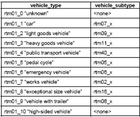
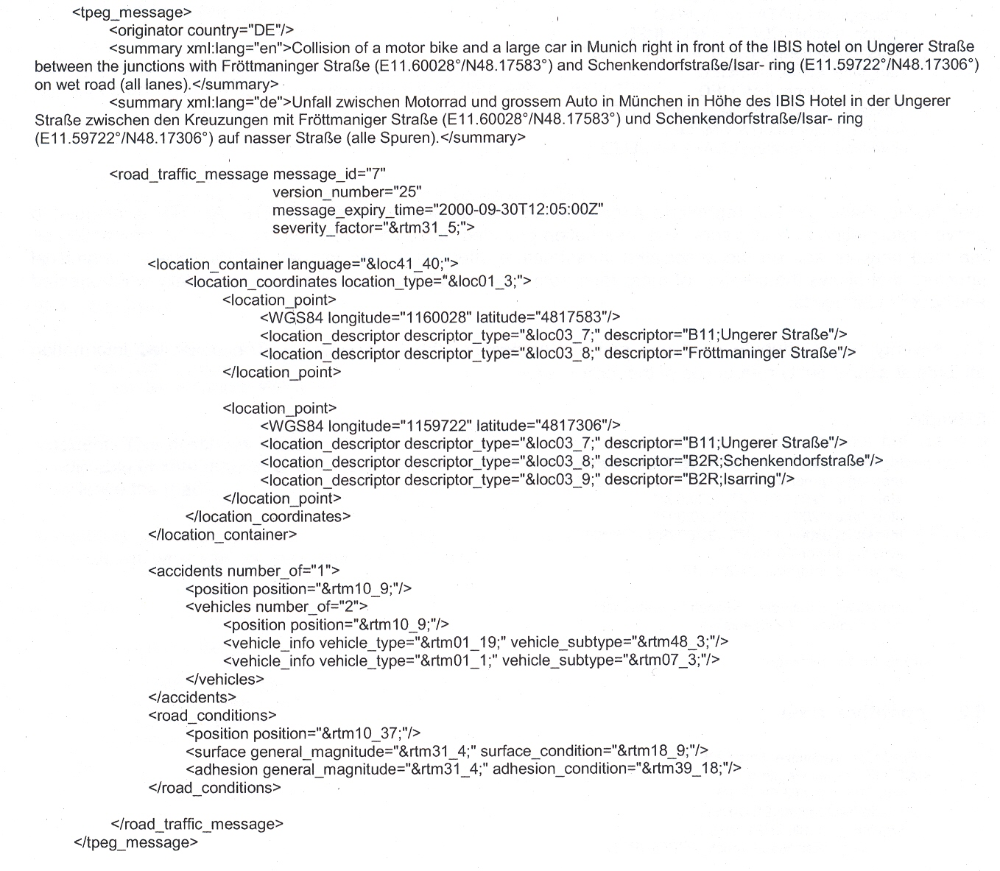
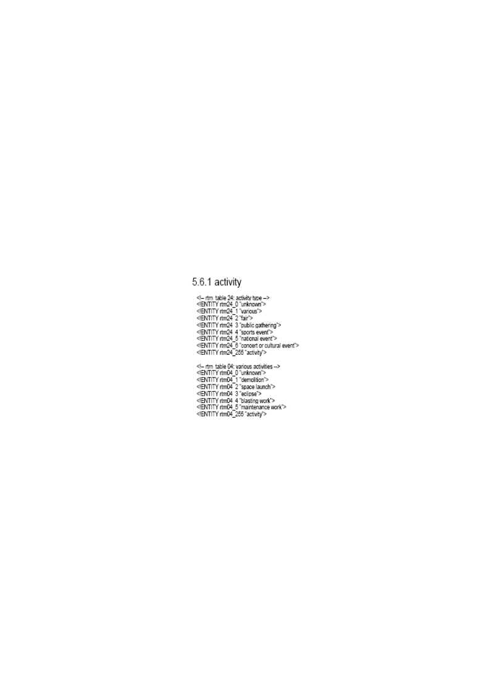
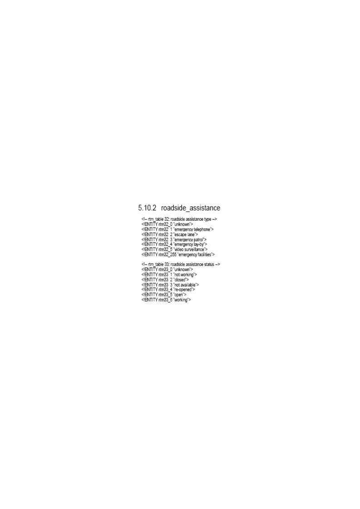
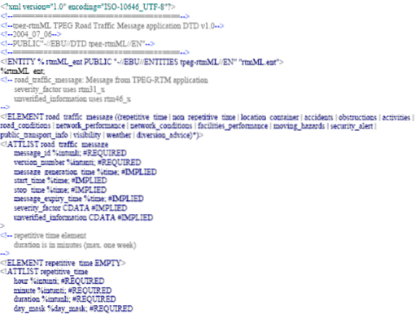
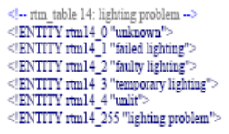

# EXTRAKT z české technické normy

**Extrakt nenahrazuje samotnou technickou normu, je pouze informativním materiálem o normě.**

**03.220.01, 35.240.60**

**Dopravní a cestovní informace (TTI) – TTI předávané rozšiřitelným označovacím jazykem (XML) – Expertní skupiny protokolů pro dopravu (TPEG) – Část 3: tpeg-rtmML**

ČSN P CEN ISO/TS 24530-3 — třídicí znak 01 8257

Platí od 1.1.2007 60 stran

**Úvod**

Tato norma je 3. částí souboru norem věnujících se standardizaci protokolu pro dopravu TPEG. Detailně popisuje aplikaci tpeg-rtmML: zprávy o silniční dopravě za použití protokolu XML. Aplikace TPEG-RTM byla vytvořena za účelem poskytování informací účastníkům silničního provozu. Poskytované informace zahrnují hierarchicky uspořádané informace o událostech, informace o stavu na silnici a případně o infrastruktuře, ovlivňující dopravu.

Aplikace TPEG-RTM zahrnuje dále tabulky, které umožňují popis TTI událostí, informací o jejich charakteru, pozici, objížďce, atp.

Pro správné porozumění tomuto dokumentu je důležité se seznámit se specifikací binární TPEG-RTM (CEN ISO/TS 18234-4).

TPEG aplikace byly prvotně vytvořeny za účelem poskytování dopravních informací tak, aby bylo umožněno jejich kódování, dekódování, filtrování a následná interpretace jak vizuální, tak hlasová. Původní technologie TPEG využívá bitový formát. Vývoj této původní binární technologie TPEG byl určen především pro přenos prostřednictvím digitálního rádia (DAB) a případně internetem s přenosovou rychlostí do 10 kbit/s.

V současnosti existují další nosiče, např. ARIB, ATSC, DAB, DVB či internet, které umožňují daleko rychlejší přenosovou rychlost a ekonomický a technický užitek. Právě pro tento účel byl vytvořen formát TPEGu XML (tpegML). TpegML je dále určen poskytovatelům služeb, kteří mají standardizované rozhraní pro příjem zpráv _(standardised message generation interface)_ a dále by jim bylo umožněno vyvíjet systém, který by uspokojil jejich požadavky. Tento způsob umožní poskytovatelům služeb vyměňovat předpřipravené informace bez ohledu na systémy generování zpráv _(message generation systems)_. TpegML dále umožňuje poskytovat jazykově nezávislou službu. To znamená, že v rámci tpegML lze předávat zprávy v kterémkoli jazyce, který zná daný internetový prohlížeč.

**Užití**

Technologie TPEG je určena pro poskytovatele služeb, neboť byla navržena pro širokou škálu aplikací, které vyžadují efektivní přenos z jednoho bodu do více bodů přes veskrze nespolehlivé rádiové vysílání.

**Souvisící normy**

Pro lepší pochopení této normy je vhodné projít analogickou normu v binárním kódu CEN ISO/TS 18234-4.

**1 Předmět normy**

Tato norma definuje kódování XML metody aplikace TPEG RTM. Aplikace TPEG RTM slouží k přenosu dopravních informací koncovým uživatelům s využitím široké škálu nosičů.

**3 Zkratky**

Tato kapitola uvádí 14 zkratek, podstatné z nich jsou uvedeny níže:

**3.1 ARIB** association of radio industries and business – Japonská Asociace rádiového průmyslu a obchodu

**3.2 ATSC** American television standards committee – americká televizní standardizační komise

**3.3 DAB** digital audio broadcasting – digitální audio vysílání

**3.5 DVB** digital video broadcasting – digitální vysílání videosignálu

**3.6 EBU** European broadcasting union – Evropská vysílací unie

**3.8 RTM** road traffic message – zpráva o stavu dopravy

**3.9 TPEG** Transports protocol experts group – Expertní skupina dopravních protokolů, forma strukturovaného zápisu informací o dopravě

**tpegML** aplikace tpeg XML psaná malými písmeny, což ji odlišuje od binárních aplikací TPEG, psané s velkými písmeny.

**tpeg-loc** location referencing for applications – označování polohy pro aplikace

**TTI** traffic and travel information – dopravní a cestovní informace

**XML** extensible markup language – rozšiřitelný značkovací jazyk

**4 Struktura normy**

Tato norma je rozdělena do částí, které popisují každá jeden prvek, používaný v rámci tpegML. Článek vždy specifikuje účel daného prvku, příslušnou DTD definici a příklad. Úplný seznam .dtd a .ent souborů je uveden v přílohách A a B.

Seznamy atributů jednotlivých prvků, používaných v tpegML, jsou uvedeny v tabulkách specifikací TPEG. V XML struktuře jsou jednotlivé vstupy kódovány. Atributy prvků v této technické specifikaci jsou převzaté z příslušné části CEN ISO/TS 18234.

Pro kódování prvků je používán formát rtmX\_Y, kde X vyjadřuje číslo tabulky a Y číslo řádku v dané tabulce (například rtm01\_1).:

**Tab. 1** Příklad kódování „typu vozidla“

Kapitola dále obsahuje 3 vzorové XML:

  - „Uzavření silnice A12 u města Brentwood, Essex“;

  - „Dočasný semafor instalován na silnici A811 u města Drymen“ a

  - „Srážka motocyklu s větším vozidlem“.

Pro ilustraci je uveden příklad 2 „Dočasný semafor instalován na silnici A811 u města Drymen“:

**5 tpeg-rtmML**

Popis tpeg-rtmML je uveden v přílohách A a B: soubory tpeg-rtmML.dtd a tpeg-rtmML.ent. Tato kapitola přináší seznam hodnot, jakých může dosahovat a způsoby, jakými je možné prostřednictvím tpeg-rtiML předat informace o následujících zprávách:

  - popis zprávy o provozu na pozemní komunikaci (PK),

  - opakovaná událost,

  - neopakující se událost,

  - nehoda (její lokalizace, informace o vozidle, lidech, atp.),

  - zácpa/překážka,

  - aktivity (události, které mohou mít důsledek na silniční dopravu),

  - podmínky vozovky (povrch, přilnavost, značení),

  - průběh dopravy (dopravní stupně, délka dotčeného úseku, rychlost, zpoždění, travel time),

  - podmínky na síti PK (omezení, změny, práce na silnici),

  - dostupnost služeb (služby pomoci na PK),

  - pohybující se nebezpečí,

  - upozornění na hrozící nebezpečí,

  - informace o veřejné dopravě,

  - viditelnost (stupeň viditelnosti, překážka viditelnosti, jas, osvětlení),

  - počasí.

Příklady aktivit:

Příklad služeb pomoci na silnici:

## Příloha A (normativní) DTD pro tpeg-rtmML aplikace TPEG Dopravní zpravodajství (tpeg-rtmML.dtd)

Tato příloha obsahuje příklady zápisu jednotlivých prvků v XML struktuře. Část vzorové XML struktury je uvedena níže:

## Příloha B (normativní) Reference externích prvků pro tpeg-rtmML – aplikace TPEG Dopravní zpravodajství (tpeg-rtmML.ent).

Tato příloha obsahuje seznamy kódů jednotlivých atributů prvků, používaných v rámci tpeg-rtmML. Příklady problémů s osvětlením jsou uvedeny níže:

Příklady typů problémů u vozidel jsou uvedeny níže:

