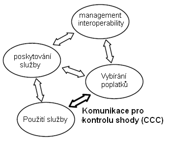

# EXTRAKT z české technické normy

**Extrakt nenahrazuje samotnou technickou normu, je pouze informativním materiálem o normě.**

ICS 03.220.20, 35.240.60

**Elektronický výběr poplatků (EFC) – Komunikace pro kontrolu shody autonomních systémů**

ČSN P CEN ISO/TS 12813 — třídicí znak 01 8389

Platí od 15. 12. 2008 44 stran

**Úvod**

Tato Technická specifikace definuje požadavky na vyhrazené spojení krátkého dosahu (DSRC) mezi palubním zařízením a zařízením na straně infrastruktury, které kontroluje shodu s platným mýtným režimem. Vychází ze systémové architektury elektronického výběru poplatků (EFC) dle normy ISO 17573, viz obrázek 1.

**Obr. 1** Komunikace pro kontrolu shody v rámci architektury EFC podle ISO 17573

Výběrčí mýtného kontrolují, zda jsou komunikace využívány v souladu s platným místním režimem mýtného. Jedním ze způsobů provedení této kontroly je sledování projíždějícího vozidla a interakce s jeho palubním zařízením (OBE). Tato interakce probíhá pod kontrolou výběrčího mýtného (viz Obrázek 1), a to pomocí vyhrazené komunikace krátkého dosahu mezi kontrolním zařízením, které je součástí infrastruktury (případně jiného vozidla), a OBE.

V interoperabilním prostředí je zásadní, aby kontrolní komunikace (CCC) byla standardizována tak, aby každý operátor kontrolního zařízení mohl kontrolovat všechna projíždějící zařízení OBE. Z tohoto důvodu definuje tato technická specifikace atributy, kterými musí palubní zařízení (OBE) disponovat, aby byla možná jeho komunikace s kontrolním zařízením.

Předpokládá se, že primárním cílem operátora kontrolního zařízení je ověřovat, zda uživatel splnil požadavky na něho kladené, zvláště ověřit,

  - zda palubní zařízení je osazeno na správném typu vozidla;

  - že jsou klasifikační data odeslaná palubním zařízením správná;

  - že je palubní zařízení v aktivním provozu, a to jak ve smyslu technickém, tak ve smyslu platnosti smlouvy.

Poznámka: Extrakt uvádí vybrané kapitoly popisovaného dokumentu a přejímá původní číslování kapitol.

**Užití**

Tato technická specifikace byla vytvořena za účelem stanovení „minimálních požadavků“, a to tak, že popisuje prvky, které jsou vyžadovány aktuálně provozovanými systémy a budou vyžadovány systémy plánovanými v blízké budoucnosti. Následující vydání mohou zahrnovat další části, které budou například standardizovat prověřené zařízení uvnitř OBE. Tato specifikace je vhodná pro výrobce telematických zařízení pro výběr poplatků tím, že stanovuje minimální požadavky na kompatibilitu, zároveň bude používána zkušebními orgány jako základ pro stanovení interoperability zařízení.

**1 Předmět normy**

Tato technická specifikace definuje požadavky na komunikaci krátkého dosahu vedenou za účelem kontroly dodržení závazků v rámci autonomních systémů elektronického výběru poplatků (EFC). Kontrolní komunikace (CCC) probíhá mezi palubním zařízením (OBE) silničního vozidla a venkovním kontrolním zařízením (zařízením na straně infrastruktury, mobilním zařízením nebo přenosným zařízením) a jejím cílem je zjišťovat, zda data přenášená palubním zařízením poskytují správné informace o využití pozemní komunikace příslušným vozidlem v souladu s platným mýtným režimem.

Předpokládá se, že provozovatel kontrolního zařízení je součástí systému výběru poplatků ve smyslu role definované normou ISO 17573. Dále se tato technická specifikace se vztahuje pouze na palubní zařízení OBE pracující v autonomním režimu; nevztahuje se na kontrolu v rámci systémů výběru poplatků pomocí vyhrazeného spojení krátkého dosahu (DSRC). Definuje syntaxi a sémantiku dat, ale nedefinuje komunikační sekvenci.

Všechny zde definované atributy jsou povinné pro veškerá zařízení OBE, která si nárokují shodu s touto technickou specifikací; a to i v případě, že zařízení OBE nedisponuje určitou funkcionalitou. Aby bylo dosaženo kompatibility se stávajícími systémy, kdykoliv je to možné, komunikace využívá atributů definovaných normou ISO 14906.

Jsou specifikovány definice pro komunikaci CEN-DSRC upravené normou EN 15509, dále pro využití systémů ISO CALM IR, UNI DSRC a ARIB DSRC jako alternativ komunikace CEN-DSRC. Definované atributy a funkce slouží ke kontrole shody pomocí komunikačních služeb DSRC poskytovaných aplikační vrstvou 7 DSRC, pomocí atributů a funkcí CCC, které jsou dostupné pro CCC aplikace na straně infrastruktury i palubní zařízení. Atributy a funkce jsou definovány na úrovni ADU (datové jednotky na aplikační vrstvě).

Požadavky na zkoušení nejsou předmětem této technické specifikace.

**2 Souvisící normy**

EN ISO 14906:2004 Dopravní telematika – Elektronický výběr poplatků – Definice aplikačního rozhraní pro radiový přenos na krátkou vzdálenost (DSRC)

_(Road Traffic and Transport Telematics (RTTT) – Electronic Fee Collection – Application interface definition for dedicated short range communication.)_

EN 15509:2007 Dopravní telematika – Elektronický výběr poplatků (EFC) – Aplikační profil interoperability pro DSRC

_(Road transport and traffic telematics – Electronic fee collection – Interoperability application profile for DSRC)_

**3 Termíny a definice**

V této kapitole je stanoveno 14 termínů, mezi jinými i

**3.12 kontext mýtného** _(toll context)_ logický pohled na konkrétní režim mýtného definovaný atributy a funkcemi

**3.13 režim** **mýtného** _(toll regime)_ sada pravidel definující mýtné schéma, tj. pravidla definující zpoplatnění a proces zpoplatnění pro specifické opatření zpoplatňující silničního uživatele

Další termíny a zkratky z oboru ITS jsou obsaženy ve slovníku ITS terminology.

**4 Symboly a zkratky**

**AC\_CR** _access credentials_ – **Pověření k přístupu**

**CCC** _Compliance Check Communication_ **– Komunikace pro kontrolu shody, kontrolní komunikace**

**ADU** Application Data Unit – **Datová jednotka aplikační vrstvy**

Další termíny a zkratky z oboru ITS jsou obsaženy ve slovníku ITS terminology (www.ITSterminology.org).

**5  Architektura aplikačního rozhraní**

Tato kapitola obsahuje základní informace o architektuře komunikace CCC. Identifikuje služby poskytované aplikacím CCC a funkce, které tyto služby implementují. Také definuje principy vztahující se k atributům a použití základních prvků komunikace DRSC. Podrobný popis funkcí je obsahem kapitoly 6; podrobný seznam atributů je uveden v kapitole 7.

Aplikační rozhraní CCC bylo vyvinuto tak, aby mohlo využívat sestavu protokolů CEN-DSRC prostřednictvím aplikační vrstvy specifikované normou ISO 15628 a EN 12834. Informace o mapování odpovídajících služeb pro další identifikovaná komunikační média DSRC jsou uvedeny v přílohách.

Pro kontrolu splnění požadavků není nutné rozlišovat mezi různými kontexty mýtného. Údaje důležité pro kontrolu, tj. identifikace vozidla, klasifikační parametry a provozní stav zařízení OBE jsou na kontextu mýtného nezávislé. Proto tato specifikace používá pouze jeden kontext komunikace CCC a zařízení OBE proto má jen jeden CCC kontext, identifikovaný pomocí jediné hodnoty EID.

Aplikační rozhraní CCC využívá sestavu komunikačních protokolů CEN-DSRC, také mohou být použita i jiná komunikační média, pokud je zajištěno rovnocenné namapování odpovídajících služeb (viz Tabulka 1). Aplikační rozhraní CCC poskytuje aplikacím CCC tyto služby:

  - přístup ke kontrolním atributům tak, aby zařízení RSE mohlo ověřit, zda OBE splňuje požadavky,

  - vzájemná autentizace zařízení RSE a OBE prostřednictvím výměny ověřovacích údajů;

  - příkaz vydaný zařízením OBE sdělující uživateli výsledek kontroly

Výše uvedené služby jsou realizovány pomocí výměny protokolů prostřednictvím komunikačních služeb a transakcí, jak je popsáno v kapitole 8. RSE může z OBE načítat libovolnou kombinaci atributů. Atributy jsou identifikovány a zjišťovány pomocí mechanismů definovaných normou ISO 14906.

**Tab. 1** Podporované sestavy komunikačních protokolů na krátkou vzdálenost

<table>
<tbody>
<tr class="odd">
<td><strong>Médium</strong></td>
<td><strong>Aplikační vrstva</strong></td>
<td><strong>Nižší vrstvy</strong></td>
<td><strong>Detailní specifikace</strong></td>
</tr>
<tr class="even">
<td>CEN-DSRC</td>
<td>
EN 12834 a

ISO 15628
</td>
<td>
EN 12795

EN 12253
</td>
<td>Specifikace viz 5.5.2</td>
</tr>
<tr class="odd">
<td>Italská UNI DSRC</td>
<td>
UNI 10607-4:2007

UNI 10607-3:2007
</td>
<td>
UNI 10607-2:2007

UNI 10607-1:2007
</td>
<td>Příklad implementace v příloze C</td>
</tr>
<tr class="even">
<td>ISO CALM IR</td>
<td>
EN 12834 a

ISO 15628
</td>
<td>ISO 21214</td>
<td>Příklad implementace v příloze D</td>
</tr>
<tr class="odd">
<td>ARIB DSRC</td>
<td>
ARIB STD-T75 a

ISO 15628
</td>
<td>
ARIB STD-T75

ITU-R.M1453-2
</td>
<td>Příklad implementace v příloze E</td>
</tr>
</tbody>
</table>

**6  Funkce**

V této kapitole jsou definovány funkce, které musí být dostupné pro OBU. V rámci CEN-DSRC jsou funkce zabezpečovány aplikační vrstvou DSRC podle normy ISO 15628 a EN 12834 (služby 'INITIALISATION', 'GET' a 'RELEASE') nebo jsou implementovány podle příslušných funkcí EFC, jak specifikuje norma ISO 14906 (funkce 'GET\_STAMPED', 'SET\_MMI' a 'ECHO').

V článcích této kapitoly jsou definovány funkce výhradně pro CEN-DSRC. Dalším médiím podporovaným v souladu s předchozí kapitolou musí být poskytnuta ekvivalentní funkcionalita, viz příloha C pro UNI 5.8 GHZ mikrovlnného DSRC, příloha D pro CALM infračerveného DSRC a příloha E pro ARIB mikrovlnného DSRC.

Funkce definované v této kapitole spadají do následujících kategorií:

  - Zahájení komunikace,

  - Přístup k datům,

  - Autorizovaný přístup k datům,

  - Upozornění řidiče,

  - Ukončení komunikace a

  - Test komunikace.

Další částí této kapitoly, která s funkcemi úzce souvisí, je zabezpečení. To je nezbytnou součástí aplikací CCC. Tato technická specifikace se zabývá všeobecnými službami zabezpečení. Detailní implementace se liší dle použitého média.

Tato technická specifikace se zabývá autentizačními službami, které budou pravděpodobně sloužit k ověření identity zdroje dat, integrity dat a zabraňovat jejich zpochybnění. Obsahuje mechanismus kontroly přístupu k datům zařízení OBE pomocí ověřovacích přístupových údajů. Ochrana přístupu rovněž slouží jako ochrana soukromí uživatele.

**7  Atributy**

Tato kapitola uvádí všechny atributy a datové prvky v kontextu CCC, které musí být dostupné na straně OBE. Jedná je o prvky Atributy CCC podle normy EN 15509 a Specifické atributy CCC

Dále jsou zde specifikovány atributy CCC týkající se identifikace, stavu a vozidla ve smyslu

  - názvu datového atributu,

  - názvů datových prvků tvořících CCC atribut (žádný CCC atribut neobsahuje volitelný datový prvek),

  - sémantické definice datového prvku, a

  - informativních poznámek, včetně odkazů na jiné normy.

**8 Transakční model**

V této kapitole jsou odkazovány požadavky na transakční model související s aplikačním rozhraním LAC pro DSRC. Ten musí splňovat požadavky EN ISO 14906, kapitoly 6, s omezeními a doplňky definovanými v přílohách pro implementace používající sestavu komunikačních protokolů CEN DSRC.

Dále kapitola obsahuje popis 2 fází transakčního modelu: inicializace a transakce.

## Příloha A (normativní) Specifikace datových typů CCC

Tato příloha obsahuje ASN.1 definice:

  - datových typů souvisejících s  funkcemi CCC, jak je specifikováno v kapitole 6;

  - datových typů souvisejících s  atributy CCC, popsanými v kapitole 7;

  - typy kontejnerů ASN.1 pro ISO aplikační vrstvu 7,

používající metodu abstraktního syntaktického zápisu (ASN.1) podle ISO/IEC 8824-1. Pravidla zhuštěného kódování musí být aplikována podle ISO/IEC 8825-2.

## Příloha B (normativní) Formulář PICS pro datové prvky v atributu

Pro posouzení shody konkrétní implementace je nutné mít prohlášení o tom, jaké schopnosti a možnosti byly implementovány. Takové prohlášení se nazývá Prohlášení o shodě implementace (ICS) nebo přesnější pro případ, kdy pokrývá transakce, Prohlášení o shodě implementace protokolu (PICS). Cílem tohoto formuláře PICS je poskytnout mechanismus, kterým by dodavatel implementace podle požadavků definovaných v této technické specifikaci, mohl podávat informace o implementaci standardizovaným způsobem.

Formulář PICS je rozdělen do článků podle těchto kategorií informací:

  - identifikace implementace;

  - identifikace protokolu;

  - souhrnné prohlášení o shodě;

  - tabulky formuláře PICS.

Tato příloha se zabývá použitím formuláře Prohlášení o shodě implementace protokolu (PICS) pro atributy definované v kapitole 7 a příloze A.

## Příloha C (informativní) Použití sestavy komunikačních protokolů UNI DSRC pro aplikace CCC

Tato rozsáhlá příloha obsahuje požadavky na aplikaci CCC využívající jako komunikační médium zásobník UNI DSRC definovaný dle normy UNI 10607. Ukazuje, jak zobecněné funkce komunikace CCC mapovat do základních funkcí služby UNI DSRC a uvádí příklad, jak lze uchovávat typy informací CCC a získávat informace od zařízení OBE kompatibilního se standardem UNI DSRC.

Měly by být použity bezpečnostní algoritmy a kalkulace, transakční model, jak je specifikováno normou UNI 11310, \[UNI Profile\], týkající se interoperability DSRC.

## Příloha D (informativní) Použití sestavy komunikačních protokolů CALM IR pro aplikace CCC

Tato příloha velmi stručně specifikuje použití sestavy komunikačních protokolů IR v CALM pro aplikace CCC podle ISO 21214.

## Příloha E (informativní) Použití sestavy komunikačních protokolů ARIB DSRC pro aplikace CCC

Tato příloha velmi stručně specifikuje, jak aplikace CCC používá ARIB mikrovlnné DSRC na frekvenci 5.8 GHz.

## Příloha F (informativní) Příklady transakce CCC

Tato příloha obsahuje příklad transakce komunikace CCC, při níž dojde k načtení všech dat a poskytnutí podpisů zaručujících integritu/autenticitu dat OBE a jejich ochranu proti zpochybnění.

## Příloha G (informativní) Doporučení týkající se zabezpečení

Tato příloha obsahuje všeobecné informace, důvody pro použití a příklad použití zabezpečovacích funkcionalit komunikace CCC popsaných v této technické specifikaci.

Požadavky na zabezpečení komunikace CCC vyplývající z těchto hlavních požadavků výběrčího mýtného:

  - výběrčí mýtného si klade za cíl donucovat k plnění svých povinností ty uživatele, kteří nesplňují povinnost spolupráce (např. deklarováním správné třídy a dohlížením na stav OBE);

  - výběrčí mýtného si klade za cíl donucovat k plnění svých povinností ty uživatele, kteří záměrně ovlivňují proces výběru poplatků v OBE;

  - výběrčí mýtného si může volitelně přát využívat tento kontrolní mechanismus ke kontrole dat o použití poskytovatele služby a ověřování jejich pravosti, tj. porovnávání dat o použití s událostí detekovanou na straně kontrolní stanice.

**Bibliografie**

Tato kapitola obsahuje použitou literaturu.
