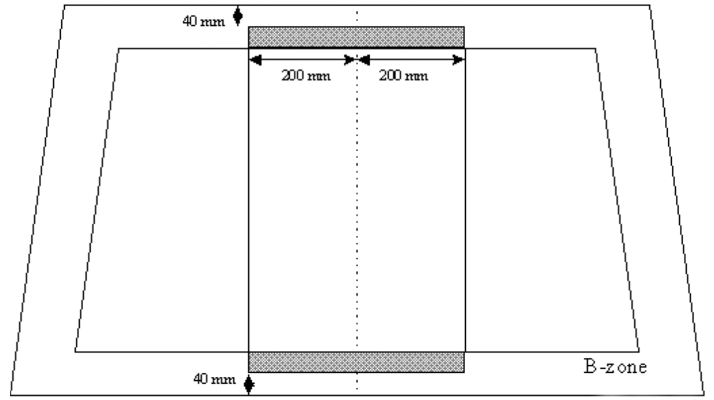

# EXTRAKT z technické zprávy CEN

**Extrakt nenahrazuje samotnou technickou normu, je pouze informativním materiálem o normě.**

ICS 03.220.20, 35.240.60

**Dopravní telematika – Elektronický výběr poplatků (EFC) – Zajištění správné funkce zařízení pro elektronický výběr mýtného instalovaného za pokoveným čelním sklem**

CEN/TR 15762

Vydána 2008, 10 stran

## Úvod

Tato technická zpráva se zabývá identifikací omezení vyplývajících z technického a normalizačního rámce pro komunikaci prostřednictvím DSRC mezi zařízením ve vozidle se zařízením podél komunikace (silnice) u vozidel s pokoveným čelním sklem a následně návrhem nepokovené oblasti v takovém čelním skle. Tato technická zpráva neodpovídá rozsahově ani strukturou obvyklým zvyklostem.

Poznámka: Extrakt uvádí vybrané kapitoly popisovaného dokumentu a přejímá původní číslování kapitol.

## Užití

Tato technická zpráva vychází z testů a simulací DSRC komunikace a určuje, jak by měla vypadat, a kde by měla být umístěna nepokovená oblast v pokoveném čelním skle. Z toho důvodu **je důležitá primárně pro výrobce pokovených čelních** skel vozidel, u kterých je předpoklad že budou zapojeny v systému EFC. Výrobcům dává parametry, které mohou při výrobě použít.

Pro **poskytovatele služeb** je tato norma přinejmenším zajímavá, protože stanovuje, jak by měla být tato nepokovená oblast označena.

Je ovšem otázkou jestli je tato norma vůbec použitelná, protože její tvůrci udávají, že výsledky v ní uvedené **nelze aplikovat na vertikální čelní skla** a zahřívaná čelní skla. Přičemž vertikální čelní skla mají autobusy, kamiony a nákladní vozy, tedy cílová skupina systému EFC. To jestli bývají tato skla metalizovaná, tato technická zpráva neřeší.

## 1 Předmět normy

Do vozidel jsou montována metalizovaná skla (kovové mikro-částečky v jedné z vrstev skla), které zvyšují efektivitu klimatizace a zkracují dobu potřebnou pro odmrazení skla. Tato vrstva ale dramaticky zvyšuje útlum signálu DSRC, který z 2-5 dB pro normální skla stoupá na 20-40 dB.

Tato technická zpráva navrhuje řešení, které je ale platné pouze pro vozidla s vyšším sklonem čelního skla. Navrhované řešení tedy NELZE použít pro autobusy či kamiony\!

## Souvisící normy

Tato technická zpráva neobsahuje samostatnou kapitolu věnující se souvisícím normám. V textu odkazuje 7 evropských norem elektronického mýta, zejména těch, které se zabývají vyhrazeným spojením krátkého dosahu DSRC, např EN 15509 - aplikační profil interoperability pro DSRC, zkouškami CEN ISO/TS 14907-1 a CEN ISO/TS 14907-2 postupy zkoušek uživatelského i pevného zařízení.

## Termíny a definice

Tato technická zpráva neobsahuje kapitolu s definicemi termínů.

Další termíny a zkratky z oboru ITS jsou obsaženy ve slovníku ITS terminology.

## Symboly a zkratky

Tato kapitola v dokumentu zcela chybí. Vzhledem k čitelnosti extraktu alespoň uvedeme používané zkratky zde.

**DSRC** vyhrazené spojení krátkého dosahu _(Dedicated Short Range Communication)_

**EFC** elektronický výběr poplatků _(Electronic Fee Collection)_

**OBU** zařízení ve vozidle _(On Board Unit)_

**RSE** zařízení podél pozemní komunikace _(Road Side Equipment)_

Další termíny a zkratky z oboru ITS jsou obsaženy ve slovníku ITS terminology (www.ITSterminology.org).

## 2 Podmínky a omezení

Technická zpráva zkoumá omezení, která přinášejí metalizovaná čelní skla ze tří pohledů. Omezení daná pravidly pro konstrukci vozidla a umístění palubního vybavení, omezení daná evropskými normami a omezení daná tržním prostředím.

Část 2.2 identifikuje regulatorní omezení pro čelní skla (ECE-R43 a další), zpětná zrcátka (EU 71/127 a další) a pro bezpečnost interiéru při nárazu (EU 74/60 a další). Z této identifikace vyplývá, že čelní výhled z vozidla nesmí být blokován umístěním OBU.

Část 2.3 identifikuje evropské normy pro EFC (celkem 7), které kladou požadavky na transakci elektronického mýtného systému (přenos informace z RSE do OBE).

## 3 Část čelního skla bez pokovené vrstvy

Tato kapitola se zabývá tím, jak by mělo vypadat čelní sklo s oblastí bez pokovené vrstvy z prvovýroby.

Část 3.2 identifikuje klíčové parametry, jejich **hodnoty** a přípustné rozmezí (tolerance) pro tuto nepokovenou oblast. Mimo jiné je to podélné umístění, minimální velikost, minimální vzdálenost od nejvzdálenějšího okraje skla a minimální prostor za nepokovenou oblastí. Dále také určuje, jak musí být tato oblast na skle označena.

**Obr. 1** Vyznačení oblastí (šedá barva), kde může být umístěna oblast čelního skla bez pokovené vrstvy, vzhledem k podélnému středu čelního skla (obrázek 4 normy)

Navržené parametry a jejich hodnoty zaručují pozitivní průběh komunikace DSRC pouze pro nevyhřívaná skla s velkým sklonem, ostatní typy skel mají příliš velký útlum.

Touto kapitolou tato technická zpráva končí.
