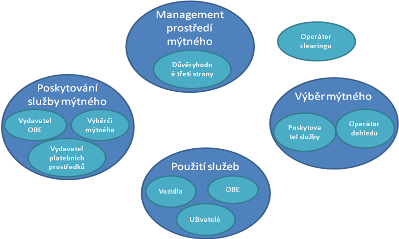
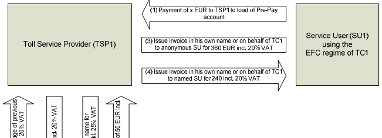

# EXTRAKT z technické zprávy CEN

**Extrakt nenahrazuje samotnou technickou normu, je pouze informativním materiálem o normě.**

ICS 03.220.20, 35.240.60

**Elektronický výběr mýtného – Požadavky na Pre-Pay systémy**

CEN/TR 16092

Vydána 2011, 40 stran

## Úvod

Tato technická zpráva se zaměřuje na rozbor možností systémů Pre-Pay (kreditu) schopných komunikovat s OBE. Klasické mýtné schéma, kdy uživatel služby platí poskytovateli služby po jejím použití (Post-Pay), nemusí být vhodné pro každého.

Ve schématu Post-Pay poskytovatel služby musí mít v uživatele důvěru a uživatel musí mít bankovní účet. V případě že nastane situace, kdy si uživatel nemůže/nechce založit účet či z nějakého důvodu není pro poskytovatele důvěryhodný, nebo prostě chce zůstat v anonymitě, ztrácí v klasickém schématu možnost systém používat. V takovém případě je výhodné mít další volitelné systémy platby za použití služby, tedy systém Pre-Pay (kreditu) – stejně jak je tomu v mobilní telefonii.

Poznámka: Extrakt uvádí vybrané kapitoly popisovaného dokumentu a přejímá původní číslování kapitol.

## Užití

Tato zpráva je důležitá hlavně pro poskytovatele služby EETS, kteří chtějí zavádět Pre-Pay model jako alternativu k Post-Pay modelu. Jejím přečtením získá čtenář představu, jaké jsou požadavky a nároky Pre-Pay modelů, a to jak s centrálním účtem tak i s účtem na OBE. Zpráva sice jako taková neřeší problematiku do takového detailu, že by model Pre-Pay umožnila zavést, ale poskytuje dostatek vodítek s odkazy na to, kde se daná problematika řeší detailněji. Bez této zprávy by si poskytovatel musel podobnou studii vypracovat sám a mohlo by to vést k rozdílným řešením v různých mýtných doménách. Zajímavostí této zprávy je i rozbor pohledů na službu mýtného z úhlu placení či neplacení DPH.

Tato zpráva je zásadní **pro poskytovatele služby mýtného,** kteří uvažují o zavedení Pre-Pay modelu plateb za mýtné služby. Umožní jim lepší orientaci v možnostech a konkrétnější diskusi s výběrčím mýta.

**Pro výrobce zařízení a dodavatele telematických systémů** tato norma obsahuje důležité pokyny, co má jednotka obsahovat s ohledem na Pre-Pay model – v souvislosti s účtem v OBE či na čipové kartě.

## 1 Předmět normy

Tato zpráva prozkoumává požadavky na všeobecně použitelný systém Pre-Pay, ve vztahu k existujícím normám a základním požadavkům na funkcionalitu. Identifikuje chybějící normy a jiné dokumenty / činnosti potřebné pro zavedení systému pro předplacené mýtné.

Na základě analýzy jsou ve zprávě jednotlivé systémy Pre-Pay roztříděny do kategorií podle jejich funkčních, technických a právních aspektů. Ujasňuje, jestli systém Pre-Pay spadá do oblasti vymezené Směrnicí 2000/46/EC a jestli je organizace vydávající platební médium peněžním ústavem ve smyslu ustanovení ve Směrnici 2007/64/EC (nemusí mít bankovní licenci).

Tato zpráva nepředjímá výběr jednoho konkrétního řešení – pouze poskytuje přehled systémů Pre-Pay spolu s jejich charakteristikami a dává tak možnému provozovateli služby možnost se informovaně rozhodnout pro ten který systém na základě jeho osobních potřeb / preferencí.

## 2 Souvisící normy

Tato zpráva odkazuje jak na normy elektronického mýta EN 15509, EN ISO/TS 25110, prEN ISO 12855, normy z oblasti platebních karet ISO/IEC 7816, ISO/IEC 14443 a ISO/IEC 15693, tak i na evropské Směrnice a další technické zprávy v  bibliografii.

V této části je uvedeno 21 norem používaných / odkazovaných touto technickou zprávou.

## 3 Termíny a definice

Tato norma uvádí 18 termínů, jsou zde standardní termíny z oblasti EETS (evropský elektronický mýtný systém), jako je

**poskytovatel služby** (_toll service provider_) – právní subjekt poskytující svým zákazníkům služby spojené s mýtným v jedné či více mýtných doménách pro jedno či více tříd vozidel

**výběrčí mýtného** (_toll charger_) – právní subjekt, který vybírá mýtné v nějaké mýtné doméně

**uživatel služby** (service user) – obecný termín pro zákazníka poskytovatele služby, který je povinen platit mýtné buď vlastník vozidla, provozovatel vozového parku, řidič atp. v závislosti na kontextu

**smlouva** (_EFC contract_) - vyjádření dohody mezi dvěma nebo více stranami ohledně využívání silniční infrastruktury

Ale také nově zavedený termín:

**zařízení pro peněžní prostředky** _(Value units Bearing Device, VBD)_ zařízení, v držení uživatele služby, které obsahuje peněžní prostředky, někdy také nazývané elektronická peněženka.

Další termíny a zkratky z oboru ITS jsou obsaženy ve slovníku ITS terminology.

## 4 Symboly a zkratky

Tato norma uvádí 27 zkratek. Mezi jinými například:

**SAM** – modul se zabezpečeným přístupem

**PSP** – poskytovatel platební služby

**VAT** – daň z přdané hodnoty

**POS** – místo prodeje

A další.

Další termíny a zkratky z oboru ITS jsou obsaženy ve slovníku ITS terminology (www.ITSterminology.org).

## 5 Problematika interoperability

Tato kapitola se odvolává na model rolí EFC z normy prEN ISO 17573. Tento model se skládá ze 4 provázaných rolí funkce EETS viz Obrázek 1. V další části této kapitoly jsou vyjmenovány 3 modely plateb uživatele služby poskytovateli služby, kterým se dále norma věnuje. Je to Post-Pay a Pre-Pay systém s centrálním účtem a Pre-Pay systém s účtem v OBE.

**Obr. 1** Role v prostředí výběru mýtného (zdroj: CEN TR 16092, Obrázek 1)

## 6 Klasifikace Pre-Pay řešení

Tato kapitola vyjmenovává v odrážkách výhody a nevýhody centrálního a lokálního (OBE) Pre-Pay řešení. Centrální řešení používá OBE, které obsahuje referenci/odkaz na centrální (anonymní) účet, ze kterého je strháváno mýtné, dobíjení kreditu může probíhat různými formami:

  - anonymní platba v hotovosti na POS,

  - kvazi-anonymní platba vkladem v bance v hotovosti na účet,

  - neanonymní platba převodem z účtu na účet.

Centrální řešení umožňuje více jednotek asociovat s jedním účtem, snižuje celkově komplexitu řešení, také riziko krádeže OBE. Zároveň ale neumožňuje strhávání plateb v reálném čase a může tak dojít k překročení limitu čerpání.

U řešení Pre-Pay s OBE je účet a tedy i kredit (peněžní jednotky) přítomen na OBE. K zaúčtování dochází okamžitě v jednotce. To jak „dobít“ do jednotky dostatečný kredit řeší norma CEN ISO/TS 25110, na kterou tato zpráva odkazuje. Výhodou tohoto systému je přenositelnost a flexibilita, nevýhodou pak přítomnost kreditu v zařízení, které může být odcizeno, dále, že je možné dobíjet kredit pouze v jedné měně a vysoké nároky na testy shody.

## 7 Požadavky na předplacený účet v centrálním systému

Článek 7.2 uvádí Požadavky obchodních procesů z pohledu uživatele služby (nevýhody z pohledu uživatele, jako například automatické blokování všech OBU asociovaných s vyčerpaným účtem atp.). Z pohledu distribučních kanálů pro vydání Smlouvy mezi uživatelem služby a poskytovatelem služby (internet, kancelář, zprostředkovatel atp.), z pohledu požadavků ve smlouvě (typ účtu, typ platby, minimální zůstatek atp.).

Dále je v kapitole rozveden způsob dobíjení kreditu, kde po počátečním nahrání kreditu na centrální účet se musí proces dobíjení do jisté míry automatizovat. Existuje několik možných řešení dobití kreditu, tyto možnosti jsou v kapitole zevrubně popsány. Jedná se o platbu v hotovosti, hotovostní vklad na účet, převod na účet či automatické inkaso vůči účtu uživatele. Obchodní procesy dále zahrnují způsob výběru mýtného, způsob fakturace, způsob refundace zůstatku na centrálním účtu, clearing mezi výběrčím mýtného a poskytovatelem služby, způsob vyřizování stížností a bezpečnostní otázky.

Článek 7.3 uvádí technické požadavky na OBE, (centrální systém neklade žádné doplňkové požadavky na OBE), požadavky na místo prodeje (POS) s ohledem na personalizaci OBE. Článek 7.4 právní a funkční otázky odkazuje na Směrnice EU, které je nutno vzít v potaz, jedná se o:

  - Směrnice 2000/46/EC o elektronických platebních prostředcích,

  - Směrnice 2007/64/EC o platebních službách,

  - Směrnice 2005/60/EC o praní peněz a

  - Směrnice 2005/60/EC o ochraně údajů.

Z funkčního pohledu se v tomto článku řeší konverze různých měn v centrálním systému podle potřeb poskytovatele služby.

## 8 Požadavky na předplacený účet na OBE

Tato kapitola uvádí požadavky na Pre-Pay účet na OBE, kde místo peněz na centrálním účtu musí být OBE schopné ukládat peníze (kredit) lokálně. Kredit může být uložen buď na nějakém platebním médiu (VBD) či v zabezpečeném aplikačním modulu SAM přímo v OBE.

Dále je tato kapitola rozčleněna dle stejné logiky jako kapitola o centrálních účtech. Obsahuje tedy články požadavky obchodních procesů, technické požadavky a právní a funkční otázky. Náplň těchto článků se ale liší.

Článek 8.2 Požadavky obchodních procesů se věnuje vydávání OBE v Pre-Pay módu, personalizaci OBE, kdy absolutní anonymita není zřejmě možná, protože výběrčí mýtného může ve své doméně vyžadovat přítomnost registračního čísla a národnosti při personalizaci OBE.

V tomto článku se také podrobněji řeší výše zmíněné způsoby dobíjení kreditu do OBE. Kredit se přenese z VBD do SAM v OBE automaticky při podkročení hodnoty minimálního zůstatku, či může poskytovatel nabídnout přenos kreditu do OBE na jednom z jeho míst prodeje POS.

Na rozdíl od centrálního účtu je lokální Pre-Pay účet složitější v nárocích na výběr mýtného, kde musí být dodržena celá řada pravidel, jak přistupovat ke kreditu uloženému na VBD či OBE při vstupu či výstupu z mýtné domény, jak řešit clearing mezi OBE a výběrčím mýtného v případě kreditu na VBD či OBE atp. Obchodní procesy dále zahrnují způsob fakturace, způsob refundace zůstatku na účtu, důkaz o provedení transakce, způsob vyřizování stížností a bezpečnostní otázky.

Článek 8.3 uvádí technické požadavky na OBE kromě těch, které jsou shodě v případě centrálního systému je zde řada nových požadavků jako například požadavky na VBD (kontaktní/bezkontaktní, elektromagnetická a formátová kompatibilita atp.) U OBE je řešena přítomnost zařízení pro čtení VBD, vše s odkazy na relevantní normy. Článek 8.4 Právní a funkční otázky je shodný až na drobnosti s článkem 7.4

## 9 Fakturace uživateli služby

Poskytovatel služby má právní nárok na fakturování jakékoli služby poskytnuté uživateli, typ faktury pak závisí na způsobu účtování DPH. Kapitola se v článku 9.2 věnuje otázkám spojeným s DPH, kde z pohledu DPH může být na mýto nahlíženo jako na daň, platební povinnost nebo jako na poplatek. Mýtné bývá většinou uváděno jako poplatek a poté spadá pod povinnost odvádět z něj DPH (první 2 případy nezakládají povinnost odvádět DPH).

Článek 9.3 Úvahy spojené s obchodním modelem uvádí různé způsoby platby DPH při dvou různých obchodních modelech (model obchodního řetězce - zprostředkování, agenturní model – fakturace jménem výběrčího). Poslední článek 9.4 této kapitoly uvádí názorně na obrázku (Obrázek 2) vypořádání DPH mezi uživatelem, poskytovatelem a výběrčím mýtného.

**Obr. 2** Část obrázku řešícího tok plateb DPH mezi uživatelem, poskytovatelem a výběrčím (zdroj: CEN TR 16092, Obrázek 6)

## 10 Chybějící normy a doporučení

Podle této zprávy v oblasti systému Pre-Pay s centrálním účtem není potřeba dodatečné standardizace. Na rozdíl od toho u Pre-Pay systému s lokálním účtem na OBE je řada nedořešených problémů, například:

  - standardizace elektronické peněženky na čipové kartě,

  - nedostatečná bezpečnostní architektura,

  - datové elementy relevantní pro Pre-Pay systém nejsou ještě zavedeny v EN 1545,

  - v prEN ISO 12855 není zavedena transakce pro nahrávání kreditu do OBE z VBD

  - atp.

Jako doporučení tato technická zpráva uvádí potřebu vypracovat technickou studii, která detailně vyhodnotí všechny aspekty Pre-Pay modelu a stanoví veškeré technické a procedurální souvislosti a restrikce.

## Příloha A (Informativní) Příklady implementace

Tato příloha uvádí tabulkovou formou mýtné systémy, které používají předplacený účet na OBE (systém Pre-Pay/kreditu). Jedná se o Asijské státy/města: Japonsko, Singapur, Peking, Šanghaj, Jižní Korea a Malajsie. Tabulka uvádí:

  - použití (pouze pro EFC či obecné),

  - vydavatele karty,

  - jak systém funguje,

  - jaký typ karty byl použit a

  - bezpečnostní architekturu řešení.

## Literatura

Tato příloha uvádí odkazy na evropské Směrnice a zprávu týkající se požadavků na městské mýto založené na DSRC.
