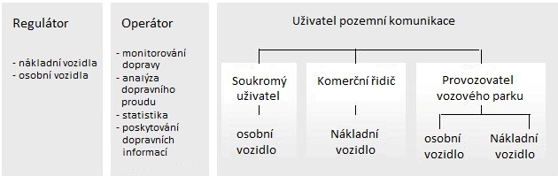
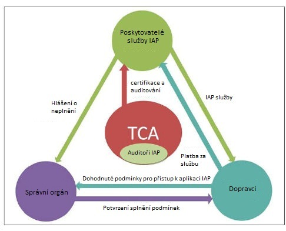

# EXTRAKT z české technické normy

**Extrakt nenahrazuje samotnou technickou normu, je pouze informativním materiálem o normě.**

ICS 35.240.60

**Elektronické vybírání poplatků (EFC) – Služby přidané hodnoty založené na využití palubního zařízení EFC**

TNI CEN/TR 16219 — třídicí znak 01 8395

Platí od listopadu 2011 67 stran

## Úvod

Tato technická zpráva **analyzuje technickou proveditelnost využití EFC OBE pro poskytování dalších služeb**, běžně nazývaných služby s přidanou hodnotou (VAS). Tyto služby mohou být poskytovány buď uvnitř vozidla řidiči, mimo vozidlo správci pozemní komunikace, přepravní společnosti, nebo široké veřejnosti.

Předmět zprávy zahrnuje zkoumání vhodnosti dostupných informací ze senzorů, datových prvků, komunikačního média a funkcí rozhraní člověk stroj (HMI) pro podporu plánovaných hromadných služeb, jako jsou například management vozového parku, management přepravy nebezpečného zboží/zvířat, automatické tísňové volání eCall a další.

Zpráva pracuje s metodikou, která spočívá nejprve v sestavení specifických požadavků aplikací pro každou třídu, následně pak ve stanovení požadavků na EFC aplikace, a nakonec v analýze potenciálních synergií a předpokladů pro společné dodávky těchto služeb. Analýza se snaží zahrnout dvě hlediska, a to obchodní a technický pohled. Zpráva dále analyzuje, jak mohou být tyto služby realizovány, aniž by byly ohroženy bezpečnostní požadavky poskytovatele služby EFC zodpovědného za OBE a za proces zpoplatnění. Analýza ústí v soubor doporučení, způsobů, jak by bylo možné předpoklady pro společné dodávky VAS s EFC zlepšit. Analýza v této zprávě ukazuje, že **určité předpoklady** nutné pro VAS **nejsou v současných normách EFC uvedeny**.

## Užití

Tato technická zpráva je zajímavá jak pro **orgány státní správy**, ukazuje potenciál regulatorních aplikací na platformě EFC, identifikuje mezery v normalizaci. Tak i pro **komerční subjekty**, které mají za cíl integrovat VAS do OBE. Výrobci jednotek tuto normu ocení pro její široký pohled na možnosti VAS vzhledem k platformě EFC a také kvůli analýze přístupů k VAS v různých zemích.

## 1 Předmět technické zprávy

Předmět této zprávy zahrnuje jak původní význam VAS, tedy dodatečné služby pro uživatele základní služby EFC, tak i přidanou hodnotu vytvořenou pro provozovatele systému zpoplatnění.

Takové dodatečné služby a aplikace (VAS) vytváří další hodnotu pro uživatele, a to buď tak, že je hodnota vytvořena novou službou přímo pro něj, nebo, v případě regulatorních služeb, tím, že kombinuje několik funkcí v jediném zařízení, čímž odstraňuje nutnost instalovat a udržovat několik kusů zařízení současně.

Tato zpráva analyzuje všechny telematické aplikace, které mohou být dodávány jako VAS na EFC. Analýza se týká požadavků na aplikace VAS a vhodnosti prostředků, které EFC systém nabízí, předpokladů, obchodní a technické architektury systému, včetně otázek řízení a distribuce práv, bezpečnostních aspektů a ochrany soukromí.

## 2 Citované normativní dokumenty

Tato zpráva cituje 8 zdrojových norem, mezi nimi jsou jak základní normy EFC tak i definice aplikačního rozhraní pro autonomní systémy.

EN ISO 14906:2004 Dopravní telematika – Elektronický výběr poplatků – Definice aplikačního rozhraní pro radiový přenos na krátkou vzdálenost (DSRC)

EN 15509:2007 Dopravní telematika – Elektronický výběr poplatků (EFC) – Aplikační profil interoperability pro DSRC

## 3 Termíny a definice

V této kapitole je obsaženo 6 termínů, mezi jinými i

**3.2 EFC platforma pro VAS** _(EFC platform for VAS)_
platforma EFC pro poskytování telematických služeb obsahuje soubor jednoho nebo více komponent ve vozidle (OBE), případně zařízení na infrastruktuře a centrálního zařízení, ale také řadu obchodních pravidel a právní rámec. Obchodní pravidla jsou institucionální uspořádání s přesně určenými povinnostmi, vlastnictvím, distribucí práv, certifikací a smluvními vztahy

**3.5 integrátor služeb na pozemních komunikacích (ORSI)** _(On-road Service Integrator)_
integrátor služeb na pozemních komunikacích poskytuje uživateli jak služby mýtného, tak i nabídky VAS a jako takový zahrnuje role a odpovědnosti Poskytovatele služeb EFC stanovené v normě ISO 17573 a další odpovědnosti jako poskytovatele VAS

## 4 Zkratky

V této kapitole je obsaženo 40 zkratek, mezi jinými i

VAS služba s přidanou hodnotou _(Value Added Service)_

## 5 Pozadí a kontext

Tato kapitola obsahuje výchozí body a cíle, motivaci a kontext VAS. Motivace k zavedení VAS uvádí pro různé role v systému, například pro výběrčího je jedna z uvedených motivací snaha urychlit zavádění EFC zařízení. Dále jsou zde rozebírány zkušenosti s VAS a důvody nepříliš velkého rozšíření.

Cílem této zprávy je vytvořit podmínky pro poskytování VAS na EFC platformách, za prvé určením které požadavky různých VAS jsou splněny EFC OBE, a které úpravy mohou být požadovány, aby určité VAS byly možné.

Při analýze kontextu EFC je zmiňován klasický model „výběrčí mýtného a uživatel“ oproti novému pojetí s poskytovatelem služby mezi nimi a s tím související termín interoperabilita. Nové pojetí je zmiňováno v souvislosti s evropským projektem CESARE a službu evropského elektronického mýtného EETS.

Analýza základních EFC norem ISO a CEN ukazuje, že EFC normy mají potenciál být užitečnými platformami pro definování VAS služeb, ale žádný výslovný odkaz na VAS v současné době neexistuje.

**Obr. 1** Klasifikace ITS aplikací sídlících v OBE podle typu uživatele (Obr. 2 normy)

Pro pochopení kontextu rozmanitosti ITS aplikací by mohl pomoci obrázek 1. Tento obrázek klasifikuje doménu ITS aplikací z pohledu „kdo má prospěch“, tj. z pohledu konečného příjemce.

Dále je v této kapitole proveden rozbor ITS akčního plánu. A v následujícím článku pak rozbor několika evropských výzkumných projektů se zabývajících se tématem multi-aplikační platformy, otevřenými ITS architekturami a modely rolí pro společné poskytování služeb. Jsou to projekty:

  - Univerzální palubní jednotka (UOBU)

  - Globální systém pro telematiku (GST)

  - Konvergence služeb pomocí GNSS (GSC)

V poslední části této kapitoly je uvedena a stručně popsána struktura normalizačních institucí CEN, ISO a ETSI ve vztahu k ITS.

## 6 ITS Aplikace

Součástí této kapitoly je roztřídění aplikací ITS do tříd, tak aby bylo možné skupinové posouzení jejich možností a požadavků a aby mohly být dodávány jako VAS k EFC.

ITS aplikace se nejlépe seskupí do tříd na základě povahy dané služby, kterou poskytují uživateli. Aplikace v rámci každé třídy jsou stejného logického typu a sdílejí společnou sadu funkčních a technických požadavků. Seskupení těchto aplikací do tříd (viz následující tabulka) umožňuje účinnější a koordinovaný přístup k rozvoji různých řešení.

**Tab. 1** Stručná charakteristika tříd aplikací VAS

<table>
<thead>
<tr class="header">
<th><blockquote>

Aplikace VAS

</blockquote></th>
<th>Popis</th>
</tr>
</thead>
<tbody>
<tr class="odd">
<td><ol type="1">
<li>
Management vozového parku;
</li>
</ol></td>
<td>Zahrnuje všechny VAS aplikace, které umožňují uživateli řídit investice do vozidel, zvýšit efektivitu a snížit celkové náklady na dopravu.</td>
</tr>
<tr class="even">
<td><ol start="2" type="1">
<li>
Zábava;
</li>
</ol></td>
<td>Poskytují řidiči a cestujícím služby spojené s médii a informacemi přenášenými ze vzdáleného zdroje. Tyto aplikace umožňují stahování multimédií na OBE, které pak přesměrovává data do palubních zařízení.</td>
</tr>
<tr class="odd">
<td><ol start="3" type="1">
<li>
Platba;
</li>
</ol></td>
<td>Umožňují mobilní, bezdrátové transakce pro služby jako jsou EFC pro zpoplatněné silnice, parkoviště, trajekty, průjezdné (drive-through) restaurace a čerpací stanice s možností platby u čerpadla.</td>
</tr>
<tr class="even">
<td><ol start="4" type="1">
<li>
Kooperativní bezpečnost silničního provozu;
</li>
</ol></td>
<td>Jsou navrženy tak, aby zlepšily řízení provozu na pozemních komunikacích, zvýšily účinnost a efektivitu silniční dopravy a zlepšily celkový „zážitek“ řidiče.</td>
</tr>
<tr class="odd">
<td><ol start="5" type="1">
<li>
Asistence řidiči;
</li>
</ol></td>
<td>Jsou určeny pro zlepšení bezpečnosti vozidel a bezpečnosti silničního provozu. Např. eco-drive asistence, zobrazování dopravních značek ve vozidle, varování před neúmyslným výjezdem z jízdního pruhu, management průjezdu křižovatkou, asistence při změně jízdního pruhu.</td>
</tr>
<tr class="even">
<td><ol start="6" type="1">
<li>
Komunikace;
</li>
</ol></td>
<td>Proaktivní přístup řidiče k vnějším datům, tak i externě generované informace publikované pro řidiče třetí stranou.</td>
</tr>
<tr class="odd">
<td><ol start="7" type="1">
<li>
Navigace a dopravní informace;
</li>
</ol></td>
<td>Tyto aplikace zahrnují navádění na trasu, upozornění na dopravní zácpy a nabídku objízdné trasy, body zájmu a upozornění na volná parkovací místa a informace o dopravním provozu.</td>
</tr>
<tr class="even">
<td><ol start="8" type="1">
<li>
Sběr dopravních dat;
</li>
</ol></td>
<td>Poskytují orgánům cenné informace pro řízení stávající silniční infrastruktury a plánování budoucích projektů generováním statistik o použití pozemních komunikací v průběhu času.</td>
</tr>
<tr class="odd">
<td><ol start="9" type="1">
<li>
Záznam použití vozidlem;
</li>
</ol></td>
<td>Poskytují řidiči knihu jízd automatickým sběrem informací o ujeté vzdálenosti, době jízdy a případně i data trasy.</td>
</tr>
<tr class="even">
<td><ol start="10" type="1">
<li>
Regulatorní aplikace.
</li>
</ol></td>
<td>Aplikace požadované zákonem nebo vytvořené s cílem usnadnit plnění tím, že poskytují relevantní data příslušným orgánům. Např. eCall, čtení tachografu, sledování přepravy nebezpečných věcí a přepravy hospodářských zvířat, řízení přístupu, řízení kvót a aplikace dohledu.</td>
</tr>
</tbody>
</table>

## 7 Architektura

Tato kapitola obsahuje analýzu systémové architektury EFC z různých hledisek. Je to obchodní hledisko a technické hledisko.

Obchodní hledisko, nebo Organizační hledisko se zaměřuje na aktéry a zainteresované strany, systém řízení a distribuce práv, a modely komerčního poskytování a využívání služeb.

  - Hledisko platformy technického řešení, nebo informační, výpočetní a inženýrské hledisko se zaměřuje na data související s danou službou, komponenty technického řešení služeb a jejich rozhraní a interakce, popsané koncepčním způsobem v technické architektuře.

Tato dvě hlediska jsou popsána v článcích této kapitoly.

Komunikační architektura pro inteligentní dopravní systémy se zaměřením na inženýrské a technologické hledisko se nachází v návrhu ETSI EN 302 665 Inteligentní dopravní systémy - Komunikační architektura. Tento návrh normy stanoví globální komunikační architekturu pro komunikační spojení inteligentních dopravních systémů.

**7.2 Obchodní architektura**

Obchodní architektura pro aplikace ITS je v této zprávě definována níže uvedenými šesti hlavními skupinami zúčastněných stran. Tato architektura je navržena na základě výstupu z evropských projektů.

1)  Uživatel služby;

2)  Výběrčí mýtného;

3)  Poskytovatelé služeb s přidanou hodnotou (Poskytovatelé VAS);

4)  Úřady státní správy;

5)  Poskytovatel služby pro elektronický výběr mýtného (EFC SP);

6)  Integrátor služeb na pozemních komunikacích (ORSI).

**7.3 Technická architektura**

Technická architektura pro VAS na koncovém zařízení EFC se skládá z technických celků:

1)  Koncové zařízení EFC a VAS

2)  Centrum integrátora služeb

3)  Zařízení na straně infrastruktury

4)  Centrum poskytovatele VAS

## 8 Požadavky na aplikace

**8. 1 Požadavky na VAS Aplikace**

Tato kapitola obsahuje kategorizované požadavky na konkrétní třídy VAS aplikací, tak jak jsou definovány v kapitole 6 ITS Aplikace. Požadavky na VAS jsou seskupeny do šesti funkčních oblastí a předloženy ve formě tabulek pro jednotlivé třídy aplikací, popsané v samostatných článcích. Tabulky jsou sestaveny jako seznam požadavků pouze na funkční oblast (sloupce); není tam žádný logický vztah mezi záznamy v jedné řádce.

Šest funkčních oblastí zahrnuje shromážděná data, komunikační služby OBE, OBE HMI, výstup VAS do centrálního systému, provozní charakteristiky a zařízení na infrastruktuře.

Například článek 8.1.8 Požadavky třídy aplikací Navigace a dopravní informace obsahuje následující požadavky

**
**

**Tab. 2** Požadavky třídy aplikací Navigace a dopravní informace (viz tabulka 8 normy)

| Shromážděné údaje           | Komunikační služby OBE                   | HMI funkce                                                                       | Výstup VAS | Provozní charakteristiky | Zařízení na straně infrastruktury |
| --------------------------- | ---------------------------------------- | -------------------------------------------------------------------------------- | ---------- | ------------------------ | --------------------------------- |
| Data pohybu vozidla: polohy | Připojení ke službě dopravních informací | Příslušné oznámení zpráv navigace a dopravních informací pro uživatele při jízdě | Žádný      | Dostupnost               | DSRC vysílače (volitelně)         |

Článek 8.1.11 požadavky na regulatorní aplikace obsahuje požadavky jak na eCall tak i na další aplikace jako je například tachograf, sledování přepravy zvířat, řízení přístupu a správa kvót a na aplikace dohledu

**8.2 Požadavky EFC aplikace**

Tento článek obsahuje rozepsané požadavky (každý požadavek je dále upřesňován) na systém EFC v těchto třídách:

  - vysokoúrovňové požadavky na systém EFC, např. „EFC systém musí zajistit spravedlivé a rovné zacházení s uživateli“,

  - funkční požadavky na systém EFC, např. „jeho rozhraní jsou po celou dobu v souladu s příslušnými normami“,

  - požadavky na výkon a přesnost, např. „Koncové zařízení musí splňovat definované požadavky na přesnost podle dat zpoplatnění“,

  - požadavky na zabezpečení, např. „Data zpoplatnění musí být chráněna před neúmyslnou nebo úmyslnou manipulací, změnou nebo vymazáním“,

  - právní a institucionální požadavky, např. „Řešení zpoplatnění musí být navrženo pro neustálou změnu v pravidlech zpoplatnění“ a

  - požadavky na OBE, např.: „Požadavky koncových zařízení na EFC v GNSS/CN systémech“

**8.3 Aplikace pro VAS**

Tento článek rozebírá, které ITS aplikace (viz kapitola 6) se jeví jako nejvhodnější pro dodávání jako VAS ke službě EFC. Vhodnost je analyzována s ohledem na dva základní aspekty tohoto problému:

  - **Technické aspekty**: Jedná se o posouzení technických požadavků VAS a EFC aplikací, především zachycené v tabulkách obsažených v článcích výše, které stanoví, zda je daná aplikace dobrou volbou a kde mohou existovat synergie.

  - **Obchodní aspekty**: Úspěšné dodávání VAS vyžaduje také vhodnost pro EFC prostředí v souvislosti s obchodními aspekty, jako je shoda v institucionálním uspořádání, režimu certifikace, právním prostředí a distribuci práv. Úvahy o životním cyklu vybavení a služby musí být rovněž začleněny.

Například článek 8.3.8 Navigace a dopravní informace uvádí tyto aspekty:

  - Technické aspekty: Existuje dobrá shoda s ohledem na základní požadavky na polohu a komunikace. GPS přijímač by se mohl dobře použít jak pro EFC, tak i pro navigaci. Neexistuje však synergie s ohledem na požadavky na palubní mapy, které vyžadují dobré rozlišení a zobrazení.

  - Obchodní aspekty: Navigace se stala převažující aplikací v osobních vozidlech. Nelze očekávat, že navigace jako taková bude dodávána jako VAS k EFC, ale spíše přes samostatné, již existující zařízení.

## 9 Integrace VAS s EFC

V článcích této kapitoly jsou analyzovány podrobněji ty VAS, které byly v předchozí kapitole identifikovány jako potenciálně vhodné pro integraci do platformy EFC. Požadavky VAS jsou srovnány s požadavky EFC aplikace podle těchto hlavních hledisek:

  - Dostupnost dat, včetně případných synergií a/nebo chybějících prvků;

  - Systém distribuce práv, včetně odpovědností rolí ve vztahu ke službě a shromážděným datům;

  - Provozní a bezpečnostní požadavky.

Jedná se o aplikace management vozového parku, platba, sběr dopravních dat, záznam použití vozidlem a regulatorní aplikace (tachograf, sledování přepravy nebezpečného zboží a hospodářských zvířat, řízení přístupu a správa kvót a aplikace dohledu).

## 10 Předpoklady pro podporu VAS

Tato kapitola zmiňuje 3 hlavní podmínky návrhu pro integraci VAS do OBE. Ty jsou:

1.  existence synergií, tj. přínosy ze společné dodávky po technické i obchodní stránce,

2.  funkce zpoplatnění nesmí být žádným způsobem narušena VAS aplikací a

3.  architektura platformy včetně souvisejících provozních a ekonomických aspektů dodávání mýtného a VAS skrze stejné OBE.

Článek 10.2 Bezchybná funkce mýtného, řeší překážky v podobě rizik aplikace VAS dodávané současně s výběrem mýtného. Kromě toho jsou pro mýtné platformy stanoveny předpoklady, které jim umožní poskytovat VAS, aniž by riskovaly funkční charakteristiky mýtného. Článek 10.3 pak analyzuje možné architektury základní platformy.

**10.2 Bezchybná funkce mýtného**

Požadavky EFC aplikace, které byly popsány v 8.2 a musí být splněny nezávisle na VAS aplikaci. To zahrnuje nepřetržitou detekci všech událostí zpoplatnění včetně pravidelných výměn dat zpoplatnění, v naplánovaném čase, stejně jako komunikace se zařízením na straně infrastruktury a mobilními jednotkami dohledu. Z tohoto důvodu je vhodné, aby výpočtová architektura byla v mýtné platformě, která umožní provoz EFC a VAS aplikace s definovanou dostupností, funkčními charakteristikami a zabezpečením. V neposlední řadě se v tomto článku řeší i problematika certifikace. Kdy integrace VAS do platformy pro EFC může způsobit zneplatnění certifikátu.

**10.3 Architektura platformy**

Existuje celá řada možných přístupů k technické architektuře pro platformu mýtného podporující VAS, kde mohou být tyto definovány rozsahem integrace mezi aplikacemi mýtného a VAS. Tento článek se věnuje popisu 3 možností integrace Platformy pro VAS a EFC, každou možnost diskutuje i s jejími výhodami i nevýhodami. Jedná se o tyto možnosti propojení:

  - volná vazba mezi platformami a aplikacemi výběru mýtného a VAS,

  - Plně integrovaná architektura, kde se funkčnost mýtného a VAS dodávají na stejné platformě. A

  - částečně integrovaná, kde VAS „kompatibilní s mýtným“ může být integrována na stejné platformě, vedle samostatné platformy pro VAS „nekompatibilní s mýtným“.

## 11 Příležitosti pro zlepšení prostředí pro VAS

Tato kapitola analyzuje vyhlídky pro VAS. Zmiňuje faktory omezující obchodní příležitosti:

  - Vyhrazené platformy: Až donedávna, z důvodu dodržení funkčních charakteristik, nebylo EFC zařízení určeno na podporu velké škály VAS.

  - Příliš malý a roztříštěný trh: EFC zařízení, které je schopno poskytovat VAS, je v současné době nasazeno pro systém zpoplatnění nákladních vozidel, což je relativně malý trh.

  - Nedostatek volného trhu poskytovatelů služeb: Historicky bylo EFC zařízení dodáno přímo od výběrčího mýtného uživateli. EETS vytváří konkrétní příležitosti pro VAS.

Naopak příležitosti, které tato norma zmiňuje, jsou:

  - Pro nákladní vozidla budou regulatorní aplikace (viz Akční plán) tržním hybatelem, protože podpora těchto aplikací je povinná v každém vozidle.

  - Jak pro osobní, tak i nákladní vozidla se kromě regulatorních aplikací očekává, že přenosná zařízení (PDA, i-Phone, atd.) a navigační systémy budou platformami usnadňující nasazení širšího spektra telematických aplikací na trhu.

**11.3 Podpora v normalizaci**

VAS k EFC v současné době nemají významnou roli v práci ve WG1. Analýza v této TR ukazuje, že vyhlídky na poskytování VAS společně s EFC se mohou výrazně zlepšit, pokud budou některá opatření specifikována a tato opatření také uvádí. Například:

  - Norma na architekturu EFC, ISO 17573, v současné době nepočítá s ustanoveními pro VAS. Mohlo by být vhodné zavést model inspirovaný myšlenkami projektů GST a GSC a zahrnout obchodní architekturu a technickou architekturu.

Dále je v této kapitole doporučena oblast, kde by měly vzniknout další pracovní položky.

  - definice multi-aplikační platformy pro regulatorní aplikace v rámci režimu založeném na certifikaci funkčním způsobem,

  - stanovení některých generických základních palubních služeb v normalizované formě.

## Příloha A (informativní) Příklady přístupů k VAS na EFC

Tato příloha uvádí příklady VAS obsažené v několika evropských systémech EFC. Příklady byly poskytnuty členy CEN/TC78/WG1 za Českou republiku, Francii, Německo, Itálii, Japonsko, Koreu, Norsko a Švýcarsko. Dále v textu uvádíme příklad za Koreu, ostatní jsou (až na Německo), rozsahově podobné)

**Článek A.7 Přístupy k VAS v Koreji.**

Dva druhy DSRC komunikačních médií, infračervené DSRC a 5,8 GHz RF DSRC, byly zavedeny v Koreji od ledna 2003. Více než 4 miliony OBE bylo nasazeno až do června 2010, jako forma autopříslušenství pro palubní desku. Podíl využití ETC služby na dálnicích dosáhl více než 45 % v roce 2010, a očekává se nárůst na 70 % do konce roku 2012.

Protože každý DSRC komunikační protokol byl přesně stanoven podle norem ISO 15628 (aplikační vrstva DSRC) a ISO 14906 (datové struktury EFC), jsou ETC OBE připraveny podpořit další ITS služby, například parkování, kontrolu přístupu apod., jak je popsáno v normě ISO.

Do dnešní doby existuje několik pokusů o integraci ETC OBE s jinými zařízeními:

  - OBE s mobilním telefonem: IC karty OBE mohou být dotazovány mobilním telefonem pomocí technologie Bluetooth, a nabíjeny kreditem z mobilního telefonu pomocí Bluetooth a mobilní sítě. Je to telekomunikační společnost, která distribuuje tyto OBE uživatelům, což znamená, že se nejedná o tradiční bilaterální vztahy mezi uživatelem a výběrčím mýtného, ale mnohostranné, tržní uspořádání.

  - OBE pro dopravní informace: Data vozidlové sondy na dálnici a důležitých dopravních tepnách v metropolitní oblasti jsou shromažďována z milionů ETC OBE a jsou zpracována tak, aby vytvořily informace o dopravě v reálném čase, a pak byly předávány zpět do zařízení pro proměnné dopravní značení ve vozidlech, Internetu, ARS a broadcast vysílání. Na trhu jsou rovněž k dispozici vysokoprofilové DSRC OBE jako samostatný produkt OBE s hlasovým sdělováním, plně integrovanými navigačními terminály apod.

V Koreji se staví tzv. všudypřítomné komunikační prostředí, a proto musí být počet těchto pokusů o integraci ETC OBE s VAS navýšen.

## Příloha B (informativní) Příklad pro architekturu regulatorního rámce

Tato příloha uvádí Australský model pro regulatorní aplikace. Kdy Austrálie vyvinula a zavedla nový způsob managementu nákladních vozidel v souvislosti s dodržováním pravidel přístupu na pozemní komunikace. Regulatorním rámcem se nazývá program inteligentního přístupu IAP. IAP představuje jedinečný národní rámec, zahrnující regulatorní, smluvní a provozní prvky pro monitoring aktivit nákladních vozidel a generování automatických hlášení o nedodržení podmínek.

**Obr. 2** Provozní model IAP (viz obrázek B.1 normy)

Technické požadavky pro účast v IAP pro poskytovatele služeb jsou založené na funkčních charakteristikách. To znamená, že IAP definuje požadované výstupy, a je na každé společnosti, která chce být certifikována jako poskytovatel služeb IAP, stanovit, pro splnění požadavků TCA, že jeho zařízení a související centrální systémy poskytují požadované výstupy.

## Bibliografie

Tato kapitola obsahuje 14 položek, mimo jiné také Rozhodnutí EETS, Směrnice EETS, ITS akční plán a další.
