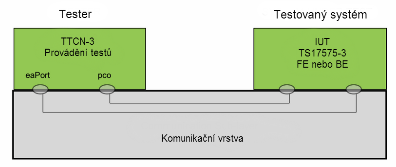

# EXTRAKT z technické specifikace ISO

**Extrakt nenahrazuje samotnou technickou normu, je pouze informativním materiálem o normě.**

ICS 35.240.60; 03.220.20

<table>
<colgroup>
<col style="width: 74%" />
<col style="width: 25%" />
</colgroup>
<thead>
<tr class="header">
<th><strong>Elektronický výběr poplatků (EFC) – 
Posouzení shody zařízení s ISO/TS 17575-3 – 
Část 2: Abstraktní sestava zkoušek</strong></th>
<th><strong> 
ČSN P 
CEN ISO/TS 
16410-2 
</strong></th>
</tr>
</thead>
<tbody>
</tbody>
</table>

12 stran

**Úvod**

Technická specifikace 16410-2 patří do skupiny normativních dokumentů umožňujících zavedení interoperabilních autonomních mýtných systémů. Důležitou součástí této skupiny jsou technické specifikace 17575 části 1 – 4 popisující datové struktury a způsob komunikace v rámci systému poskytovatele služby (Service Provider). Technická specifikace 17575 část 3 je zaměřena na popis datových struktur, prostřednictvím kterých je definován způsob výběru mýta v konkrétní oblasti, tarify i vlastní definice zpoplatněných objektů.

Poznámka: Extrakt přejímá původní číslování kapitol

**Užití**

Tato technická specifikace je určena jako návod posouzení shody autonomní mýtné palubní jednotky a centrálního systému s technickou specifikací 17575-3 jak z pohledu podporovaných schopností, tak z pohledu chování. Na základě výsledků zkoušek lze udělit schválení typu. Uživateli jsou technici, kteří implementují software pro mýtné jednotky, a pracovníci zkušebních laboratoří.

**Souvisící normy (výběr)**

Tato technická specifikace souvisí s následujícími normativními dokumenty: ISO/TS 17575-3 Definice aplikačního rozhraní pro autonomní mýtné systémy, část 3: Kontextová data, ISO/IEC 9646 Propojení otevřených systémů (OSI), Metodologie posuzování shody.

**1 Předmět normy**

Tato norma definuje abstraktní sestavu zkoušek (ATS) pro posouzení shody koncového zařízení a centrálního zařízení s požadavky ISO/TS 17575-3.

Cílem je poskytnout základ pro zkoušení shody koncových a centrálních zařízení v systému elektronického výběru poplatků, který se zakládá na autonomním palubním zařízení (OBE); tento základ umožní interoperabilitu mezi různými zařízeními od různých výrobců.

**3 Termíny a definice**

Tato technická specifikace definuje čtyři termíny.

Dále tato kapitola obsahuje 9 zkratek, například:

DUT – zkoušené zařízení _(Device Under Tests)_

IUT – zkoušená implementace _(Implementation Under Test)_

**5 Abstraktní popis zkoušek**

Zkoušet lze buď implementaci centrálního systému (back end), nebo koncového zařízení (front end). V obou případech je součástí zkoušené implementace i komunikační vrstva. Zkouška se zahájí spuštěním sady zkušebních případů zapsaných v jazyku TTCN-3.

Jak je patrné z obrázku 1, testovaný systém (zkoušená implementace) a tester jsou propojeny pomocí komunikační vrstvy definované v ISO TS 17575-2.

**Obr. 1** Architektura testovacího systému (obrázek 1 normy)
**

**6 Neproveditelné zkoušky**

Žádné nejsou známy.

**7 Datové typy abstraktní sestavy zkoušek**

Všechny datové typy potřebné k provedení sady zkušebních případů zapsaných v jazyce TTCN-3 jsou dodány jako moduly ve formátu ASN.1. Jedná se o:

- ContextDataModule: obsahuje kontextová data (ContextData) .

- ChargingModule: obsahuje mimo jiné hlášení mýtného (ChargeReport) a odpověď na něj (ChargeReportResponse).

- EfcModule: obsahuje mýtnou DSRC komunikaci mezi palubní jednotkou a zařízením na infrastruktuře.

- CccModule: obsahuje kontrolní DSRC komunikaci mezi palubní jednotkou a zařízení na infrastruktuře.

- DSRCModule: obsahuje popis pro DSRC komunikaci.

- AVIAEINumberingAndDataStructures: obsahuje popis pro automatickou identifikaci zařízení a vozidla.

**8 Externí funkce**

Definice v TTCN-3 obsahuje tyto externí funkce:

- Inicializace komunikační vrstvy

- Uvolnění komunikační vrstvy

**9 Filtrování zpráv**

Aplikační datové jednotky (ADU) posílané mezi UIT a testerem, které nejsou součástí testovacích cílů, by měly být ignorovány. Do TTCN-3 kódu je proto přidán příkaz, kterým se všechny ADU nezpracované skriptem pro účely zkušebních případů, ignorují.

**10 Konvence pro pojmenovávání**

Pro vyšší přehlednost je v rámci TTCN-3 doporučeno používat určité konvence při tvorbě identifikátorů. Konvence určují používání velkých a malých písmen, předpon a přípon a dělení identifikátorů do částí oddělených „podtržítkem“.

V technické specifikaci je dále na příkladech ukázán způsob pojmenovávání různých objektů v rámci TTCN-3, viz tabulka 1.

**Tab. 1** Příkad konvencí pro pojmenovávání identifikátorů v TTCN-3

| **Prvek jazyka**               | **Konvence pojmenování**             | **Předpona** | **Přípona** | **Příklad**     | **Poznámka** |
|--------------------------------|--------------------------------------|--------------|-------------|-----------------|--------------|
| Modul                          | Počáteční písmeno velké (camel case) | žádná        | žádná       | ContextData_TE  |              |
| Skupina testů                  | Všechna písmena velká                | žádná        | žádná       | TP_RT_PS_TR     |              |
| Skupina položek v rámci modulu | Počáteční písmeno velké              | žádná        | žádná       | Valid_Behaviour |              |

Popsán je také způsob pojmenovávání zkušebních případů, ze kterého je možné zjistit:

- skupinu zkušebního případu,

- zařízení, kterého se zkouška týká (Back End nebo Front End),

- typ zkoušky (pozitivní nebo negativní),

- sekvenční číslo zkoušky.

Dále je popsáno tvoření jmen modulů TTCN-3.

- \_TypesAndValues: modul obsahuje všechny datové typy a konstanty

- \_Functions: modul obsahuje funkce TTCN-3 určené pro porovnávání a ověření správnosti výsledků

- \_Templates: modul obsahuje šablony odesílaných a přijímaných zpráv

- \_Pixits: modul obsahuje rozšířené informace o implementaci (PIXIT) pro automatickou konfiguraci

- \_PICS: modul obsahuje definice PICS

- \_TCs: modul obsahuje zkušební případy

- \_TE: modul obsahuje řídící část zkušebního skriptu

## Příloha A (normativní) Knihovna TTCN-3 modulů pro koncové zařízení a centrální systém

Jedná se o elektronickou přílohu tvořenou dvěma archivy

1.  „ContextData_ttcn3_asn1.zip“, který obsahuje skripty TTCN-3 a definice datových typů v ASN.1.

2.  „ContextData_html_doc.zip“, HTML dokumentace.

## Příloha B (informativní) Proforma formulář PIXIT pro koncové zařízení a centrální systém

Proforma protokolu s rozšířenými informacemi o implementaci pro potřeby zkoušení centrálního systému a koncového zařízení (PIXIT).
