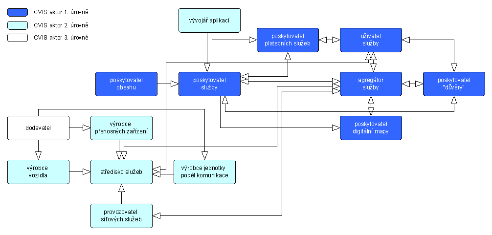
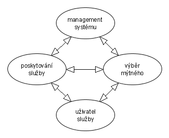
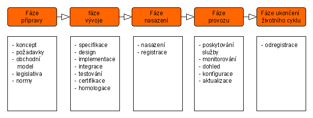
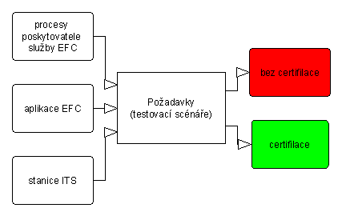

# EXTRAKT z technické zprávy CEN

**Extrakt nenahrazuje samotnou technickou normu, je pouze informativním materiálem o normě**

ICS 03.220.20, 35.240.60

**Elektronický výběr mýtného – Pokyny pro aplikace EFC nainstalované ve stanicích ITS ve vozidle**

CEN/TR 16690

104 stran

## Úvod

Tato technická zpráva se zaměřuje především na poskytnutí přehledu možných kombinací služby elektronického výběru poplatků (dále jen jako EFC) a nově se rozvíjejících služeb na platformě kooperativních ITS (dále i jako C-ITS). Zpráva poskytuje návrhářům služeb C-ITS informace o povaze a specifikách služeb EFC. Také poskytuje zainteresovaným stranám v systému EFC návod, jak lze služby EFC zahrnout do souboru služeb poskytovaných v prostředí C-ITS. Pro tento účel byl ve zprávě zvolen následující přístup:

  - > Poskytnout přehled o dostupné terminologii, architekturách a požadavcích jak pro EFC tak i pro C-ITS.

  - > Identifikovat hlavní požadavky služeb EFC mající dopad na stanici ITS.

  - > Poskytnout přehled jak mohou být do kontextu C-ITS zahrnuty role a funkce v EFC (EETS).

  - > Identifikovat základní technickou architekturu umožňující funkci EFC v prostředí C-ITS.

  - > Analyzovat obchodní modely a poskytnout příklad obchodní architektury pro EFC v C-ITS.

  - > Zdůraznit potenciální synergie mezi „ekosystémy“ EFC a ITS.

Poznámka: Extrakt přejímá původní číslování kapitol.

## Užití

Tato technická zpráva je **zajímavá** hlavně pro **poskytovatele služby mýtného.** Jako konceptuální dokument stanoví co očekávat v případě přesunutí služeb EFC ze specializovaného HW na sdílený v rámci jednotky pro kooperativní systémy (stanice ITS). Jedná se hlavně o **studii**, která se snaží popsat veškeré aspekty integrace služby EFC do stanice ITS a to jak z pohledu EFC, tak i z pohledu C-ITS.

Pro **výběrčí mýtného** je tato technická zpráva zajímavá tím, že identifikuje požadavky na EFC v kontextu C-ITS, které mohou být v první fázi použity jako základ povinné certifikace.

**Výrobce zařízení** a dodavatele telematických systémů tato technická zpráva informuje jakými zdroji a prostředky by měla stanice ITS disponovat, aby na ní bylo možno „spustit“ službu EFC.

V neposlední řadě je zpráva důležitá pro zástupce standardizačních organizací a Evropské Komise, neboť identifikuje oblasti, pro které nejsou v tuto chvíli stanovena žádná pravidla (normy). Zpráva tedy může být použita pro návrh nových pracovních položek (norem).

## 1 Předmět technické zprávy

Tato technická zpráva obsahuje analýzu technické a provozní proveditelnosti použití obecné stanice ITS pro aplikace EFC. Zpráva zahrnuje:

  - > Popis kontextu kooperativních inteligentních dopravních systémů (C-ITS) a stanic ITS (ITS-S)

  - > Popis kontextu EFC aplikací

  - > Načrtnutí základních rolí a konceptů pro oba „ekosystémy“

  - > Identifikace hlavních požadavků pro provoz EFC aplikací na ITS stanici

  - > Souhrn požadavků na funkcionalitu, provoz a zabezpečení pro stanici ITS s aplikací EFC

  - > Popis prolnutí rolí mezi kooperativními ITS a EFC

  - > Úvahy na téma certifikace EFC v kontextu kooperativních ITS

  - > Pokyny a doporučení k další standardizaci a

  - > Zdůraznění bezpečnostních prvků EFC, které musí být přeneseny do prostředí C-ITS.

Tato zpráva se zaměřuje na stanici ITS, pouze okrajově, tam kde je to nezbytné, se zabývá i centrální částí systému (také jako back office).

## 2 Souvisící normy (výběr)

Tato zpráva přímo vychází z vybraných norem elektronického mýta (EFC) a kooperativních inteligentních dopravních systémů (C-ITS). V části “normativní dokumenty” je uvedeno 10 norem používaných / odkazovaných touto technickou zprávou a v části literatura pak dalších 50 různých dokumentů.

Mezi jinými to jsou normy zabývajícící se komunikací a architekturou, např. ISO 21217 - architektura CALM (je odkazována celá série CALM), ISO 17573 - architektura systému EFC, službami s přidanou hodnotou CEN/TR 16219 -,služby s přidanou hodnotou na zařízení EFC a v neposlední řadě také bezpečností CEN/TS 16439 - bezpečnostní rámec EFC a ISO/IEC 15408 bezpečnostní technologie - hodnotící kritéria pro zabezpečení IT.

## 3 Termíny a definice

## Tato norma uvádí 22 termínů, jsou zde standardní termíny z oblasti EETS a kooperativních systémů. Například:

**poskytovatel služby** _(toll service provider)_ – právní subjekt poskytující svým zákazníkům služby spojené s mýtným v jedné či více mýtných doménách pro jedno či více tříd vozidel

**stanice ITS** _(ITS station)_ – prvek v komunikační síti, který obsahuje a „spouští“ aplikace ITS-S v určitém vymezeném zabezpečeném a řízeném prostředí skládajícím se z vrstvy služeb ITS, síťové, přenosové a přístupové vrstvy a řídicího a bezpečnostního prvku ITS-S

**kooperativní systémy** _(cooperative systems)_ - podmnožina z ITS, která se zabývá komunikací a sdílením informací mezi stanicemi ITS za účelem zvýšení bezpečnosti, udržitelnosti, účinnosti a pohodlí nad rámec samostatných, nepropojených, systémů.

## 4 Zkratky

Tato norma uvádí 55 zkratek. Mezi jinými například:

**ITS-S** stanice ITS _(ITS station)_

**EETS** evropská služba elektronického mýtného _(European Electronic Toll Service)_

**C-ITS** kooperativní inteligentní dopravní systémy (Cooperative ITS_)_

**C2C-CC** konsorcium pro vozidlovou komunikaci _(car2car communication consortium)_

**CVIS** evroppský projekt kooperativních systémů vozidlo-infrastruktura _(Cooperative Vehicle-Infrastructure Systems)_

**KPI** klíčové ukazatele výkonnosti _(Key Performance Indicators)_

**SLA** dohoda o úrovni služby _(Service Level Agreement)_

**RSE** zařízení podél pozemní komunikace _(Road Side Equippment)_

**OBE** zařízení ve vozidle _(On Board Equippment)_

## 5 Popis kontextu C-ITS

Tato kapitola je analytická (cca 17 stran), shromažďuje na jednom místě, uceleně, **informace** z různých dokumentů a norem **o požadavcích a omezeních C-ITS**, také na tyto zdrojové dokumenty odkazuje.

Článku 5.1 je věnován definici C-ITS nejprve obecně a poté i dle mandátu M453 (nařízení evropským normalizačním orgánům k aktivní práci na standardizaci prvků interoperability C-ITS), dále se zabývé kontextem C-ITS v oblasti aktivní bezpečnosti vozidla C2C-CC (car2car communication consortium) a standardizačních institucí CEN/ETSI/ISO.

Článek 5.2 uvádí **model rolí a obchodní architekturu** C-ITS, tak jak jsou definovány normou ISO 17247 doplněné o výstupy evropských projektů kooperativních systémů (CVIS). Model rolí také obsahuje stanovení zodpovědnosti a povinností s ohledem na bezpečnost dat. Dále je zde uvedena obchodní architektura C-ITS jako distribuovaného systému, která aktéry (viz obr. 1) přiřazuje do jednotlivých odvětví: spotřební, regulační, finanční, technologické, výrobní a poskytování služby.

**Obr. 1** Role C-ITS dle projektu CVIS (obrázek 3 normy)

Článek 5.3 uvádí technickou architekturu systému zahrnující několik typů ITS stanic, od přenosných mobilních zařízení po stanice podél pozemní komunikace. Dále se tento článek zabývá komunikačními a přístupovými technologiemi ITS, kde vyjmenovává různé protokoly a normy, popisuje vyhrazené frekvenční pásmo a také síťovou a přenosovou vrstvu a vrstvu služeb (facilities). Řeší životní cyklus aplikací C-ITS, jako je vytvoření, nasazení a provozování služby. V poslední řadě je v tomto článku zmíněno zabezpečení s odkazem na normu ETSI 21217 (komunikační architektura) a další dokumenty.

Článek 5.4 se věnuje legislativním aspektům vycházejícím z mezinárodního práva, Evropské Směrnice o ITS 2010/40/EU a z „akčního plánu nasazování ITS“. Zmiňuje odkazy na ochranu soukromí uživatele a povinnosti zúčastněných stran vycházející z používání C-ITS aplikací.

Článek 5.5 obsahuje přehled standardizačních aktivit. Uvádí základní seznam norem v gesci ETSI (tzv. základní aplikace C-ITS) i CEN (komunikace, organizační aspekty apod.). Pro CEN i ETSI jsou popsány skupiny, které se standardizací C-ITS zabývají.

Článek 5.6 přináší přehled a obecnou charakteristiku mezinárodních (evropských) výzkumných a vývojových projektů a spolků. Jedná se o projekty: CVIS, SAFESPOT, eCoMove, DRIVE C2X, C2C-CC, EasyWay, COMeSafety a Amsterdam Group.

## 6 Popis kontextu EFC

Tato kapitola (cca 14 stran) je opět analytická, shromažďuje, na jednom místě, uceleně, **informace** z různých dokumentů a norem **o požadavcích a omezeních EFC**, také na tyto zdrojové dokumenty odkazuje. Má velmi podobnou strukturu té předcházející.

V článku 6.1 uvádí definici EFC dle normy ISO 17573.

Článek 6.2 popisuje model rolí a obchodní architekturu EFC, tak jak je definován normou ISO 17573 vycházející z evropského projektu CESARE.

Dále je zde uvedena obchodní architektura EFC sestávající se z rolí v systému EFC (viz .obr 2). Jednotlivé role jsou zde také zevrubně popsány.

**Obr. 2** Role v EFC dle normy ISO 17573 (obrázek 9 normy)

Článek 6.3 uvádí technickou architekturu systému zahrnující, jak autonomní palubní jednotku využívající technologie GNSS a CN (popisuje implementaci), tak i palubní jednotku vybavenou pouze DSRC. Dále jsou zde popsány funkce RSE a centrálního systému výběrčího a provozovatele služby a komunikační a přístupové technologie EFC. V tomto článku je také věnován prostor zabezpečení EFC, opět odkazem na normy a jejich zevrubným popisem.

Článek 6.4 se věnuje „dalším hlavním aspektům“ mj. interoperabilitě, kterou rozděluje na 3 úrovně: technickou, procedurální a smluvní. Důležitým prvkem tohoto článku jsou **„služby s přidanou hodnotou“** (VAS), dle normy CEN 16219. Jsou zde definovány a klasifikovány, jsou vyjmenovány klíčové prvky návrhu a také omezení. Například požadavek na: „neovlivněnou funkci EFC a na neovlivněnou certifikaci“, kdy před certifikací, která je vyžadována v EETS musí být v jednotce již nainstalovány všechny VAS. V tomto článku jsou také zmíněny různé implementace systémů EFC v USA, Asii a Austrálii.

Článek 6.5 identifikuje legislativní aspekty vycházející z mezinárodního práva, Evropské Směrnice o EETS 2004/52/EC, Rozhodnutí 2009/750/EC a příručky pro použití směrnic interoperability EFC. Zmiňuje odkazy na ochranu soukromí uživatele a dat.

Článek 6.6 obsahuje přehled standardizačních aktivit. Uvádí oblasti norem v gesci CEN a odkazuje na mandát M338 o vývoji norem pro interoperabilitu EFC systémů v Evropě.

Článek 6.7 přináší přehled komerčních nasazení EFC systémů. Jsou zde „malé“ implementace EFC (tunely), národní a mezinárodní (interoperabilní).

## 7 Návrh požadavků EFC na stanici ITS

Tato kapitola je analytická a částečně i návrhová, shromažďuje na jednom místě jak požadavky z analyzovaných norem, tak i požadavky nové, vycházející z kombinace požadavků na C-ITS a EFC.

Nejprve jsou popsány obecné požadavky (high level) na EFC, definované v normě CEN 16219, je identifikovaná jejich vazba na různé varianty ITS stanice. V další části kapitoly jsou pak popsané požadavky na EFC jako na registrovanou službu stanice ITS. Ty se dělí do dvou skupin: požadavky na službu EFC jako na součást ITS stanice a požadavky na ITS stanici podporující funkci služby EFC.

Článek 7.2 stanoví požadavky na aplikace EFC (v kontextu C-ITS). U každého požadavku jsou kromě popisu uvedeny podmínky/poznámky, aplikovatelnost a ovlivněné role. Je identifikováno celkem 9 požadavků, například: článek 7.2.9 „Zpětná vazba uživateli (zpoplatněné) pozemní komunikace“, má tento obsah (doslovná citace):

> _„Požadavek: Aplikace EFC musí uživateli poskytnout zpětnou vazbu informující o správné funkci_
>
> _Podmínky/poznámky:_

1)  > _Zpětná vazba musí být poskytnuta prostřednictvím vhodného rozhraní člověk-stroj_

2)  > _Zpětná vazba musí indikovat uživateli, jestli provozní stav aplikace EFC umožňuje použití placených úseků v dané doméně._

> _Aplikovatelnost:_

  - > _stanice ITS ve vozidle_

> _Ovlivněné role:_

  - > _Poskytovatel služby mýtného.“_

Článek 7.3 „Vyplývající požadavky na stanici ITS“ obsahuje ve stejné formě jako předchozí článek 7 technických požadavků (např. přístup k senzorickým údajům), 5 požadavků na zabezpečení (např. zabezpečení a ochrana dat zpoplatnění), 3 provozní požadavky (např. management životního cyklu aplikace EFC).

## 8 Služby EFC v prostředí C-ITS

Tato kapitola (cca 11 stran) obsahuje syntézu předchozích analýz a dopad na EFC v kontextu C-ITS.

Článek 8.1 zavádí služby EFC v prostředí C-ITS, kterými jsou: služba zpoplatnění EFC (DSRC mód), služba zpoplatnění EFC (autonomní mód), služba enforcementu EFC, služba pro posílení lokalizace v EFC. Tyto služby se liší od služeb v prostředí EFC. Například uživatel služby zpoplatnění je pro C-ITS uživatel pozemní komunikace a pro EFC výběrčí mýtného.

Služby EFC mohou vyžadovat pro správnou funkci více než jednu aplikaci běžící v C-ITS (v jednotce vozidla, podél pozemní komunikace a v centrále). Například služba zpoplatnění autonomním EFC vyžaduje tyto aplikace: aplikaci zpoplatnění autonomního EFC ve stanici ITS ve vozidle, aplikaci zpoplatnění autonomního EFC ve stanici ITS v centrále a aplikaci posílení lokalizace ve stanici ITS podél pozemní komunikace.

Článek 8.2 dekomponuje role v životním cyklu EFC služeb na „pod role“. Životní cyklus může být rozdělen do pěti fází: přípravná, vývojová, nasazení, provoz a ukončení, následující obrázek (obr. 4) tyto fáze a jejich náplň demonstruje. Každá z těchto fází je podrobena zkoumání s ohledem na to jaké „aktivuje“ pod-role C-ITS a jaké obsahuje postupy spojené se službami EFC. Tyto role a postupy EFC služby jsou pro každou fázi přehledně popsány formou tabulky.

**Obr. 4** Fáze životního cyklu služeb EFC (obrázek 14 normy)

Článek 8.3 popisuje kombinaci modelů EFC služeb v kontextu C-ITS. Jsou identifikovány vztahy mezi modely rolí EFC a C-ITS, kdy model C-ITS je založen na organizační architektuře, zatímco u EFC nikoliv, kde EFC je implementačně závislé zatímco C-ITS není, atp. Proto vazbu mezi rolemi nelze snadno vytvořit, například téměř neexistují relace 1:1. Je zde popsána (schématem a odstavcem textu) technická architektura EFC v kontextu C-ITS, ze které vychází potřeba vytvořit dvě nové role: poskytovatele služby ve stanici  ITS podél pozemní komunikace a poskytovatele služby ve stanici  ITS ve vozidle. Tyto role se potom dělí o zodpovědnost (její obsah je v hrubých rysech nastíněn) spojenou s poskytováním služby. Vytvořené nové role vedou k novému modelu, který je graficky prezentován. V poslední řadě je v tomto článku zmíněna obchodní architektura EFC v C-ITS (obrázek 4 normy doplněný o toky jednotlivými aktéry).

## 9 Úvahy nad konkrétními implementačními aspekty

Tato kapitola (cca 18 stran) obsahuje popis problematiky spojené s migrací současných systémů EFC na otevřenou či uzavřenou platformu ITS-S v kontextu C-ITS. Dále jsou zde zmíněny provozní i certifikační aspekty, jedná se tedy o jakousi „složku“ na vše „ostatní“ co se nekvalifikovalo na samostatnou kapitolu.

Článek 9.1 Úvod zahajuje kapitolu popisem vzniku požadavků na jednotlivé aplikace otevřené platformy ITS, tu přirovnává k osobnímu počítači a aplikace k programům.

Článek 9.2 popisuje možné synergie vyplývající z přítomnosti služby EFC ve stanici ITS, tedy hlavně výhody plynoucí pro službu EFC. Jedná se například o automatické nastavení poplatku podle informací shromážděných stanicí ITS ve vozidle. Zajímavá je i úvaha o využití frekvence 5,9 GHz alokované pro C-ITS i pro účely EFC (to jak naložit se současným médiem 5,8 GHz autoři neřeší).

V článku 9.3 jsou popsané určité zájmové a kritické oblasti EFC v prostředí C-ITS. Jsou navržené kroky při migraci z uzavřeného systému EFC na otevřenou ITS-S pro celkem 5 výchozích scénářů, v rámci kterých je například řešen i problém dvojího zpoplatnění atp. V části “management zdrojů” jsou popsány hardwarové a komunikační požadavky na ITS-S vyplývající z přítomnosti služby EFC. Požadavky jsou rozděleny na „schopnosti systému“ a „výkonnost systému“, a jsou ke každé skupině uvedeny výčtem, ideální forma pro tzv. „nákupní list“. Důležité je, že aplikace EFC je „jednou z mnoha“ a z principu C-ITS nebude aplikací s nejvyšší prioritou, proto je potřeba mít na zřeteli možnost neprovedení transakce z důvodů konfliktu s aplikací s vyšší prioritou.

Dále je v článku zmíněno monitorování efektivity EFC, které většinou bývá stanoveno smluvně. Stanoveny mohou být zejména požadavky na minimální dostupnost ITS-S ve vozidle a maximální dobu na opravu a výměnu nefunkční ITS-S. Předpokládá se, že monitorování efektivity bude jedna ze služeb stanice ITS.

Článek 9.4 se zabývá vhodností k použití a certifikací. Z pohledu obtížnosti lze tuto problematiku rozdělit na 2 rozdílné úrovně: EFC služba v jedné doméně a interoperabilní EFC služba (např. EETS). Autoři vznášejí otázku certifikace a recertifikace nezbytné při podstatné změně v službě EFC. Vzhledem k tomu, že je nezbytné, aby byla služba EFC certifikována v přítomnosti všech ostatních služeb v ITS-S může jakákoliv „podstatná“ změna i změna jakékoliv z aplikací v ITS-S či aktualizace systému ITS-S vést k opětovné certifikaci služby EFC. Bude na výběrčím mýtného, aby stanovil hranici “podstatné” změny.

**Obr. 5** Požadavky na stanice ITS, aplikace EFC a postupů poskytovatele služby vedoucí k celkové certifikaci systému (obrázek 23 normy)

V článku je věnován (skromný) prostor i aspektům „certifikace“, tedy: shodě se specifikacemi, testům vhodnosti k použití a samotné certifikaci. Certifikace musí proběhnout na několika úrovních (viz obrázek 5) a testy, podmínky ani postupy ještě nejsou stanoveny. Prvním krokem je certifikace vůči požadavkům stanoveným v této technické zprávě v kapitole 7.

V provozní fázi systému EFC budou sledovány klíčové ukazatele výkonnosti (KPI) stanovené v dohodě o úrovni služby (SLA), tento článek přisuzuje povinnost stanovit KPI poskytovateli služby s tím, že se v zásadě nijak neliší od KPI uvedených pro uzavřený systém EFC .

Poslední článek 9.5 “Správa, řízení a zodpovědnost” se zabývá způsobem sdílení dat a prostředků mezi aplikacemi stanice ITS. V multiaplikačním prostředí je stanovena tzv. “regulatorní ITS-S” (horizontální integrace zdrojů = vše se certifikuje), dále “ITS-S pro výběr a zpoplatnění” (vertikální integrace zdrojů = certifikuje se pouze vertikální “silo/blok” s EFC) a “multiaplikační ITS-S” (jak horizontální tak vertikální integrace).

Z technického hlediska mohou nastat dva způsoby implementace ITS-S: stanice s jedním OBE pro všechny aplikace a stanice s více spolupracujícími (uzavřenými) jednotkami OBE. První případ je složitý na implementaci a na zasmluvnění, protože všechny aplikace sdílejí zdroje ITS-S a tudíž nelze zaručit dodržení všech KPI ve všech případech. Druhý případ je pro nasazení výrazně jednodušší, služba EFC má vlastní zdroje a prostředky a tudíž na ní lze klást stejné požadavky jako na uzavřený systém EFC.

U multiaplikační ITS-S je také potřeba zajistit jakým způsobem budou probíhat aktualizace aplikací a jak bude zaručeno, že nedochází po aktualizaci ke konfliktu.

## 10 Pokyny pro další práci

Tato kapitola (cca 5 stran) obsahuje “normalizační” úvahy nad další prací.

V článku 10.1 je popsáno očekávání, že EFC posílí (urychlí) nasazování stanic ITS a jejich základních služeb. Mezi hlavní důvody patří, že uživatelé EFC již znají, že EFC je (bude) povinné a ITS stanice bude nahrazovat jednoúčelovou jednotku EFC již přítomnou ve vozidle. To přinese finanční úspory za HW díky jeho sdílení různými aplikacemi.

Poskytovatelé služeb EFC by měli podporovat EFC na stanicích ITS, protože to povede ke sníženým nákladům. Výběrčí mýtného budou mít v budoucnu daleko menší kontrolu nad jednotkami umístěnými ve vozidle a budou nuceni se více spoléhat na certifikaci a testování ITS stanic.

Jak je uvedeno v článku 10.2 bude z těchto důvodů (viz výše) nezbytné **vytvořit hormonizovaná certifikační a testovací pravidla**, kdy služba EFC běžící ve sdíleném prostředí stanice ITS bude muset splňovat stejné nároky jako ta samá služba běžící na samostatném zařízení. Výběrčí mýta by měli vydat (vytvořit) pravidla vhodnosti k použití v jejich doméně, vůči těmto pravidlům by byla stanice ITS prověřována. Dále by také měli vytvořit testovací sestavu pokrývající všechna výše zmíněná pravidla.

Doporučení pro další standardizační práci v článku 10.3 obsahují aktualizaci rolí v EFC s ohledem na prostředí C-ITS. Specifikaci dodatečných rozhraní mezi rolemi EFC a C-ITS, dodatečné úlohy rolí EFC v případě že služba „poběží“ na ITS-S. Aktualizaci definic aplikačních dat, testování shody, zabezpečení EFC, dopracování norem pro testování EFC. Dále je z pohledu C-ITS doporučena tvorba aplikačního rozhraní (API) pro různé platformy na kterých by stanice ITS mohla být nasazena.

Článek 10.4 popisuje osvědčené postupy ve standardizaci, posouzení shody se specifikacemi a interoperability mezi systémy, vytvoření konkurenčního prostředí, včasné zahrnutí provozních požadavků při návrhu systému a ustanovení harmonizovaných pravidel certifikace a testů shody.

## Příloha A (informativní) Bezpečnostní aspekty

Tato příloha popisuje různé bezpečnostní aspekty, tak jak jsou stanoveny v normě CEN 16439. Jedná se o oblasti dostupnosti a spolehlivosti systému a aplikací, zabezpečení dat ve smyslu důvěrnosti, integrity, autenticity a „neodmítnutí“ a ochrana soukromí uživatele.

Všechny tyto oblasti jsou nejprve definovány články 1 a 2 a poté podrobně z různých úhlů prozkoumány. Nejprve jako obecné úvahy o zabezpečení EFC (článek 3), který obsahuje popis analýzy zabezpečení a analýzy rizik, popis bezpečnostního systému, jeho technická a organizační architektura zabezpečení.

Poté jsou uvedeny hrozby týkající se dostupnosti a spolehlivosti aplikací a systému (článek 4) a následně zabezpečení stanice ITS. Certifikací zabezpečení se zabývá norma ISO/IEC 15408.

Článek 6 ”Shrnutí” obsahuje doporučení implementovat zabezpečení již do konceptu ITS stanice a ne pouze do aplikace EFC, jedině tak může být „dosaženo“ celkově zabezpečeného a odolného systému.

## Bibliografie

Tato část je zejména důležitá, protože vyjmenovává všechny důležité normativní i nenormativní dokumenty vztahující se k integraci EFC funkcionality do stanice ITS. Celkem se jedná o 51 norem, zpráv Evropské Komise, Směrnic, Rozhodnutí a jiných dokumentů.
