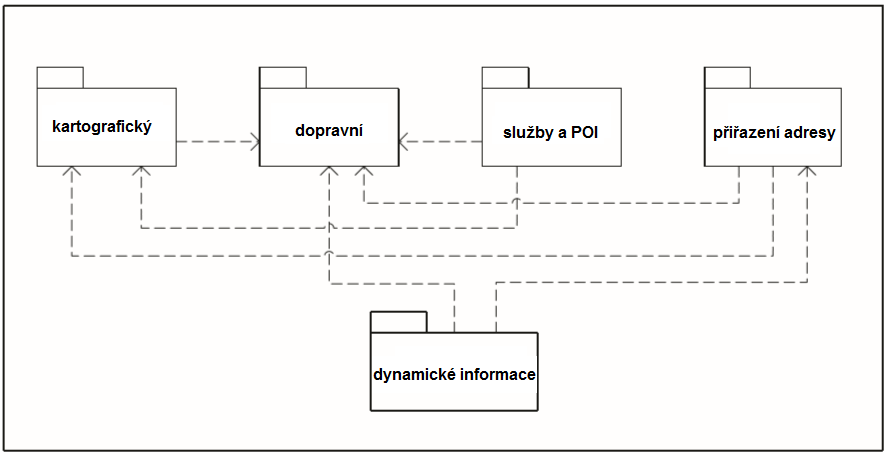
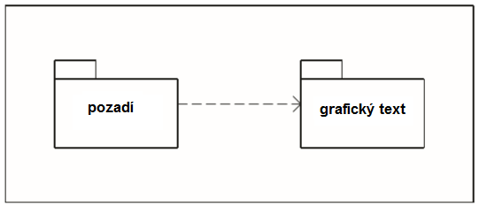
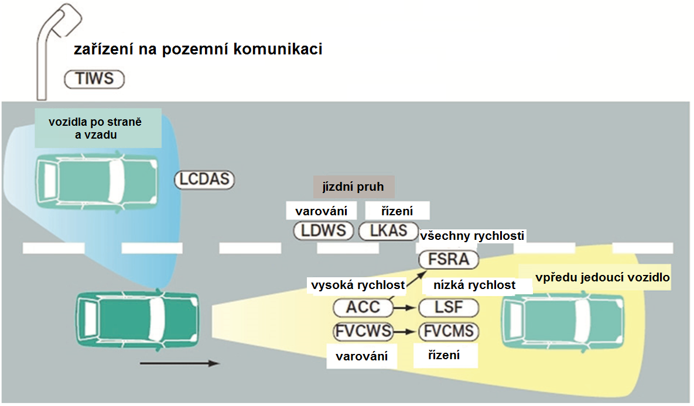

# EXTRAKT z mezinárodní normy

EXTRAKT z mezinárodní normy

**Extrakt nenahrazuje samotnou technickou normu, je pouze informativním materiálem o normě.**

**Inteligentní dopravní systémy (ITS) — Rozšíření specifikací mapové databáze pro aplikace kooperativních ITS systémů**

ISO 14296 — třídicí znak 01 8285

Vydána 2016, 88 stran

**Úvod**

ISO 14296 je součástí norem zaměřených na oblast navigačních a lokačních systémů a souvisejících aplikací (viz kapitola Souvisící normy). Její uplatnění nalezneme zejména v oblasti navigačních a lokačních systémů, poskytování dopravních služeb, dopravním zpravodajství a systémech řízení dopravy.

Tato norma je věnována popisu základní sady aplikací pro kooperativní ITS systémy. Tyto aplikace jsou užívány ve vozidlové navigaci a v navigačních produktech nejrůznějších poskytovatelů mapových podkladů (Google, Garmin, HERE, CCS apod.).

Jedná se zejména o metody podporující dynamickou formu navigace, služby podporující řízení a navigační služby ve vozidlech a v multimodální dopravě. Z tohoto pohledu je norma vhodná i pro tvůrce či provozovatele dopravních informačních center, správce významných dopravních objektů (tunelové stavby, dálniční stavby apod.).

Poznámka: Extrakt uvádí vybrané kapitoly popisovaného dokumentu a přejímá původní číslování kapitol.

**Užití**

Norma přispívá vývojářům kooperativních ITS aplikací v šíření jejich aplikačních výstupů. Tyto aplikace těží z dostupnosti normalizovaného datového modelu a datových prvků. V konečném důsledku umožňuje vývojářům zkrátit čas potřebný k uplatnění nového produktu a služby na trhu. Norma nedefinuje datový model pro individuální navigační služby mimo vozidlovou navigaci.

**Pro orgány státní správy** tato norma představuje popis současných technologií v oblasti poskytování aktuálních dopravních informací, jako jsou metody ITS-RSU, VICS, či RDS/TMC.

**1 Předmět normy**

Norma poskytuje mapově vztažené funkční požadavky, datový model (logický datový model / organizaci logických dat) a datové prvky pro aplikace kooperativních ITS systémů, které vyžadují informace odvozené z mapových databází.

Kapitoly 2 a 3 stručně popisují souvisící normy, kterým tento dokument vyhovuje a je s nimi ve shodě.

**2 Souvisící normy**

ISO 14825:2011 Intelligent transport systems – Geographic Data Files (GDF) – GDF5.0

ISO/IEC 19501:2005 Information technology – Open Distributed Processing – Unified Modeling Language (UML) Version 1.4.2

ISO/TS 20452:2007 Requirements and Logical Data Model for a Physical Storage Format (PSF) and an Application Program Interface (API) and Logical Data Organization for PSF used in Intelligent Transport Systems (ITS) Database Technology

**4 Termíny a definice**

Kapitola obsahuje 37 termínů a definic souvisících s touto normou. Klíčové termíny jsou následující:

**nastavení polohy** _(positioning)_ – [kategorie](http://itsterminology.org/cz/%22kategorie%22) [aplikace](http://itsterminology.org/cz/%22aplikace%22), která se zabývá stanovením [polohy](http://itsterminology.org/cz/%22polohy%22) [vozidla](http://itsterminology.org/cz/%22vozidla%22) a přizpůsobením [polohy](http://itsterminology.org/cz/%22polohy%22) na [mapu](http://itsterminology.org/cz/%22mapu%22)

**geokódování** _(geocoding)_ – softwarový proces přiřazování [adresy](http://itsterminology.org/cz/%22adresy%22) (ulice) nebo jiné geografické [entity](http://itsterminology.org/cz/%22entity%22) do mapové [databáze](http://itsterminology.org/cz/%22databáze%22) za účelem odvození (získání) geografických [souřadnic](http://itsterminology.org/cz/%22souřadnic%22) [adresy](http://itsterminology.org/cz/%22adresy%22) nebo souvisejícího [úseku](http://itsterminology.org/cz/%22úseku%22) ulice

**přiřazení adresy** _(address location) –_ [kategorie](http://itsterminology.org/cz/%22kategorie%22) [aplikace](http://itsterminology.org/cz/%22aplikace%22), která se zabývá úlohami vyjadřujícími reálnou polohu na zemi v [rámci](http://itsterminology.org/cz/%22rámci%22) datové reprezentace PSF (Physical Storage Format)

**propojení** _(junction) –_ [entita](http://itsterminology.org/cz/%22entita%22) [datového modelu](http://itsterminology.org/cz/%22datového%20modelu%22), která reprezentuje [navigační geoprvek](http://itsterminology.org/cz/%22navigační%20geoprvek%22), kterým je buď pojmenované [propojení](http://itsterminology.org/cz/%22propojení%22), nebo pojmenované [křížení](http://itsterminology.org/cz/%22křížení%22) a které přiřazuje pojmenovaný [navigační geoprvek](http://itsterminology.org/cz/%22navigační%20geoprvek%22) k množině linií, [uzlů](http://itsterminology.org/cz/%22uzlů%22) a [míst](http://itsterminology.org/cz/%22míst%22)

**bod zájmu** _(point of interest) –_ cíl a/nebo místo zájmu cestujících, obvykle nekomerční povahy

Další termíny a zkratky z oboru ITS jsou obsaženy ve slovníku ITS terminology.

**5 Symboly a zkratky**

Kapitola obsahuje 10 nejrůznějších zkratek vztahujících se k předmětu normy, z nichž nejdůležitější jsou následující:

GDF geografické datové soubory _(Geographic Data Files)_

LDM lokální dynamická mapa _(Local Dynamic Map)_

POI bod zájmu _(Point of Interest)_

ITS-RSU inteligentní dopravní systém – jednotka zařízení na pozemní komunikaci _(Intelligent Transport System - Road Side Unit)_

RDS-TMC RDS rádiový datový systém (Digitální informační kanál na vlnách FM; TMC kanál pro přenos dopravních informací prostřednictvím RDS)

VICS vozidlový informační a komunikační systém _(Vehicle Information and Communication System)_

Další termíny a zkratky z oboru ITS jsou obsaženy ve slovníku ITS terminology (www.ITSterminology.org).

**6 Požadavky**

Tato kapitola je členěna do dvou základních částí popisující aplikační a funkční požadavky pro aplikace kooperativních ITS systémů. Šest aplikačních kategorií (zobrazení mapy, nastavení polohy, plánování trasy, navádění na cíl, služby/POI přístup k informacím a umístění adresy) pro navigační funkcionalitu jsou definovány ve shodě s ISO/TS 20452:2007. V této normě jsou nově definovány kooperativní ITS systémy (včetně podpory řízení) a funkcí podpory multi-modální dopravy.

Mezi základní funkce této množiny patří funkce zobrazení mapy. Tato funkce poskytuje kartografická data, která mohou být využita k zobrazení mapy jakékoliv aplikace libovolně orientovaného pravoúhelníku v databázi. Data jsou složena z databázových entit podporujících rozmanitost stylů pro vykreslování mapy: kartografické geoprvky, kartografický text a symboly.

Zobrazení mapy poskytuje následující metody přístupu k datům (výčet není úplný):

\- R-1. Prostřednictvím kartografických geoprvků, kartografického textu a vlastnosti symbolů, kartografického textu a symbolů pro aplikačně specifikovaný pravoúhelník, prostřednictvím hladiny a typu geoprvku;

\- R-2. Prostřednictvím souřadnic pro aplikačně určený kartografický geoprvek;

\- R-3. Prostřednictvím atributů kartografických geoprvků, jako jsou: typ geoprvku, název a funkční začlenění;

  - R-4. Prostřednictvím úplných či částečných kartografických geoprvků propojených s aplikačně specifikovanými dopravními prvky;

  - R-5. Prostřednictvím oblasti (velikosti), aplikačně specifikovaného rovinného geoprvku;

Mezi klíčové funkce patří funkce stanovení polohy.

Funkce stanovení polohy je užívána k určení polohy vozidla, například prostřednictvím zeměpisné šířky a délky prvku sítě pozemních komunikací a pro přiřazení na mapu. Přiřazení na mapu je metoda určování změny polohy navigačního systému v síti pozemních komunikací, založená na znalosti předcházející polohy navigačního systému a na datech o pohybu navigačního systému z externích vstupů. Tímto způsobem jsou upřesněny geo-lokalizace na pozemních komunikacích.

Pro účely stanovení polohy by měly být poskytnuty následující funkce (nejedná se o úplný výčet):

\- R-25. Jednotná množina souřadnic pro aplikačně specifikovaný geoprvek Bod z tématu Pozemní komunikace a trajekty;

\- R-26. Množina hran, uzlů a/nebo mezilehlých bodů pro aplikačně specifikovaný geoprvek, nebo množina propojených geoprvků z tématu Pozemní komunikace a trajekty;

\- R-27. Množina topologicky propojených geoprvků z tématu Pozemní komunikace a trajekty propojených s aplikačně specifikovaným geoprvkem z tématu Pozemní komunikace a trajekty.

**6.3.5 Funkce navádění na trase**

Jedná se o významnou funkci, která se využívá k podrobnému generování instrukcí k následování trasy. Tyto instrukce mohou zahrnovat orientaci kompasem, vzdálenost, názvy pozemních komunikací, texty dopravních značek, orientační body a statické nebo pohyblivé obrázky. Navádění může být realizováno textem, hlasem či grafickými výstupy.

Navádění na trase poskytuje následující metody přístupu k datům (nejedná se o úplný výčet):

\- R-77. Prostřednictvím relevantních geoprvků a relačních vztahů vztažených k dopravním prvkům specifikovaných aplikací, nebo množiny dopravních prvků, jako jsou: prvek křižovatky, informace na dopravních ukazatelích, okolní podmínky a orientační body v blízkosti dopravního prvku;

\- R-78. Pomocí naváděcích atributů dopravního prvku specifikovaného aplikací, nebo množinou těchto prvků, které jsou: názvy pozemních komunikací, vzdálenost, směr dopravního proudu a druh pozemní komunikace;

\- R-79. Pomocí vymezení, zda je aplikačně specifikované křížení částí křižovatky nebo celou křižovatkou;

**7 Logický datový model**

Přehledový model zahrnuje statická mapová data pro ITS služby a vztah mezi mapovými daty a dynamickými externími informacemi pro ITS systémy. Přehledový model znázorněný na obr. 1 vyjadřuje vztah mezi následujícími bloky: dopravní blok, kartografický blok, blok přiřazení adresy, blok služeb a POI, blok dynamických informací.

**Obr. 1** Přehledový model (obr. 1 normy)

**Kartografický blok**

Kartografický blok je určen zejména pro zobrazení mapy. V kartografickém bloku je proměnlivý počet datových úrovní a relačních vztahů mezi jednotlivými úrovněmi. Kartografický blok se skládá z částí reprezentující pozadí a grafický text. Grafický text, jako například názvy mapových geoprvků, je jedním z atributů kartografických dat. Nicméně text pro kartografická data je nezávislý na datech pozadí.

**Dopravní blok**

Dopravní balík definuje síťová data pro kooperativními ITS služby podporované LDM, službou multi-modální podpory dopravy, vozidlovou navigací, službami veřejné dopravy, navigací pro cyklisty a chodce.

Dopravní blok se skládá z následujících pěti pod-bloků: sítě dopravních zón, sítě pozemních komunikací, sítě veřejné dopravy, sítě cyklistických cest a sítě cest pro pěší.

**Obr. 2** Ilustruje kartografický blok (obr. 14 normy)

**Blok služeb a POI**

Tento blok se skládá z entity služby a entity referenčního bodu POI. Entita služby zahrnuje POI data. Definice entity služby je popsaná v ISO/TS 20452.

**Blok přiřazení adresy**

V ISO/TS 20452 je blok přiřazení adresy složen z místa, názvu navigačního geoprvku, úseku pozemní komunikace, křižovatky, propojení a poštovního směrovacího čísla. Nicméně blok přiřazení adresy je v této mezinárodní normě složen pouze z místa a referenčního bodu. Místo reprezentuje pojmenovanou oblast, která může být použita pro přiřazení adresy.

**Blok dynamických informací**

Dynamické informace, které mohou být poskytnuty externě v součinnosti s informacemi o poloze, jsou vztaženy k mapovým datům a jsou využívány k poskytování informací o dopravních podmínkách v reálném čase, například dopravní informace, informace o počasí a cestovní informace. Dynamické informace mohou být využity k rozšíření výpočtu trasy, pro podporu řízení a pro kooperativní ITS služby.

Externí dynamické informace pro ITS systémy jsou spojeny s polohou oblasti, liniovým stanovením polohy, například částí pozemní komunikace, nebo bodovým stanovením polohy, například polohou křižovatky nacházející se na pozemní komunikaci v rámci mapového podkladu. Množina dynamických informací se může skládat z entity polohy dynamické informace, dynamické dopravní informace (např. RDS-TMC, VICS), aktuální dopravní informace (např. zpoždění vlaku) a informace o počasí (např. déšť, záplava, sněžení, blizard, nebo mráz).

## Příloha A (normativní) – Abstraktní testovací sada

Tato abstraktní testovací sada se týká souhrnných dat odvozených z této normy. Předmětem metody testování je posoudit shodu mezi toto normou a testovanou datovou strukturou, zda pokrývá všechny datové prvky popsané touto normou.

## Příloha B (informativní) – Popis výrazových prvků UML

Tato norma využívá nově vyvinutou metodologii k vyjádření strukturovaných souvislostí, nazývanou UML. V příloze je uveden krátký popis výrazových UML prvků diagramu, které zajišťují, aby nedocházelo k nesprávnému výkladu, zaviněnému postupným vývojem UML1.4.

## Příloha C (normativní) – Základní množina definic aplikací

Tato příloha normy popisuje formou tabulky základní množinu aplikací stanovenou v souladu s ETSI TC ITS TR 102638 a ETSI TC ITS TR 102863.

## Příloha D (informativní) – Přehled příkladů služeb podpory řidiče, japonské příklady

Tato příloha, na základě zprávy ITS Japan report 2011, pomáhá seznámit čtenáře s příklady ITS systémů v Japonsku. Příloha je členěna do 4 částí: služby varování založené na informacích z pozemní komunikace, (informace o dopravních omezeních, informace o dopravním značení, dopravní informace, informace o podmínkách na povrchu pozemní komunikace, zvláštní zóny), služby varování založené na informacích o situaci v okolí vozidla (pozemní komunikace, křižovatky), ovládání vozidla, podpora eko-řizení (poskytování zpráv k eko-řízení, poskytování informací k multimodální dopravě).

**Obr. 3** Situace okolo vozidla (obr. D. 12 normy)

**Legenda:**

TIWS – varovný systém překážek dopravy, FVCWS – varovný systém před srážkou s vpředu jedoucím vozidlem, LCDAS – varovný systém podpory sledování bočních překážek, ACC – adaptivní tempomat, LSF – podpůrný systém pomalé jízdy v koloně, FVCMS – vozidlový systém pro zmírnění kolize, LDWS – varovný systém před neúmyslným vyjetím z jízdního pruhu, LKAS – asistenční systém pro udržení vozidla v jízdním pruhu, FSRA – adaptivní tempomat pro všechny rychlostní režimy

**Tab. 1** Informace o pozemní komunikaci (tab. D.1 normy)

|                                                                         |                                               |                                               |                                                                                                           |
| ----------------------------------------------------------------------- | --------------------------------------------- | --------------------------------------------- | --------------------------------------------------------------------------------------------------------- |
| **Cíl**                                                                 | **Požadované informace o pozemní komunikaci** | **Řídicí prvek**                              | **Poznámka**                                                                                              |
| 1\. rychlostní limit                                                    | informace o rychlostních omezeních            | úřad pro veřejnou bezpečnost každé prefektury |                                                                                                           |
| 2\. bezpečná rychlost                                                   | zakřivení a sklon                             | správce pozemní komunikace                    |                                                                                                           |
|                                                                         | informace o nebezpečné dopravní oblasti       | správce pozemní komunikace, řidič             | informace od řidičů mohou sloužit jako zdroj                                                              |
|                                                                         | informace o povrchu pozemní komunikace        | správce pozemní komunikace, řidič             | informace o skluzu kol detekovaného prostřednictvím systému ESP, může být rovněž informací v reálném čase |
| 3\. snížení kongesce                                                    | místa poklesu kongesce                        | správce pozemní komunikace                    |                                                                                                           |
|                                                                         | informace o rychlostních omezeních            | úřad pro veřejnou bezpečnost každé prefektury |                                                                                                           |
| Přínosy služby: snížení dopravních nehod z důvodu nepřiměřené rychlosti |                                               |                                               |                                                                                                           |

## Příloha E (informativní) – Vztah mezi základní množinou aplikací a službami podpory řízení, japonský příklad

Tato příloha přináší přehled členění základní množiny aplikací v rozlišení na aplikační třídy, aplikace, případy užití a služby podpory ovládání vozidla.

## Příloha F (informativní) – Případ užití služby multimodální podpora dopravy, japonský příklad

Tato příloha přináší jak grafické znázornění případu užití, tak podrobný přehled případu užití členěného na položky, popis a poznámky včetně popisu hlavních funkcí procesu multimodální podporu dopravy.
