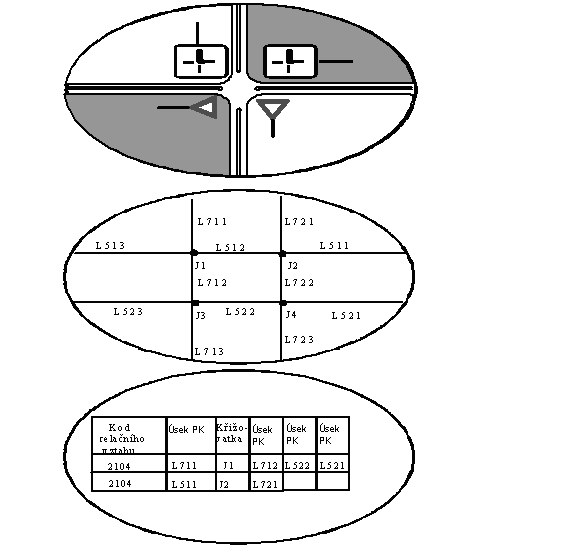
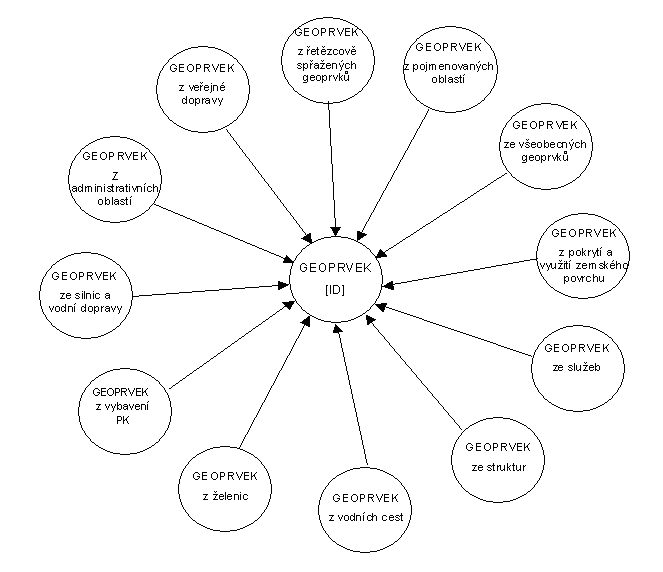
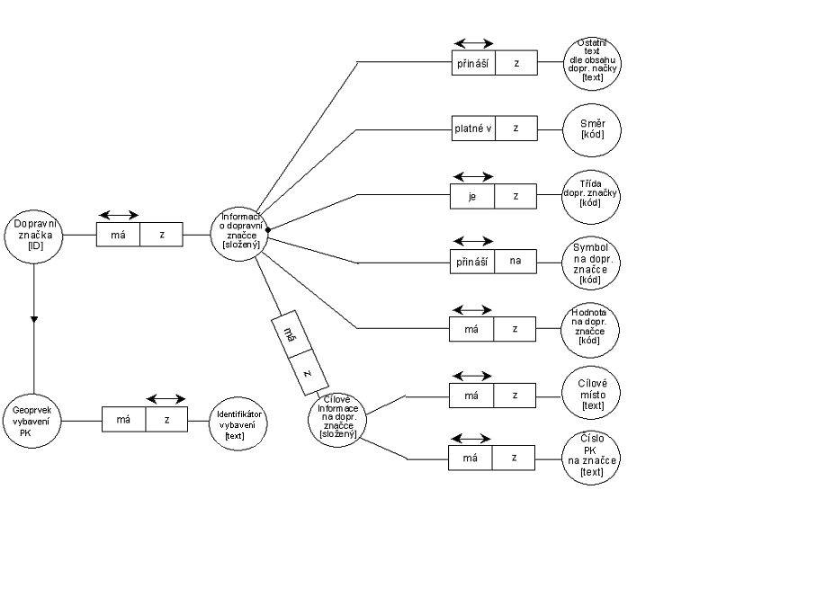
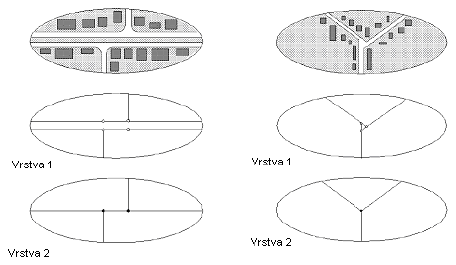

# EXTRAKT z české technické normy

**Extrakt nenahrazuje samotnou technickou normu, je pouze informativním materiálem o normě.**

**03.220.01, 35.240.70**

**Inteligentní dopravní systémy – Geografické datové soubory (GDF) – Celková datová specifikace**

ČSN EN ISO 14825 — třídicí znak 01 8281

Platí od 11.2004 590 stran

**Úvod**

Tato norma je součástí norem zaměřených na oblast navigačních a lokačních systémů a souvisejících aplikací.

Podnět ke vzniku normy dali výrobci a uživatelé digitálních silničních map v osmdesátých letech, jež hledali formát pro běžnou výměnu dat a interoperabilitu systémů, jež tato data využívají. Aktivity vyvrcholily návrhem evropské normy GDF, jež vycházela ze známých regionálních norem v Japonsku a USA.

Tato norma specifikuje konceptuální a logický datový model a výměnný formát pro geografická data pro ITS aplikace. Konceptuální datový model je aplikačně nezávislý. To je předpokladem pro budoucí harmonizaci této normy s ostatními geografickými databázovými směrnicemi. Jak vyplývá z obsahu normy, GDF reprezentuje část reálného okolního světa, který sám o sobě je dynamický. V této souvislosti je proces sledování reálných změn a jejich promítnutí do GDF realizován prostřednictvím pravidelných aktualizací.

Práce na normě pokračují dále, a tak v současné době vzniká aktualizovaná verze normy s pracovním označením XGDF. Závěrečný návrh aktualizované normy má být k dispozici počátkem roku 2009. Součástí normy je zapracování pozměňujících návrhů v oblastech: 3D městský model, 3D model terénu, model směrů dopravního proudu, rozšíření atributů pro kategorii komerčních vozidel, katalog atributů, dodatky do UML diagramů a.j. Například datový model městské mapy má obsahovat atributy: budova (půdorys), schéma budovy, detaily budovy (obrysy), jméno bloku, skupina bloku, znázornění podzemní dráhy, typ železniční dráhy, a.j.

**Užití**

Norma svým obsahem patří do oblasti navigačních a lokačních systémů a souvisejících aplikací. Její uplatnění nalezneme zejména v oblasti navigačních a lokačních systémů, poskytování dopravních služeb, dopravním zpravodajství, systémech řízení dopravy a aktivních vozidlových systémů, či aplikací ADAS (pokročilé asistenční systémy podpory řidiče).

**Pro orgány státní správy** tato norma stanovuje formát a rozsah dat poskytovaných správci pozemních komunikací pro potřeby nejrůznějších aplikací a služeb.

**Pro výrobce zařízení a dodavatele telematických systémů** je tato norma využívána jako běžný datový formát v mapových produktech dodávaných společností TeleAtlas (TomTom), Navteq (Garmin), CEDA a v bezpočtu aplikací, jež využívají tyto mapové podklady. V poslední době dochází k využívání a přechodu na tento formát i ze strany kartografických společností. Tento formát vytváří předpoklady ke sjednocení datové struktury navigačních map od nejrůznějších výrobců. V neposlední řadě je již implementován do řady komerčních GIS produktů, což umožňuje jeho další rozšíření.

**Tab. 1** Příklady využití rozšířeného GDF formátu v oblasti aktivních vozidlových systémů

|                    |                                         |                                                                                                         |
| ------------------ | --------------------------------------- | ------------------------------------------------------------------------------------------------------- |
|                    | **Aplikace**                            |                                                                                                         |
| **Podélné řízení** | Adaptivní řízení (ACC)                  | Automatická kontrola s ohledem na rychlost a odstup od vpředu jedoucích vozidel                         |
|                    | Adaptivní řízení nastavení světlometů   | Dynamické ovládání světlometů                                                                           |
|                    | Varovné rychlostní systémy              | Varují před průjezdem zatáčkou nepřiměřenou rychlostí                                                   |
|                    | Zlepšení viditelnosti                   | Systémy zvyšující viditelnost v nepříznivých světelných a klimatických podmínkách                       |
|                    | Vizuální a akustická signalizace řidiči | Systémy poskytují vizuální a akustické informace varující před výskytem potencionálně nebezpečných míst |
|                    | Varovné protikolizní systémy            | Varují řidiče před možností kolize                                                                      |
|                    |                                         |                                                                                                         |
| **Příčné řízení**  | Varování před změnou směru              | Varují řidiče před nezáměrnou změnou směru                                                              |
|                    | Asistent “držení jízdní stopy”          | Napomáhá řidiči zachovat jízdní dráhu vozidla                                                           |
|                    | Asistent změny směru                    | Informuje řidiče o vozidlech v sousedních jízdních pruzích                                              |
|                    | Autonomní řízení                        | Podporuje plně automatické řízení                                                                       |
|                    |                                         |                                                                                                         |

**Souvisící normy**

ISO/IEC 8859-1 Informační technologie – 8 bitové kódované grafické znakové množiny – Část 1: Latinská abeceda č.1

**1 Předmět normy**

Norma je členěna do osmi základních částí: celkový konceptuální datový model, katalog geoprvků, katalog atributů, katalog relačních vztahů, pravidla reprezentace geoprvků, katalog metadat, logická datová struktura a specifikace datového záznamu.

**3 Termíny a definice**

**3.2.3 datový soubor** _(data file)_ Soubor souvisejících datových záznamů jež mají homogenní strukturu.

**3.4.2 atribut** _(atribute)_ charakteristika geoprvku, jež je nezávislá na jiných geoprvcích (negeometrická vlastnost prvku – název ulice, popisné číslo, PSČ,….)

**3.4.11 geoprvek** _(feature)_ databázová reprezentace objektu reálného světa. (Geoprvek je základní prostorová entita, která je dále nedělitelná na prvky stejného typu a která je popisovaná prostorovými daty. Z geoprvků je složeno prostředí, v němž se pohybuje člověk.)

**7.3.52 označení pozic** _(location referencing)_ metoda označení pozic za účelem snadné výměny informací o pozicích mezi různými systémy

**12.1.3 záznam** na médiu _(media record)_ název skupiny souvisejících datových polí jež k sobě náleží. GDF záznam na médiu tvoří délku 81 nebo 82 znaků podle toho, zda je použit jeden nebo dva kontrolní znaky na ukončení záznamu.

**UML** _(unified modelling language)_ nástroj pro popis a návrh informačních systémů. V této normě je UML použito jako nástroj k vyjádření strukturálních vztahů a specifických vazeb s využitím grafických prvků. Úplná definice UML je obsažena v normě ISO 19501.

**ESN** (_ESN_) jazyk pro popis datové struktury. Tento jazyk umožňuje vytvořit různou složitost datových typů složením z množiny základních typů.

**metadata** _(metadata)_ jsou data, popisující obsah, reprezentaci, rozsah /prostorový či časový/, prostorový referenční systém, kvalitu a administrativní, případně i obchodní aspekty využití digitálních dat

**5 Celkový konceptuální datový model**

V této kapitole je předložena koncepce datového modelu, kde jsou vysvětleny základní stavební prvky GDF a jejich vztahy. Jsou zde popsány jednotlivé typy topologických struktur podporované touto normou a současně přístup, jakým jsou prvky reálného světa reprezentovány v databázi.

**6 Katalog geoprvků**

V dalších kapitolách _Katalog geoprvků, Katalog atributů, Katalog relačních vztahů_ popisuje norma jednoduché a složené geoprvky, jejich charakteristiky, jež označujeme jako atributy a topologické a netopologické vztahy mezi nimi. Atributy mohou být rovněž jednoduché, představované jednou hodnotou, nebo složené, utvořené z množství tzv. podatributů. Netopologické vztahy mezi geoprvky jsou představovány relačními vztahy. Norma přistupuje k reprezentaci geoprvku jako k bezrozměrné, jedno či dvourozměrné entitě. Tří rozměrná prezentace je dokumentem rovněž podporována, ale ne geometricky.

**Obr. 1** Relační vztahy priorit jízdních úkonů při průjezdu křižovatkou řízenou svislým dopravním značením. U světelně řízené křižovatky relační vztahy nelze stanovit.

V této části je i popsána organizace geoprvků v GDF. Pojmově jsou geoprvky členěny podle témat. Fyzicky jsou geoprvky sloučeny do skupin či vrstev podle oblasti, jež reprezentují.

**Obr. 2** Datový model Katalogu geoprvků

Norma obsahuje souhrnný přehled geoprvků, jež jsou tímto dokumentem podporovány. Mimo to je zde specifikováno i začlenění blíže nedefinovaných geoprvků, tzv. uživatelsky definovaných geoprvků. Tato specifikace geoprvků však není striktně předepisována. Skutečný obsah GDF je na rozdíl od minimální množiny záznamů považován za definovanou položku mezi zákazníkem a dodavatelem.

**8 Katalog relačních vztahů**

V seznamu relačních vztahů jsou definovány nejrůznější netopologické vztahy, jež se u geoprvků mohou vyskytovat. Přirozeně i zde existuje možnost definovat relační vztahy uživatelem.

Jak je z předešlého zřejmé, norma nestanoví skutečný obsah GDF, pouze napomáhá uživateli k snadnějšímu definování geoprvků. V určitých případech jsou nabízeny různé způsoby modelování a prezentace.

**10 Katalog metadat**

Norma je koncipována jako ucelený dokument, jež k porozumění nepotřebuje externí výklad. Aby toto bylo zajištěno, definuje norma způsoby popisu GDF pomocí metadat, viz. definice

**11 Logické datové struktury**

V této kapitole je pro usnadnění mechanismu výměny a definování dat využit logický pohled na data, jež je následně přenesen do logické datové struktury. Datové struktury jsou popsány pomocí datového popisného jazyka ESN.

**12 Specifikace datového záznamu**

V této kapitole jsou popsány základní koncepty specifikace výměnného formátu datových záznamů.

## Příklad z ČSN EN ISO 14825– Datový model pro vybranou oblast atributů

**Obr. 3** Datový model pro atributy z vybavení PK

## Příloha A (normativní) Sémantické kódy

V příloze A je popsán postup pro správu a přidělování identifikátorů ke strukturám CS1, CS2 a CS8. Článek A.1 stanovuje hierarchii úřadů (administrátorů) pro přidělování identifikátorů.. Hlavní důraz je kladen na zachování konzistence dat. Příloha A dále obsahuje kódy pro reprezentaci geoprvků, atributů a relačních vztahů užívaných v reálných GDF.

## Příloha B (informativní) Metadata kódů

Příloha B obsahuje soupis kódů užívaných při formulaci metadat.

## Příloha C (informativní) Služby

Příloha C obsahuje specifikaci geoprvků tématu Služby.

## Příloha D (normativní) Syntaxe pro časové domény

V příloze D jsou popsána pravidla pro specifikaci proměnných aspektů geodetických informací.

## Příloha E (normativní) Segmentování GDF datových množin

Příloha E popisuje proces organizace segmentování datových záznamů v GDF s cílem usnadnit zpracování velkého množství dat. Předmětem segmentování je pouze organizace dat pro lepší zpracování, nikoli definice databázového pokrytí oblasti. Oblast pokrytá konkrétní GDF je definována nezávisle na svém logickém členění jednotek datových množin, vrstev a sekcí.

## Příloha F (informativní) Pravidla pro tvorbu vrstvy 2 Geoprvky silniční a trajektové

V příloze F jsou popsány geoprvky silniční, křižovatkové a mimoúrovňového propojení jako složené geoprvky, jež jsou tvořeny různou kombinací silničních prvků a spojení. Funkční charakter křižovatky má souvislost s rozhodnutím o směru jízdy (např. "odboč vlevo"). Funkční charakter mimoúrovňového spojení je obecně vztažen k množině navigačních rozhodnutí (např. Na křižovatce Frankfurter odboč směr Würzburg).

Praktické příklady reprezentace v GDF:

**Obr. 4** Reprezentace vícepruhové Tří-valenční křížení se třemi spojeními
komunikace na Vrstvě 2 a jednou křižovatkou

## Příloha G (informativní) Typy názvů administrativních oblastí a čísla zemí

Příloha G obsahuje typy názvů administrativních oblastí a čísla zemí.

## Příloha H (informativní) Definice měřicích metod

V příloze H je věnována pozornost kvalitativní stránce geografických informací, neboť určitý počet chybných reprezentací geoprvků nelze nikdy vyloučit. To je řešeno přiloženou metodikou, s jejíž pomocí může být pojem kvality statisticky kvantifikován. Metodika nespecifikuje, jaká by vlastně kvalita měla být, nýbrž pouze stanoví, jak popsat a vyjádřit kvalitativní charakteristiky.

## Příloha I (informativní) Specifikace možného využití typů atributů u geoprvků a relačních vztahů

Příloha I specifikuje možné využití typů atributů na geoprvcích a relačních vztazích. Tato příloha obsahuje tabulku možných atributů pro geoprvky a relační vztahy. Tabulka je pouze informativní. Je zamýšlena jako průvodce k využití typů atributů s různými geoprvky a relačními vztahy pro převládající využití atributů v tomto kontextu.
