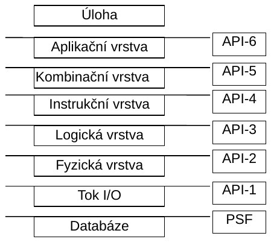
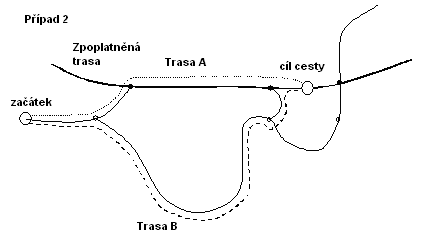

# EXTRAKT z mezinárodní normy ISO

**Extrakt nenahrazuje samotnou technickou normu, je pouze informativním materiálem o normě**.

**ICS: [03.220.01](http://www.iso.org/iso/products/standards/catalogue_ics_browse.htm?ICS1=03&ICS2=220&ICS3=01&); [35.240.60](http://www.iso.org/iso/products/standards/catalogue_ics_browse.htm?ICS1=35&ICS2=240&ICS3=60&)**

**Inteligentní dopravní systémy – Standardní API navigačního systému**

ISO 17267

Vydána 2009, 139 stran

**Úvod**

Tato norma je součástí norem zaměřených na oblast navigačních a lokačních systémů a souvisejících aplikací.

Podnět ke vzniku normy dali výrobci a uživatelé digitálních silničních map, jež hledali formát pro běžnou výměnu dat a interoperabilitu systémů, jež tato data využívají. Jak se průmysl s navigačními systémy rozrůstal, narůstala i nekompatibilita mezi navigačními systémy a mapovými databázemi. Stejně tak jako normalizovaný fyzický formát pro ukládání (PSF), tak i normalizované rozhraní pro navigační aplikační programy (API) může usnadnit slučitelnost mezi navigačními systémy a mapovými databázemi. Smyslem této normy je definovat strukturu modelu pro přístup k datům pro vozidlové navigační a cestovní informační systémy. Tato norma je nezávislá na formátu fyzického ukládání dat. Zatímco toto API je primárně určeno pro samostatné vozidlové systémy předpokládá se, že bude využito i jinými aplikacemi využívajícími mapová data stejným způsobem. Například se může jednat o systémy klient/server nebo distribuované navigační systémy či služby založené na lokalizaci bez dalšího upřesnění.

Poznámka: Extrakt uvádí vybrané kapitoly popisovaného dokumentu a přejímá původní číslování kapitol.

**Užití**

Norma svým obsahem patří do oblasti navigačních a lokačních systémů a souvisejících aplikací. Její uplatnění nalezneme zejména v oblasti navigačních a lokačních systémů, poskytování dopravních služeb, dopravním zpravodajství, systémech řízení dopravy a aktivních vozidlových systémů, či aplikací ADAS (pokročilé asistenční systémy podpory řidiče).

**Pro orgány státní správy** tato norma stanovuje formát a rozsah dat poskytovaných správci pozemních komunikací pro potřeby nejrůznějších aplikací a služeb.

**Pro výrobce zařízení a dodavatele telematických systémů** je tato norma využívána jako běžný datový formát v mapových produktech dodávaných společností TeleAtlas (TomTom), Navteq (Garmin), CEDA a v bezpočtu aplikací, jež využívají tyto mapové podklady. V poslední době dochází k využívání a přechodu na tento formát i ze strany kartografických společností. Tento formát vytváří předpoklady ke sjednocení datové struktury navigačních map od nejrůznějších výrobců. V neposlední řadě je již implementován do řady komerčních GIS produktů, což umožňuje jeho další rozšíření.

**2 Souvisící normy**

ISO 14825 Geografické datové soubory (GDF).

ISO 17572 Označení pozic pro geografické database

**3 Termíny a definice**

Pro účely této mezinárodní normy je definováno 58 termínů a definic:

**uzel** _(node)_ entita datového modelu topologicky propojující dvě nebo více spojnic nebo jejich zakončení; obsahuje hodnotu souřadnice odpovídající GDF propojení

**konečný uzel** _(destination node)_ ze dvou uzlů na koncích trasy je to ten, ke kterému se na cestě míří. Viz také startovní uzel, uzel zahájení, uzel ukončení, výchozí uzel a cílový uzel. (pokud se po trase jede ve směru topologické orientace, je konečný uzel uzlem ukončení. Pokud se po trase jede v opačné topologické orientaci, pak je konečný uzel uzlem zahájení).

**startovní uzel** _(origin node)_ ze dvou uzlů na koncích trasy je to ten, ze kterého jízda začíná. Viz také konečný uzel, uzel zahájení, uzel ukončení, výchozí uzel a cílový uzel. (pokud se po trase jede ve směru topologické orientace, je startovní uzel uzlem zahájení. Pokud se po trase jede v opačné topologické orientaci, pak je startovní uzel uzlem ukončení.

**výchozí uzel** _(source node)_ ze dvou uzlů na koncích trasy je to ten, ze kterého začíná hledání pro výpočet trasy. Viz také cílový uzel, startovní uzel, konečný uzel, uzel zahájení, uzel ukončení. (pokud se po trase hledá ve směru od startu cesty, je výchozí uzel trasy jeho startovním uzlem. Pokud se použije reverzní hledání z cíle cesty, pak je výchozí uzel konečným uzlem.

**cílový uzel** _(target node)_ ze dvou uzlů na koncích trasy je to ten, ze kterého začíná hledání pro výpočet trasy. Viz také výchozí uzel, startovní uzel, konečný uzel, uzel zahájení a uzel ukončení. (pokud se po trase hledá ve směru od startu cesty, je cílový uzel trasy jeho konečným uzlem. Pokud se použije reverzní hledání z cíle cesty, pak je cílový uzel startovním uzlem.

Další termíny a zkratky z oboru ITS jsou obsaženy ve slovníku ITS terminology.

**4 Symboly a zkratky**

Pro účely této normy je definováno devět zkratek.

Další termíny a zkratky z oboru ITS jsou obsaženy ve slovníku ITS terminology (www.ITSterminology.org).

**5. Architektura API**

**5.3 Slučitelnost programů**

ISO-API bude podporovat slučitelnost programů následujícím způsobem:

  - dřívější verze aplikačního software mohou použít DAL (Data Access Library) korespondující s pozdější ISO-API verzí a

  - dřívější verze DAL (Data Access Library) mohou použít data v pozdější PSF.

**5.4 Zpracování chyb**

Aplikační software bude rovněž zodpovědný za zpracování chyb. DAL upřesní podrobnější popis chyby, zatímco aplikační SW na ně reaguje. ISO-API bude specifikovat seznam chybových podmínek pro každé volání funkce. Systémový vývojář může rozhodnout, který chybový mechanizmus bude pro implementaci využit.

**5.5 Přidělení paměti**

Životní cyklus objektů a struktur bude řízen aplikačním softwarem. Paměť objektů a struktur interně využívaná prostřednictvím DAL bude i pomocí DAL řízena.

**5.6 Upřednostnění a zrušení**

ISO-API bude podporovat prioritu a zrušení ke kontrole vstupně/výstupních operací, správu inteligentní vyrovnávací paměti, atd. Tato funkce bude podporována ISO-API následujícím způsobem: každá třída (objektově orientovaná) bude mít dvě členské funkce "setPriority()" a "getPriority()".

**5.9 Zpracování velkého množství výsledků**

Pro mnoho API volání není jednoduché předem odhadnout množství vrácených dat. Například požadavek získat všechny prvky PK uvnitř určité ohraničené oblasti může vrátit velké množství dat, jestliže se jedná o oblast s velkou hustotou.

Na druhou stranu DAL bude implementováno na široké spektrum platforem. Jestliže paměť s výsledky je alokována dynamicky, vracení velkého množství dat může představovat problémy pro alokaci paměti na některých platformách.

Je požadováno takové flexibilní řešení, kdy výsledek v případě potřeby může být vrácen po částech. Obecný přístup je následující: je zavolána funkce, která připraví možný návrat velké množiny výsledků. Druhá funkce je volána dle potřeby tak často, aby byl zajištěn návrat celého objemu dat. Třetí funkce sloužící k „uzavření“ operace se pravděpodobně bude volat ještě předtím, než dojde ke vrácení celé množiny výsledků.

**5.10 Multimediální podpora výstupů**

Mimo mapová data může databáze obsahovat i multimediální objekty jako například grafické znázornění POI. Musí být zajištěno získat takovéto výsledky prostřednictvím API. Následující typy multimediálních objektů mají být podporovány:

  - textové soubory, HTML soubory, zvuk, statické a pohyblivé obrázky

Množina multimediálních typů, které jsou podporovány API, není konečná a musí být rozšiřitelná.

**6. Funkční specifikace API**

**6.1 Úvod a úrovně API**

Je stanoveno, že ISO-API úroveň by měla být definována v rámci kombinace vrstvy a pomocí instrukcí této vrstvy. Jasnější definování vrstev API je na následujícím obrázku. V definici API-5 a API-6 jsou obsaženy interní API úrovně aplikačního SW.

Problém s umístěním API v příliš spodní úrovni (úroveň API 2 a nižší) je ten, že zde není žádná výhoda z důvodu extrémně nízké úrovně společného rozhraní. Přinejmenším by ISO-API mělo oddělovat aplikační software od PSF a medií, a kromě toho by nemělo být závislé na dané HW konfiguraci.

**Obr. 4** Úrovně API

**6.1.1 Funkční definice úrovní API**

_Aplikační vrstva API-6_ – Tato vrstva je odpovědná za vyšší úroveň funkčnosti systému, příklady: plánování trasy, pozice vozidla,…,

_Kombinační vrstva API-5_ – Zahrnuje zdroj a metody vyhledávání dat. Data zaslaná zpět funkcemi v této vrstvě se skládají z dat nižší úrovně a jsou definovaným způsobem vrácena volající funkci. příklady: kombinace dat různých typů, získání pozice vozidla na dané spojnici, a.j.

_Instrukční vrstva (vysoce logická vrstva) API-4_ – API 4 Skrývá dělení a uspořádání dat z vyšších vrstev, příklady: zpracování dat podobného typu s vícenásobným přístupem k fyzické paměti, zpracování velkých datových množin a.j.

_Logická vrstva (nižší logická vrstva) API-3_ – API-3 odděluje vyšší vrstvy z PSF, jako je fyzické uspořádání datových struktur, bitová pole nebo zarovnání slov, příklady: návrat celé datové množiny ohraničené oblasti, volitelná dekomprese dat,

_Fyzická vrstva API-2_ – API-2 odděluje vyšší vrstvy z absolutních adres sektorů, příklady: Čtení datových údajů začíná od specifikované adresy sektoru po danou délku dat. Liší se podle užitého systémového souboru.

_Propojovací vrstva API-1_ – otevírá, čte, vyhledává, uzavírá. Příklad: ANSI C soubor operačních funkcí

**6.2 Specifikace konvence**

Funkční specifikace API je popsána v IDL, který je součástí ISO 14750. IDL je systémově a implementačně nezávislý popis jazyka pro software rozhraní. Pojmy popsané v tomto jazyce mohou být snadno implementovaný několika programovacími jazyky např. Java, C++, C.

**6.3 Aplikační kategorie**

Celková struktura API bude specifikována užitím IDL entit _modul_ a _rozhraní_.

_Modul_ je využíván na seskupení související množiny definic, například „MapRoutePlanning“, který obsahuje všechny rozhraní aplikační oblasti „Plánování trasy (Route planning)“.

_Rozhraní_ popisuje soubor přístupových funkcí k entitám logického datového modelu a jejich vzájemných vztahů s jinými entitami. Např. rozhraní „MapLink“ obsahuje všechny přístupové funkce poskytující informace na dané spojnici, jak je specifikováno v koncepčních požadavcích.

**6.3.1 Celková specifikace modulu**

Tato kapitola popisuje jednotlivé dílčí moduly API. Jejich bližší popis je uveden v následující kapitole. Původně pro každou aplikační oblast je specifikován dílčí modul. V pozdějším stádiu některé moduly mohou být sloučeny v závislosti na definici konceptuální datové množiny Logického datového modulu.

Dílčí moduly MapAPI jsou následující:

**module MapAPI {**

**module MapRoutePlanning;**

**module MapRouteGuidance;**

**module MapPositioning;**

**module MapDisplay;**

**module MapAddressLocation;**

**module MapService;**

**module MapGeneral;**

**6.3.3 Plánování trasy**

V této části je popsán modul „Plánování trasy“ poskytovaný API. Výpočet trasy je proces definování jedné nebo více tras, které budou doporučeny cestujícímu směřujícímu z výchozího bodu (počátku) do konečného bodu (cíle) případně i s doporučením jednoho nebo více mezilehlých bodů trasy. V různých variantách výpočtu trati může cestující specifikovat různé požadované charakteristiky trati nebo trasy navrhnout. Například cestující může specifikovat optimalizační kritéria jako jsou doba jízdy nebo cestovní vzdálenost. Také může specifikovat soubor jednoho nebo více druhů vozidel, které se budou po dané trase pohybovat. Navíc cestující může specifikovat typy komunikací, které budou preferovány, nezačleněny či nepovoleny.

**6.3.3.2 Datové položky**

***kandidát traťového bodu (WaypointCandidate)** –* jedna volba pro významný traťový bod, např. soubory míst reprezentující vstupy a výstupy z restaurace, je jednou z množin alternativním traťových bodů

***seznam kandidátů traťových bodů (WaypointCandidateList)*** – tato datová struktura je užívána dvěma odlišnými způsoby v různých funkcích volání. V některých případech je využívána jako alternativní množina významných traťových bodů, kde pořadí není důležité. Například když uživatel říká „ Naveď mě k nejbližší bance, je mi jedno k jaké.“ V tomto případě zde bude vybrán jeden kandidát pro každou banku jako traťový bod a jeden seznam kandidátů traťových bodů reprezentující celou množinu. V jiných funkcích volání je datová struktura využita jako sled po sobě jdoucích traťových bodů, ve kterém pořadí hraje významnou roli.

***nastavení traťových bodů ze seznamu (WaypointSetList)*** – seznam traťových bodů (nebo množin traťových bodů) k nahlédnutí. Například, pokud uživatel říká „ Naveď mě k bance z tohoto seznamu (je mi jedno k jaké) a k restauraci z toho seznamu (je mi jedno k jaké).“ Výsledkem bude jeden seznam kandidátů traťových bodů pro banky a další pro restaurace.

***výběr traťových bodů (WaypointChoice)*** – specifikuje výběr traťového bodu a výběr kandidáta traťového bodu

***výběr ze seznamu traťových bodů (WaypointChoiceList)*** – vytvořen seznam pro výběr. Pokud máme množinu třech traťových bodů a požadujeme optimalizovat pořadí traťových bodů, pak můžeme dostat následující výsledky {{1, 2}, {2, 2}, {0, 1}}.To by znamenalo že „cestu využije kandidát číslo 2 množiny traťových bodů 1, pak kandidát číslo 2 množiny traťových bodů 2 a následně kandidát číslo 1 množiny traťových bodů číslo 0". Všimněme si, že množiny traťových bodů a kandidáti jsou číslovány od nuly, tedy první množina traťových bodů má číslo 0, druhá číslo 1 atd.

***neurčitý traťový bod (FuzzyWaypoint)*** – neurčitý traťový bod je reprezentován kruhem, například bodem a poloměrem.

***seznam neurčitých traťových bodů*** ***(FuzzyWaypointList)*** – je reprezentován seznamem neurčitých bodů

***použitý výpočet trasy na mapě (MapRouteUsageEnum)*** – tento výpočet je využit pro preferenci využití dálnice.

***použitý výpočet dynamické dopravní trasy na mapě (MapRouteDynamicTrafficUsageEnum)*** – tento výpočet je využit pro preferenci využití dynamické dopravy.

**6.3.3.4 Funkce plánování trati (Route Planning Functions)**

***Výpočet cesty na mapě (MapComputePath)*** – tato funkce vrací ukazatel na uspořádaný seznam cestovních nákladů spojnic a uzlů pro vypočítanou trasu.

Následující příklad ukazuje použití vypočtených řídících hodnot a bRelaxConstraint. V příkladě se předpokládá, že rcComputeControl.rcmCostCriteria.rmoeMinimizerGoal je nastaven na nejkratší vzdálenost tj. vzdálenost bude minimalizována.

Uvažujme případ 1: pokud rcComputeControl.rcmCostCriteria.rtueTollroadAffinity nemá nastaveny žádné priority, tak bude vybrána trasa A. V případě, že je nastaveno AVOID\_TOLLROADS, bude vybrána cesta B. Jestliže je nastaveno PROHIBIT\_TOLLROADS bude vybrána cesta C. Ve všech těchto případech bConstraintsRelaxed bude nastaveno na FALSE, protože nebylo povoleno žádné omezení.

Dále uvažujme případ 2, kdy cíl se nachází na zpoplatněné PK:

pokud rcComputeControl.rcmCostCriteria.rtueTollroadAffinity nemá nastaveny žádné priority, tak bude vybrána cesta A. V případě, že je nastaveno AVOID\_TOLLROADS, tak bude vybrána cesta B. Jestliže je nastaven PROHIBIT\_TOLLROADS a pokud bRelaxConstraints je FALSE, výpočet selže a bude vrácena funkce MapRouteNotFound, ale pokud je bRelaxConstraints TRUE, pak funkce umožní změnu parametru z PROHIBIT\_TOLLROADS na AVOID\_TOLLROADS a bude vybrána trasa B a bConstraintsRelaxed bude nastaven na TRUE.

***Výpočet trasy na mapě s využitím neurčitých traťových bodů (MapComputePathWithFuzzyWaypoints)** **– ***tato funkce se odlišuje od MapComputePath() pouze v tom, že je v ní přidaný seznam neurčitých traťových bodů jako vstupní parametr. Tento neurčitý bod není bod, ve kterém si řidič přeje zastavit. Spíše je to obecná oblast, přes kterou si řidič přeje projet. Primárně je tato funkce určena řidiči k tomu, aby mu umožnila modifikovat trasu vyznačením obecné oblasti, přes kterou chce projíždět. Například při výběru ze dvou dálnic mezi městy z nichž jeden je pro řidiče vhodnější.

***Výpočet trasy na mapě s využitím množin traťových bodů (MapComputePathWithWaypointSets) –*** tato funkce se odlišuje od MapComputePath() vložením vstupní množiny traťových bodů a logickou volbou, upřesňující zda pořadí traťových bodů má být optimalizováno. Také obsahuje dodatečné výstupy, které vrací množinu aktuálně vybraných traťových bodů. Každý traťový bod je specifikován ne jako jednotlivý traťový bod ale spíše jako množina kandidátů.

***Výpočet vícenásobných tras na mapě (MapComputePathMultipleRoutes)*** – tato funkce je odlišná od MapComputePath() tím, že umožňuje na jednotlivé volání vrátit vícenásobné alternativní trasy. Aby k tomu mohlo dojít, tak je zde přidaný parametr nRoutesDesired, který specifikuje počet požadovaných alternativních tras. Vstupní parametr rcComputeControl je soubor MapRouteControlTypes, jeden na požadovanou trasu, tak aby podpořil například simultánní požadavky na nejkratší, nejrychlejší a pěší cesty, která požaduje různé kontrolní parametry.

***Výpočet trasy na mapě s vícenásobnými cíli (MapComputePathsMultipleDestinations)* –** tato funkce je odlišná od MapComputePath() tím, že umožňuje výpočet tras z jednoho počátku do vícenásobných cílů současně. Aby k tomu mohlo dojít, tak je zde přidaný vstupní parametr nDestinations a cíle jsou specifikovány posloupností LocusLists a ne pouze jedním LocusList.

**6.3.4 Navádění na trasu**

**6.3.4.1 Datové struktury**

***MapManeuverDescription*** – je datová struktura v ukazateli. Je jedna pro oznámený manévr, nebo pro prvek složeného manévru.

***MapRouteGuidanceControl*** _– t_ato datová položka obsahuje kritéria, jež jsou využívána funkcí MapGuidePath pro navádění na trasu. Každý z datových prvků struktury je nastaven tak aby indikoval, zda má být manévr na základě popsaných podmínek oznámen.

**6.3.5 Stanovení polohy**

**6.3.5.2 Funkce stanovení polohy**

***GetPosition*** – na základě zjištěné polohy vrací opravený a k mapě přizpůsobený výsledek.

***GetNearbyMapFeatures*** – vrací množinu sousedních mapových geoprvků

**6.3.6 Zobrazení mapy**

**6.3.6.3 Funkce zobrazení mapy**

***GetFeatures –*** vrací množinu mapových geoprvků

***GetFeaturesFiltered –*** vrací množinu mapových geoprvků. Tato verze je doplněna filtrací schopností (nad rámec běžné funkce GetFeatures() ).

***Map Handle Functions*** - tato část obsahuje funkce užívané k řízení ovladačů mapy ***mapHandleCombine –*** vytváří ovladač mapy pomocí kombinace několika již existujících ovladačů mapy.

**6.3.7 Adresa umístění**

**6.3.7.1 Datové struktury**

AddressOutRequestType ***–** v*stup specifikující typy adresních výstupů při zpětném geokódování. Mohou se vyskytovat podmnožiny.

***AddressOutResponseType –*** jedná se o výstup při zpětném geokódování. Základní prvky jsou uvedeny sekvenčně, spíše než aby byly sjednoceny. Je to z důvodu, kdy více než jeden z nich nebo dokonce všechny mohou být požadovány.

***AddressLevelType*** – jde o obecnou definici datové struktury, která je užívána v souvislosti s uliční adresou. (na Západě) a je adresou v mnoha případech (na Východě). Jedná se o definici, jaké entity území jsou využívány a jaké je jejich příslušné obecné pojmenování. Například v US je typické použití „city“ a „state“ a v Japonsku je to “prefecture”, “city”, “ward”, “chome”, “banchi”, “go”. Jména odpovídajících úrovní adres jsou volena z definovaného seznamu, tak aby aplikace mohly využívat sémantiku termínů. Termíny, které jsou spíše pro interní použití, než aby byly předloženy uživateli, budou formulovány v anglickém jazyce, pokud existuje anglický výraz, a jinak v původním jazyce.

***AddressType*** – tato datová struktura obsahuje části adres vrácených při zpětném geokódování funkcemi getAddressFromPoint(), getAddressFromLocus() a getAddressFromFeatureID(). V závislosti na umístění mohou být některá pole vynechána. Tato datová položka je rovněž využívána jako vstup pro funkci GetLocsFromParsedAddress(), která geokóduje vstupy z adresy (zcela či částečně stanovené).

***PartialAddressCompletionType*** – tento vstup specifikuje, které části struktury adresy budou vráceny nebo budou poskytnuty funkcím zpětného geokódování.

**6.3.7.3 Funkce adresující polohu**

***GetAddressFromPoint*** – k danému bodu (zeměpisné šířce/zeměpisné délce) je zpětným keokódováním přiřazena adresa.

***GetAddressFromFeatureID*** – k danému identifikátoru GDF geoprvku z mimo uličních a mimo křižovatkových mapových geoprvků jakými jsou orientační bod, zájmový bod, park, jezero apod., je zpětným keokódováním přiřazena adresa/adresy.

***ScrollerHelper*** – k danému počátečnímu podřetězci (možno i nulovému prvku) tvořící jméno, vrací seznam kandidátů pro toto jméno. Jiné využití této funkce je v získání všech kandidátů pro jednu část analyzované adresy, danou specifikací jedné nebo všemi ostatními částmi. Například, získat seznam všech měst v zemi obsahující konkrétní název ulice by bylo možné vyplněním názvu země a ulice a dotazem na všechny úplné názvy měst začínající prázdným řetězcem.

***SpellerHelper*** - k danému počátečnímu podřetězci (i nulovému prvku) tvořící jméno (města, státu, ulice apod.), vrací množinu možných hodnot a počet (i přibližný) možných jmen, která dokončují řetězec.

**6.3.8.3 Funkce Služby a Body zájmu**

***GetPOIsByBBox*** – k dané ohraničené oblasti, vrací služby a POI pro vybrané parametry/hodnoty atributů filtrů, seřazené podle výběru.

***GetPOIsByPointRad*** – k danému bodu a poloměru/vzdálenosti, vrací služby a POI pro vybrané parametry/hodnoty atributů filtrů, seřazené podle výběru.

***GetPOIsFromNamedArea*** – k dané pojmenované oblasti, vrací služby a POI pro vybrané parametry/hodnoty atributů filtrů, seřazené podle výběru.

**6.3.9 Užitečné funkce**

**6.3.9.3 Funkce velké množiny výsledků**

Tato kapitola obsahuje funkce využívané pro zpracování velkých množin výsledků. Je úlohou aplikačního programu, aby si alokoval dostatečnou paměť pro uložení záznamů vyplývajících z jednotlivých dotazů. Aplikační program se může dotázat jednoho nebo všech výsledných záznamů v libovolném okamžiku, kdy je k dispozici dostatečná paměť.

Velkou výslednou množinu lze považovat za „pásku“ obsahující N záznamů. Záznamy jsou číslovány od 1 do N. Rovněž je potřebné popsat mezery mezi záznamy. Mezery jsou číslovány od 0 (mezera před prvním záznamem) do N (mezera za posledním záznamem).
