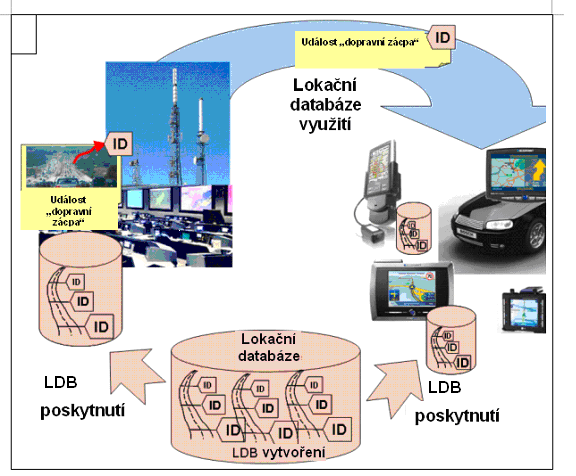
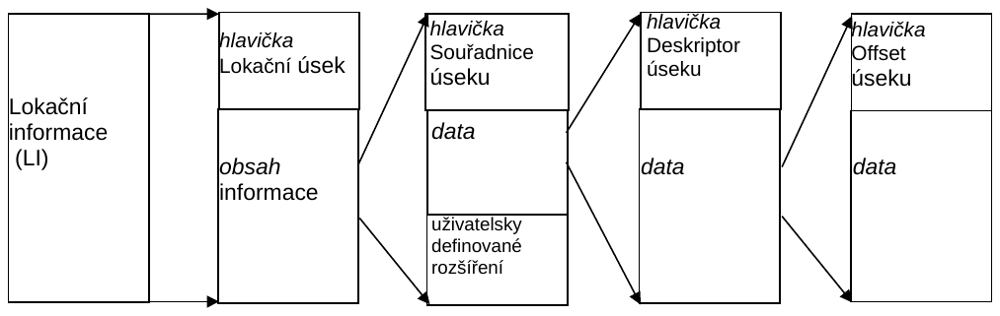
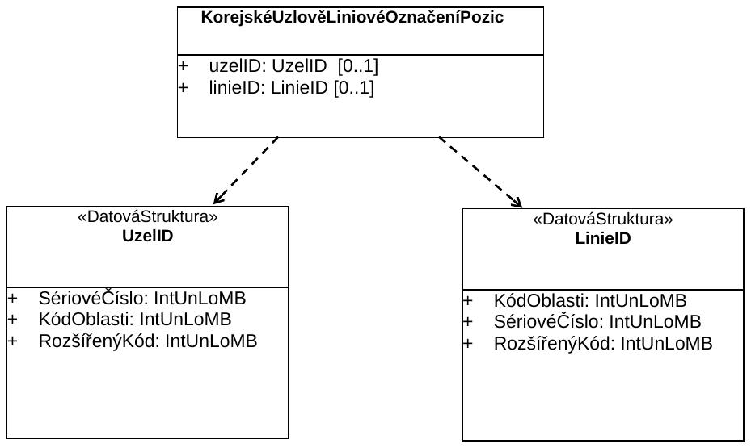

# EXTRAKT z české technické normy

**Extrakt nenahrazuje samotnou technickou normu, je pouze informativním materiálem o normě.**

**ICS 35.240.60**

**Inteligentní dopravní systémy – Označení pozic pro geografické databáze – Část 2: Předem kódované označení pozic**

ČSN ISO 17572-2 — třídicí znak 01 8284

Vydána 2008, 33 stran

**Úvod**

Tato norma je součástí norem zaměřených na oblast navigačních a lokačních systémů a souvisejících aplikací. Její uplatnění nalezneme zejména v oblasti navigačních a lokačních systémů, poskytování dopravních služeb, dopravním zpravodajství a systémech řízení dopravy.

Poznámka: Extrakt uvádí vybrané kapitoly popisovaného dokumentu a přejímá původní číslování kapitol.

**Užití**

Tato druhá část je věnována popisu dynamických forem označení pozic a předem kódovaných označení pozic. Tyto metody jsou užívány ve vozidlové navigaci a v navigačních produktech společností Teleatlas, Navteq apod. Stejně tak v lokačních produktech řady jiných dodavatelů (Tranis, CCS, apod.).

Jedná se zejména o metody podporující dynamickou formu navigace, tedy o poskytování dopravních zpráv v reálném čase. Z tohoto pohledu je norma vhodná i pro tvůrce či provozovatele dopravních informačních center, správce významných dopravních objektů (tunelové stavby, dálniční stavby apod.). Norma umožňuje reprezentovat stejné geografické jevy v různých geografických databázích odlišných distributorů, v různých aplikacích a na odlišných SW/HW platformách.

**Pro orgány státní správy** tato norma představuje popis současných technologií v oblasti poskytování aktuálních dopravních informací jako jsou metody VICS či RDS/TMC.

**1 Předmět normy**

Norma je členěna do tří částí: část 1 Všeobecné požadavky a konceptuální model, část 2 Předem kódované označení pozic a část 3 Dynamické označení pozic. Tato druhá část mezinárodní normy specifikuje lokalizační referenční metody (LRM) z pohledu geografických databází. Jejich využití nalezneme v nejrůznějších dopravně vztažených aplikacích na straně kódovacího i dekódovacího zařízení. Norma specifikuje podrobně jednotlivé odkazy na polohu včetně charakteristik položek a to s rozlišením, zda se jedná o položky volitelné či povinné.

Tato část normy popisuje dvě rozdílné metody:

  - Předem kódované označení pozic

  - Dynamické označení pozic

Norma neobsahuje definici fyzického formátu pro implementaci LRM. Nicméně požadavky pro fyzický formát zde definovány jsou. Stejně tak, součástí normy není podrobná definice lokalizačního referenčního systému (LRS), jako například SW či HW implementace.

Předem kódované označení pozic je metoda, kterou používají uživatelská zařízení obsahující databázi míst LDB, což koresponduje s databází poskytovatelů služeb. Všeobecně všechny metody předem kódovaných označení pozic sdílejí koncepci standardních a běžně používaných databází ID. Tento koncept byl vyvinut v minulosti pro technologie jako jsou TMC (Traffic Message Channel) pro Evropu či VICS (Vehicle Information and Communication System) pro Japonsko.

V základní části normy je dále stručný přehled současných způsobů implementace používaných metod: TMC (specifikace protokolu Alert C), VICS a korejský uzlově-liniový identifikační referenční model.

**2 Souvisící normy**

Dokument vychází z následujících mezinárodních norem:

ISO 14825:2004 Geografické datové soubory (GDF 4.0)

ISO 17572-1 Označení pozic pro geografické databáze – Část 1: Obecné požadavky a konceptuální model

ISO 17572-3 Označení pozic pro geografické databáze – Část 3: Dynamické označení pozic

EN ISO 14819-1 Dopravní a cestovní informace (TTI) – Zprávy TTI předávané kódováním dopravních zpráv – Část 1: Protokol kódování pro Rádiový datový systém – Kanál dopravních zpráv (RDS-TMC) s využitím ALERT-C

EN ISO 14819-3 Dopravní a cestovní informace (TTI) – Zprávy TTI předávané kódováním dopravních zpráv – Část 3: Odkazy na polohu pro ALERT-C

IEC 62106:2000 Specifikace rádiového datového systému (RDS) pro VHF/FM šíření zvukem ve frekvenčním pásmu od 87,5 do 108,0 MHz.

**3 Termíny a definice**

**hlavní spojení** _(major link)_ je orientované spojení

Norma uvádí 1 termín a jeho definici a pro účely tohoto extraktu jsou doplněny další:

**geoprvek** _(feature)_ databázová reprezentace objektu reálného světa

**TPEG** protokol přenosu dat používaný u vysokorychlostních přenosových kanálů

**RDS-TMC** RDS rádiový datový systém – digitální informační kanál na vlnách FM; TMC kanál pro přenos dopravních informací

**UML** nástroj pro popis a návrh informačních systémů. V této normě je UML použito jako nástroj k vyjádření strukturálních vztahů a specifických vazeb s využitím grafických prvků. Úplná definice UML je obsažena v normě ISO 19501.

**VICS** vozidlový informační a komunikační systém. Byl vytvořen pro účely digitálních mapových databází jako základ pro poskytovatele mapových děl k začlenění odlišných mapových identifikátorů do jejich vlastních digitálních map. Digitální mapový základ na nulté úrovni tvoří uzly a linie, které pokrývají celou uliční síť.

Další termíny a zkratky z oboru ITS jsou obsaženy ve slovníku ITS terminology.

**4 Symboly a zkratky**

Norma uvádí 19 zkratek.

Kapitoly 5 Požadavky na standardní metodu označování pozic a kapitola 6 Konceptuální datový model pro metody označování pozic jsou odkazovány na část 1 této normy.

Další termíny a zkratky z oboru ITS jsou obsaženy ve slovníku ITS terminology (www.ITSterminology.org).

**7 Specifikace předem kódovaného označení pozic**

Metoda označení pozic se v této kapitole rozděluje do dvou kroků. Prvním krokem je proces definování databáze ID identifikačních míst pro danou síť PK. V tomto kroku různí poskytovatelé služeb a poskytovatelé systému definují jednotnou databází obsahující všechna definovaná místa (databáze míst s kódy). Tato databáze je základem pro poskytovatele služeb, a také pro všechny přijímací systémy. Druhý krok je uskutečněn v reálném čase, kde poskytovatel služeb využije databázi ID, aby informoval uživatele o aktuální situaci.

**Příklad z ISO 17572-2 – Logický model metody označení pozic**

**Obr. 7** 1 – Funkční schéma předem kódovaného lokalizačního referenčního systému

**7.2 Vytvoření lokační databáze a její aktualizace**

Různé lokační referenční systémy více či méně podporují standardizované cesty vytváření nových lokačních databází. Všechny vycházejí z podstaty, kde konceptuální model specifikuje jak rozdílné lokační kategorie uvedené v části 1 souvisí navzájem. Tato specifikace společně s odbornou literaturou napomáhá k vytváření nových lokačních databází.

**7.3 Poskytování lokační databáze**

Po ukončení procesu tvorby, nově vytvořená lokační databáze je poskytnuta zařízením na trhu. To je realizováno běžnou cestou uvolňování aktualizací. Lokační referenční systém musí zajistit aby kódovací a dekódovací zařízení byly schopny rozlišit která verze databáze je využívána neboť jen na základě ID oni samy nemohou učinit rozhodnutí o správnosti lokace

**7.4 Užití lokační databáze**

Poskytovatel služeb využívající lokační databázi, nyní v souladu se specifikovanými pravidly vytvoří označení pozice z dostupných ID a přiloží k nim další atributy, tak aby příslušná část sítě PK byla podrobněji definována. Označení pozice, zaslané následně do přijímače, pak obsahuje nejen seznam čítající jeden či více lokačních ID ale i další doplňující atributy. Za předpokladu, že přijímací systém má k dispozici aktualizovanou databázi, přiřadí odpovídající lokační ID a aplikuje doplňující atributy v souladu s lokační referenční specifikací. Tím je zajištěno, že dekodér poskytne stejnou definici lokace jaká je požadována poskytovatelem služeb.

**8 Současné implementace**

Různé implementace předem kódovaných označení pozic byly již částečně popsány v předcházejících kapitolách. Některé jsou řešeny v rámci jiných ISO norem a některé si vyžadují popis na tomto místě. Tato kapitola poskytuje přehled v současné době známých metod předem kódovaných označení pozic a krátce je představuje. Současně naviguje čtenáře na další dokumenty umožňující podrobné seznámení s rozdílnými implementacemi.

**8.1 Kanál dopravních zpráv (TMC) / Alert-C specifikace**

Pravidla označování pozic definovaná v dokumentu EN ISO 14819-3 specifikují konkrétní požadavky na TMC systémy, které využívají zkrácené kódované tvary zpráv pro poskytování TTI zpráv prostřednictvím mobilních sítí (například GSM, DAB) nebo prostřednictvím výměnných formátů jakým je DATEX. Konkrétně Radio Data System - Traffic Message Channel (RDS-TMC) poskytuje digitálně kódované dopravní a cestovní informace prostřednictvím datového kanálu RDS v pásmu FM rozhlasových stanic, založené na protokolu ALERT-C (EN ISO 14819-1),

**8.2 Vozidlový informační a komunikační systém (VICS)**

Vozidlový informační a komunikační systém specifikuje v části \[Error: Reference source not found\] digitální mapovou databázi jako základ pro ostatní poskytovatele mapových produktů, tak aby si ji tito poskytovatelé mohli přizpůsobit a odlišit mapové ID pro jejich vlastních digitální mapy. Digitální mapový základ tvoří uzly a silniční prvky, které tvoří kompletní silniční mapu na nulové úrovni. Na obrázku 8.1 je pak znázorněna definice konceptuálního datového modelu pro takovouto mapu.

**8.3 Korejský uzlově-liniový identifikační referenční model**

V roce 2004 vytvořilo korejské Ministerstvo výstavby a dopravy (MOCT) pro potřeby inteligentních dopravních systémů normu pro uzlově-liniový identifikační referenční model. Norma slouží pro efektivní výměnu informací v reálném čase. Uzly a linie jsou zde reprezentovány maximálně deseti číslicemi.

## Příloha A (informativní) Logický formát pro VICS liniovou lokalizaci

V této části přílohy je uvedena struktura metody ve formátu ASN.1 i ve schématu XML. Na obrázku je přiložena skladba lokační informace.

Obrázek A.1 – Schéma logické struktury metody VICS

## Příloha B (informativní) Fyzický formát pro TMC označení pozic

Tato část popisuje relevantní části pro definici kódovacího formátu. Odkazuje se na specifikaci TPEG a první část normy. Je zde popsán binární formát datového modelu TMC a XML schéma pro předem kódované TMC označení pozic.

Radio Data System - Traffic Message Channel (RDS-TMC) využívá prostředky poskytující digitálně kódované dopravní informace, které jsou dostupné uživateli prostřednictvím jeho rádiového přijímače obsahující RDS tuner naladěný na FM stanici s využitím protokolu ALERT-C (EN ISO 14819‑1).

Pravidla lokačních odkazů definovaná v normě EN ISO 14819-3 specifikují požadavky TMC systému, který používá zkrácený kódovací formát poskytující TTI zprávy přes mobilní sítě (např. GSM, DAB) nebo prostřednictvím výměnných protokolů jakým je DATEX.

## Příloha C (informativní) Fyzický formát pro korejský uzlově-liniový identifikační referenční model

Tato příloha definuje datové struktury korejského uzlově-liniového identifikačního referenčního modelu užívaného v předkódovaném LRC zásobníku. Vlastní metoda označení pozic je popsána v článku 8.3.

Označení pozice zaslané například mezi poskytovatelem dopravních dat a dopravním řídicím centrem může být pouze částí rozsáhlé databázové výměny realizované typicky pro internet ve formátu xml. Aby byla zajištěna tato potřeba definuje tato kapitola XML schéma přenášející stejný obsah jako binární formát. Obecná část tohoto schématu je popsána v první části přílohy E.

Obrázek C.1 – Struktura korejského uzlově-liniový identifikačního referenčního modelu
