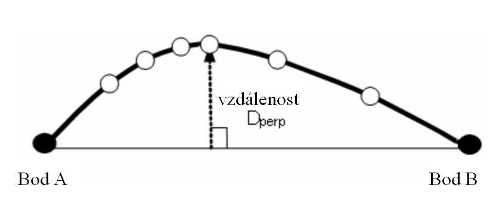
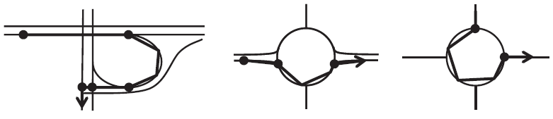
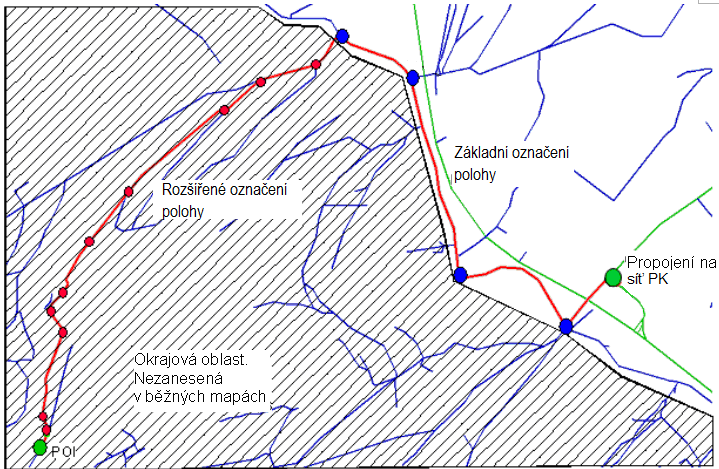
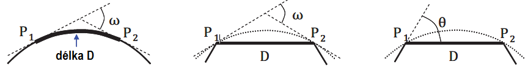

# EXTRAKT z české technické normy

**EXTRAKT z mezinárodní normy**

**Extrakt nenahrazuje samotnou technickou normu, je pouze informativním materiálem o normě.**

**Inteligentní dopravní systémy (ITS) — Označení poloh pro geografické databáze – Část 3: Dynamické označování poloh (dynamický profil)**

ISO 17572-3 — třídicí znak 01 8284

103 stran

**Úvod**

Tato norma je jednou ze tří částí normy na Označování poloh pro geografické databáze, zaměřené na oblast navigačních a lokačních systémů a souvisejících aplikací (viz kapitola Souvisící normy). Její uplatnění nalezneme zejména v oblasti navigačních a lokačních systémů, poskytování dopravních služeb, dopravním zpravodajství a systémech řízení dopravy.

Tato třetí část normy je věnována popisu metod dynamických forem označení poloh a předem kódovaných označení poloh. Tyto metody jsou užívány ve vozidlové navigaci a v navigačních produktech společností TomTom, Nokia ,apod. Stejně tak v lokačních produktech řady jiných dodavatelů (Tranis, CCS apod.).

Jedná se zejména o metody podporující dynamickou formu navigace, tedy o poskytování dopravních zpráv v reálném čase. Z tohoto pohledu je norma vhodná i pro tvůrce či provozovatele dopravních informačních center, správce významných dopravních objektů (tunelové stavby, dálniční stavby apod.).

Poznámka: Extrakt přejímá původní číslování kapitol.

**Souvisící normy (výběr)**

ISO 17572-1 Intelligent transport systems (ITS) — Location referencing for geographic databases —
Part 1: General requirements and conceptual model

ISO 17572-2 Intelligent transport systems (ITS) — Location referencing for geographic databases — Part 2: Pre-coded location references (pre-coded profile)

**Užití**

Norma umožňuje reprezentovat stejné geografické jevy v různých geografických databázích odlišných distributorů, v různých aplikacích a na odlišných SW/HW platformách. Norma vytváří základ pro on-line aktualizaci mapových podkladů. V této souvislosti vychází z výsledků mezinárodního výzkumného projektu AGORA.

**Pro orgány státní správy** tato norma představuje popis současných technologií v oblasti poskytování aktuálních dopravních informací, jako jsou metody VICS\[1\] či RDS/TMC.

**1 Předmět normy**

Norma 17572 je členěna do tří samostatných částí: část 1: Všeobecné požadavky a konceptuální model, část 2: Předem kódované označené polohy a část 3: Dynamicky označené polohy. Tato třetí část normy specifikuje metodu DLR (Dynamic Location Referencing) také známou jako AGORA-C, která je závislá na specifických atributech dostupných v běžných mapových databázích.

Tato metoda je vhodná pro systémy, které mají fyzický formát založen na GDF (Geographic Data Files). Metoda vychází z přístupu aplikace v reálném čase k původním nebo přeloženým hodnotám příslušných atributů z vlastní digitální mapy. Metoda DLR bývá také nazývána “on-the-fly referencing”, protože umístění referenčního kódu může být okamžitě vymazáno, jakmile je interní definice umístění dekódována.

**3 Termíny a definice**

Kapitola obsahuje 26 termínů a definic souvisících s touto normou. Klíčové termíny jsou následující:

**hlavní bod** *(core point)***
**bod patřící k hlavní označené poloze

**polohový bod** *(location point)***
**hlavní bod, který ohraničuje polohu nebo je umístěn na dané poloze

POZNÁMKA 1 k heslu Polohové body se mohou shodovat s body křížení nebo trasovacími body. Začátek a konec polohy je vždy reprezentován polohovým bodem. Další mezilehlé polohové body mohou být vytvořeny, aby reprezentovaly tvar polohy. Polohový bod je jedním ze tří definovaných typů hlavního bodu.

**rozšířený bod** _(extension point)_ **
**bod patřící k rozšíření označené polohy

**deskriptor pozemní komunikace** *(road descriptor)***
**úplné číslo pozemní komunikace nebo příznačný řetězec oficiálního názvu pozemní komunikace

POZNÁMKA 1 k heslu Deskriptor pozemní komunikace má v ideálním případě délku tří až pěti znaků.

**metoda označení polohy** *(location referencing method)
***LRM
**způsob přiřazení označení polohy

**4 Zkratky**

Kapitola obsahuje 19 nejrůznějších zkratek a 19 zkrácených odborných termínů vztahujících se k předmětu normy, z nichž nejdůležitější jsou následující:

GDF geografické datové soubory _(Geographic Data Files)_ (datový model, datová specifikace a výměnný standard pro geografická data aplikací silniční dopravy)

LRM metoda označení polohy _(Location Referencing Method)_

RDS-TMC RDS rádiový datový systém (digitální informační kanál na vlnách FM; TMC kanál pro přenos dopravních informací prostřednictvím RD.)

UML nástroj pro popis a návrh informačních systémů (v této normě je UML použito jako nástroj k vyjádření strukturálních vztahů a specifických vazeb s využitím grafických prvků. Úplná definice UML je obsažena v normě ISO 19501)

AGORA Implementace globálních polohových referenčních přístupů (název evropského výzkumného projektu řešeného v letech 2000 - 2002)

DLR dynamické označení polohy (také známé jako DLR1, neboť se jedná o první LRM s dynamickým tvarem)

Další termíny a zkratky z oboru ITS jsou obsaženy ve slovníku ITS ([www.itsterminology.org](http://www.itsterminology.org/)).

**5 Cíle a požadavky pro metody označování poloh**

Podrobný popis je uveden v normě ISO 17572-1:2014, kapitole 4. Přehled metod označování poloh je uveden v normě 17572-1:2014, příloze B.

**6 Konceptuální datový model pro metody označování poloh**

Podrobný popis je uveden v normě ISO 17572-1:2014, kapitole 5. Příklad užití konceptuálního datového modelu je uveden v normě 17572-1:2014, příloze A.

**7 Specifikace dynamicky označovaných poloh**

Tato kapitola je členěna do 5 částí popisující základní stavební bloky označování poloh, atributy, relační vztahy bodů a seznam typů atributů.

7.1 Základní popis

DLR koncept je vytvořen tak, aby vyrovnával rozdílnosti, které mohou nastat mezi mapou vysílacího systému (kódovací částí) a mapou přijímacího systému (dekódovací částí). Tyto rozdílnosti v mapě mohou být zapříčiněny tím, že přijímací systém používá starší mapu od stejného poskytovatele, nebo že přijímací systém používá mapu od jiného poskytovatele.

Koncept definuje dva stavební bloky:

  - Základní označení polohy (Location reference core)

  - Rozšířené označení polohy (Location reference extension)

Dynamicky označená poloha je vytvořena jako soubor informačních prvků, které obsahují body a jim příslušející atributy. Každý bod může mít jeden nebo více atributů.

Na straně příjemce systém potřebuje rekonstruovat polohu na základě označené polohy, tak jak bylo zamýšleno na straně vysílače. Pravidla pro kódování poskytují potřebnou sémantickou podporu jak pro vytvoření lokačního kódu na straně vysílače, tak i interpretaci tohoto kódu na straně přijímače.

Tato kapitola popisuje základní stavební prvky pro potřeby dynamického označení polohy a specifikuje různé typy atributů.

7.2 Stavební prvky metody označení polohy

Mezi základní stavební prvky popisované v této kapitole patří body, viz. kapitola 7.2.2, a atributy, kapitola 7.2.3.

7.2.3 Atributy

Tabulka 1 přiložená v kapitole 8.1 této normy uvádí soupis definovaných typů atributů pro dynamické označení polohy a jejich možné hodnoty. Čtenář si povšimne, že některé atributy jsou vztaženy k bodům a jiné k částem silniční sítě pozemní komunikace mezi těmito body. Zde je uveden jen výběr z těchto typů atributů.

7.2.3.2 Funkční třída pozemní komunikace (PK)

GDF definuje tento atribut za účelem přiřazení důležitosti daného úseku PK, jež plní v rámci celé sítě PK.

  - hlavní silniční tahy: nejdůležitější silnice v dané síti PK

  - silnice prvních až osmých tříd

  - silnice devátých tříd: nejméně důležité silnice v dané síti PK

7.2.3.7 Atribut směru jízdy v bodě

Tento atribut představuje další upřesnění směru jízdy v souvislosti s informací o orientaci směru jízdy. Atribut je nastaven na hodnotu nula (false), jestliže směr jízdy je opačný. Ve všech ostatních případech má atribut hodnotu 1 (true) – směr je nedefinovaný, obousměrný či žádný.

7.2.3.9 Indikátor paralelních pruhů

V případě, že máme více souběžných jízdních pruhů ve stejném směru jízdy, které se nedají rozlišit pomocí předem daných pravidel, tak je v tomto případě využíván tzv. indikátor paralelních pruhů k rozlišení jednotlivých částí pozemní komunikace.

Indikátor paralelních pruhů je stanoven v horizontálním i vertikálním směru a definuje pořadí a ukazatel jízdního pruhu, ve kterém se objekt nachází.

7.2.3.10 Kolmá vzdálenost

Atribut „Kolmá vzdálenost“ je stanoven jako maximální rozdíl geometrického tvaru obsaženého v databázi a přímé spojnice mezi body A a B. V pravidlech 10 a 31, viz. kapitola 8 se od „kolmé vzdálenosti“ vyžaduje, aby byla menší než předem definovaná hodnota.

Pro přiblížení čtenáři jsou na obrázku 1 (Výpočet kolmé vzdálenosti) vidět po sobě jdoucí body na daném úseku PK mezi body trasy A a B. Kolmá vzdálenost Dperp na spojnici bodů A a B by měla být menší než parametr Dperp-max. Jestliže tomu tak není, je potřebné vložit jeden nebo více mezilehlých bodů.

**Obr. 1** Výpočet kolmé vzdálenosti (obr. 5 normy)

8 Pravidla kódování

Celkem se jedná o 42 pravidel. Pravidla kódování jsou rozdělena podle příslušnosti k funkci lokačního referenčního systému. Pro využití v inteligentních dopravních systémech poskytuje základní označení poloh kompletní a dostatečnou množinu pravidel pro všechny případy lokace. Rozšířená část pak doplňuje pravidla užívaná pro cílové lokality. Každý bod využitý při označení polohy může obsahovat doplňkové atributy pro zvýšení přesnosti.

**Příklady pravidel**:

**Pravidlo 12**

Body křížení (viz obr. 2 textu) jsou umístěny v místě křížení, které reprezentují. Pokud křížení je ve tvaru jednoduché křižovatky, je poloha uzlu v místě průsečíku. Pokud se jedná o komplexní křížení, je vybrán první bod na cestě uvnitř křížení počítaný ve směru polohy, kde se mění příznaky.

**Obr. 2** Příklad umístění bodů křížení (obr. 7 normy)

**Pravidlo 17**

Váhový faktor podle funkční klasifikace dané komunikace se používá k výpočtu váhy vzdálenosti při dekódování cílů. Váha vzdálenosti se definuje jako váhový faktor x vzdálenost. V případě chybějícího atributu FC (viz definice GDF), je použito srovnatelné ohodnocení, které zajistí, že na dané trase nebude použito „zkratek“ přes neobvyklé či krátké ulice.

|                      |               |                         |                         |                         |
| -------------------- | ------------- | ----------------------- | ----------------------- | ----------------------- |
| **Funkční třída PK** | **hlavní PK** | **silnice první třídy** | **silnice druhé třídy** | **silnice třetí třídy** |
| **Váhový faktor**    | 2             | 3                       | 4                       | 6                       |

Tabulka 1 – Váhový faktor vzdálenosti podle funkční klasifikace pozemní komunikace
(tab. 2 normy)

8.4 Rozšířená pravidla kódování označených poloh

V této části normy jsou popsána další pravidla pro rozšířené odkazy na polohu. Rozšířené označení poloh je určeno pro lokalizaci míst, jež budou použita jako cílová místa ve vozidlové navigační aplikaci. V tomto případě je důležité umožnit poloze, která není obsažena v mapě dekodéru, propojení s hlavní sítí PK, která je vždy obsažena v mapě dekodéru a to tak, aby bylo umožněno alespoň základní navigování. Obrázek 3 ukazuje příklad navigování do oblasti, kde cíl je například v prostoru národního parku. Přijímač bude naváděn tak, aby nalezl cestu v nedigitalizované oblasti pomocí následování cesty kódované v přesně geometricky popsaném tvaru.

**Obr. 3** Příklad polohy cíle obsahující rozšířené označení polohy (obr. 12 normy)

9 Specifikace logického datového formátu

Tato kapitola rozdělená do pěti částí popisuje minimální požadavky v případě, že je využit fyzický formát, jež není popsán v informativních přílohách tohoto dokumentu A, B a C. Dává náležitý přehled všech dat potřebných pro různá pravidla definovaná v kapitole 8.

Data jsou dále dělena do třech základních typů: bodů, atributů a jejich vzájemných vztahů. V případě bodů nestačí pouze uložit souřadnice těchto bodů, ale i jejich odpovídající pořadí korespondující jejich topologické poloze v reálném světě.

Body a úseky PK jsou nositeli atributů, jež je odlišují od ostatních sousedních úseků PK. Z téhož důvodu musí být možné ukládat atributy různých typů definovaných v tomto dokumentu.

Předpokládá se, že dynamické označení polohy obsahuje více než jeden bod či úsek PK.

Pro přiblížení čtenáři je uvedena část 2 definující datový model. Tato podkapitola souhrnně popisuje datové struktury a jejich minimální a maximální hodnoty užité v dynamických tvarech metod pro označení poloh, přičemž atributy jsou popsány v kapitole 7.2.5. Přiložené diagramy popisují všechny prvky dynamicky označených poloh s rozlišením, zda se jedná o prvky volitelné či povinné.

Příloha A Dynamicky označené polohy, TPEG2 logická struktura (informativní)

V této příloze je popsána logická struktura dynamických označení poloh (DLR) v souladu s pravidly TPEG2. Rovněž je zde obsažen formát kódování souřadnic a význam jednotlivých hodnot atributů.

Obecně jsou v této příloze specifikována data uložená ve zprávě podle metody AGORA-C, definovaná v kapitole 8 této normy. Následující obrázek 4 popisuje datovou strukturu na nejnižším stupni podrobnosti, který umožňuje volbu lineárního kódování polohy, explicitního nebo implicitního kódování oblasti.

/

Obrázek 4 – „Zásobník" dynamicky označených poloh, AGORA-C (obr. A.1 normy)

Příloha B Dynamicky označené polohy, TPEG2 binární reprezentace (normativní)

Tato příloha normy popisuje TPEG2 binární reprezentaci DLR paměťového uložiště.

Příloha C Dynamicky označené polohy, TPEG2 XML reprezentace (normativní)

Tato příloha normy popisuje TPEG2 XML reprezentaci DLR zásobníku.

Příloha D Průvodce kódováním pro dynamicky označené polohy (informativní)

Tato příloha pomáhá implementovat metody označení poloh co nejjednodušším způsobem. Pro tento účel jsou poskytnuty pomocné informace a postupy kódování založené na pravidlech popsaných v kapitole 8. Tyto postupy mohou být využity jako základ pro vývoj kódovacích algoritmů.

Metody označení poloh zohledňují ve svých pravidlech kategorizaci s vyšší shodou mezi různými mapovými databázemi. Atribut FC (funkční třída PK) nemusí být obsažen ve všech databázích, ale kodér i dekodér musí být schopny ho z ostatních dostupných informací (rychlost, jízdní pruhy, směrové tabule apod.) odvodit. Pro tento účel následující tabulka poskytuje výklad v pravidlech pro nejvíce užívané funkční třídy pozemních komunikací.

|                         |                                                                                      |                                                                                  |                         |                         |
| ----------------------- | ------------------------------------------------------------------------------------ | -------------------------------------------------------------------------------- | ----------------------- | ----------------------- |
| **Funkční třída PK**    | **hlavní PK**                                                                        | **silnice první třídy**                                                          | **silnice druhé třídy** | **silnice třetí třídy** |
| **Interpretace popisu** | Spojení zemí či metropolitních oblastí, zejména se směrově oddělenými jízdními pruhy | Národní hlavní PK spojující centra, zejména se směrově oddělenými jízdními pruhy | Národní PK nebo dálnice | Ostatní PK              |

Tabulka 2 – Popis interpretace funkční třídy pozemní komunikace (tab. D.1 normy)

Příloha E Specifikace komprimovaného datového formátu (informativní)

V případech přenosu velkého množství dat v jednom paketu označujících polohu, přicházejí v úvahu další požadavky. To vede ke snaze redukovat celkovou velikost dat na přiměřenou hodnotu. Experimenty s označením polohy ukázaly, že jedním z vhodných přístupů takového řešení je zakódování všech pozemních komunikací sítě PK do jednoho paketu. Získání homogenní množiny dat velmi efektivní komprimací pak pomáhá k výrazné redukci velikosti přenášených dat. Tato příloha popisuje jen binární datové formáty. Je zde vycházeno ze specifikace komunikace mezi centry a terminály jako jsou vozidlové jednotky, kde je zohledněna malá kapacita přenosového média v podobě rozhlasového vysílání.

Jednou z cest komprimace je například predikce zakřivení či poloměru zakřivení a následná redukce bodů. V tomto případě se jedná o predikci hodnot rozdílů úhlů za několik stupňů (dle rozlišení). Zakřivení je definováno ve dvourozměrné rovině, body jsou znázorněny na křivce délky L měřeno od pevného bodu a úhel ω je definován jako úhel mezi tečnami ze dvou bodů P1(L) a P2 (L+ ΔL).

**definice zakřivení jednoduchá výpočetní metoda (1) jednoduchá výpočetní metoda (2)
**

Obrázek 5 – Zakřivení (obr. E.2 normy)

1.  _VICS vozidlový informační a komunikační systém byl vytvořen pro účely digitálních mapových databází jako základ pro poskytovatele mapových děl k začlenění odlišných mapových identifikátorů do jejich vlastních digitálních map. Digitální mapový základ na nulté úrovni tvoří uzly a linie, které pokrývají celou síť místních komunikací_
