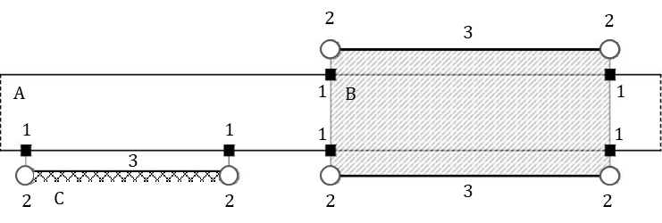
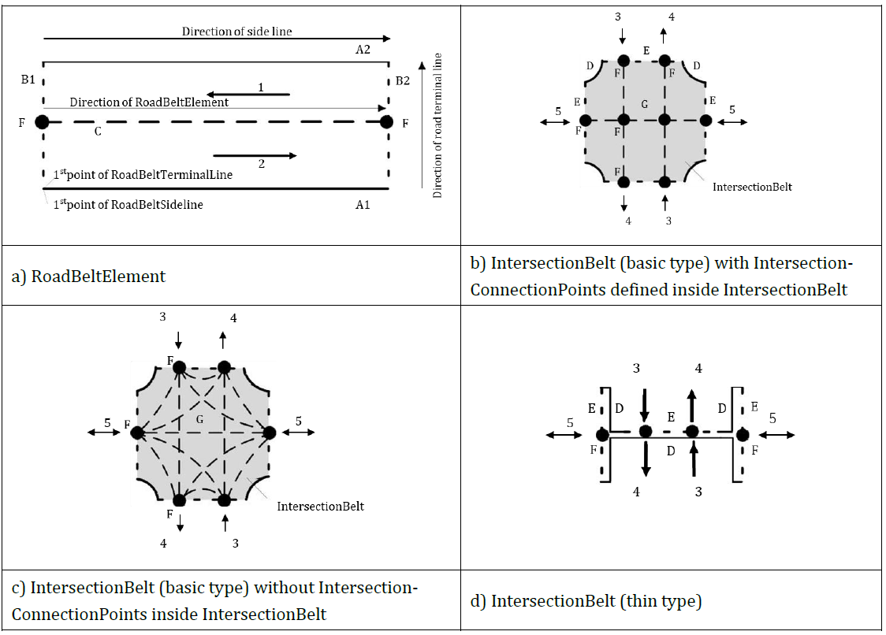

# EXTRAKT z technické specifikace ISO

**Extrakt nenahrazuje samotnou technickou normu, je pouze informativním materiálem o normě.**

|                                                                                                                                                                                                                                    |                    |
| ---------------------------------------------------------------------------------------------------------------------------------------------------------------------------------------------------------------------------------- | ------------------ |
| **Inteligentní dopravní systémy – Specifikace dynamických dat a mapové databáze pro aplikace propojených a automatizovaných systémů řízení – Část 1: Architektura a logický datový model pro harmonizaci statických mapových dat** | **ISO/TS 22726-1** |

Vydána 2025, 269 stran

## Úvod

Soubor norem ISO/TS 22726 vznikl jako reakce na potřebu sjednotit způsob, jakým jsou reprezentována a ukládána **statická mapová data pro automatizované řízení (ADS).** Moderní vozidla s vysokým stupněm automatizace vyžadují extrémně přesná, konzistentní a rychle dostupná mapová data, která propojují detailní popis infrastruktury s dynamickými informacemi o provozu. Stávající standardy – například ISO 14296 nebo GDF 5.1 – pokrývají navigaci či výměnu dat mezi poskytovateli, ale nejsou optimalizované pro **runtime přístup v palubních systémech** ani pro reprezentaci detailních prvků, jako jsou jízdní pruhy, jejich topologie, přesné geometrie nebo vztahy k dopravním událostem.

**ISO/TS 22726‑1** proto definuje logický datový model a databázovou strukturu pro ukládání a přímé dotazování na detailní statické mapové entity. **ISO/TS 22726‑2** na tento model navazuje a specifikuje fyzické datové struktury a implementační pravidla, aby bylo možné model reálně nasadit v databázích používaných vozidly, backendy a poskytovateli mapových služeb. Společně tvoří základní rámec pro budoucí generaci vysoce přesných map pro automatizované řízení.

Tento extrakt (dále jen “popisovaný dokument”) popisuje část 1 normy.

_Poznámka: Extrakt uvádí vybrané kapitoly popisovaného dokumentu a přejímá původní číslování kapitol._

## Užití

Norma je určena pro poskytovatele map, výrobce vozidel, dodavatele ADS funkcí i provozovatele C‑ITS služeb. Umožňuje jednotný způsob ukládání a aktualizace detailních mapových vrstev, což snižuje náklady na údržbu a zajišťuje interoperabilitu napříč dodavateli. Výrobci vozidel ji využívají při integraci mapových knihoven, kde je zásadní rychlý a deterministický přístup k datům a jasné vazby mezi statickými a dynamickými informacemi.

Norma se uplatní při tvorbě HD map, aktualizaci mapových vrstev, validaci dat z flotilových senzorů, plánování trajektorií nebo integraci dopravních událostí do mapových podkladů. Výsledkem je jednotné prostředí, které podporuje bezpečné a spolehlivé automatizované řízení v celém ekosystému mobility.

## Souvisící normy

Popisovaný dokument uvádí 1 normativní odkaz, a to na normu ISO/IEC 19501 UML verze 1.4.2

## 1 Předmět

Popisovaný dokument specifikuje architekturu a logický datový model statických mapových dat (MHAD) pro ADS. Definuje hlavní balíčky, jejich prvky, společné datové třídy, pravidla pro polohu a geometrii prvků, modelování dopravních předpisů a požadavky na konformitu (viz Příloha A).

## 3 Termíny a definice

Kapitola obsahuje **11** termínů a definic, z nichž nejdůležitější jsou následující:

**prvek (feature)** databázová reprezentace reálného objektu

**pás (belt)** konfigurační koncept pro vymezení plochy ohraničené bočními čárami a koncovými čárami, charakterizovaný směry a při skeletonizaci reprezentovaný jednou nebo více liniovými osami

dále jsou v normě a extraktu použity následující termíny

**balíček (package)** logická jednotka modelu, která sdružuje související datové prvky do jednoho celku a vymezuje jejich společný názvový prostor

**podbalíček (subpackage)** balíček hierarchicky umístěný uvnitř jiného balíčku, sloužící k jemnějšímu členění jeho obsahu

## 4 Zkratky

Tato kapitola uvádí **33** zkratek, z nichž nejdůležitější jsou následující:

**ADS** automatizovaný systém řízení (_automated driving system_)

**MHAD** mapa pro vysoce automatizované řízení (_map for highly automated driving_)

**RBE** prvek silničního pásu (_RoadBeltElement_)

**LBE** prvek pásu jízdního pruhu (_LaneBeltElement_)

**RSE** konstrukce a vybavení silnice (_RoadStructuresAndEquipment_)

_Poznámka: Další termíny a zkratky z oboru ITS jsou obsaženy ve slovníku ITS terminology ([www.itsterminology.org](http://www.itsterminology.org))._

## 5 Struktura dokumentu a požadavky na shodu

Tato kapitola, v rozsahu 2 strany, odkazuje na hlavní části dokumentu a stanovuje požadavky na shodu implementace s touto normou a UML diagramů s normou s ISO/IEC 19501.

## 6 Architektura

Tato kapitola, v rozsah 1,5 strany a 1 schéma, obsahuje diagram koncepční architektury ITS stanice pro ADS s různými moduly aplikací (např. lokalizační modul či modul pro ovládání řízení). Stanovuje MHAD jako primární statický zdroj, dynamická data doplňují aktuální stav prostředí a mohou MHAD aktualizovat.

## 7 Logický datový model mapových dat

Kapitola na 2 stranách ukazuje na schématu obecný datový model odvozený z ISO 14296 a rozšíření balíčku Doprava o MHAD. Identifikuje hlavní balíčky (AddressLocation, Cartographic, Service\&POI, Transportation, DynamicInformation) celkového datového modelu mapových dat a na schématu ukazuje vztahy mezi nimi a MHAD jako součástí balíčku Doprava (Transportation). Na schématu ukazuje strukturu balíčku Doprava s částmi MHAD obsahujícím RoadBeltNetwork, LaneBeltNetwork a RoadStructureAndEquipment a vztahy k RoadNetwork a TransferZoneNetwork a dalším sítím a vymezuje v jakých normách jsou tyto části sítě stanoveny.

## 8 Balíček Map pro vysoce automatizované řízení (MHAD)

Přehledová kapitola na 4 stranách definuje klíčové koncepty a konfiguraci Map pro vysoce automatizované řízení MHAD. Identifikuje podbalíčky balíčku **MHAD**: _RoadStructureAndEquipment, RoadBeltNetwork, LaneBeltNetwork a společného balíčku MHADCommonProperty_ a ukazuje na diagramu třídy MHAD vzájemné závislosti. Popisuje pásový koncept pro silnici, křižovatku a jízdní pruh jako plošný prvek definovaný směrem, šířkou a krajními a koncovými hranami (čárami) a ukazuje 2 příklady.

Popisuje vztahy mezi prvkem silnice a prvky konstrukce a vybavení silnice a ukazuje na schématu, jak jsou prvky konstrukce a vybavení silnice (most, svodidlo) přiřazeny prvkům silnice (silniční pás) s pomocí kotevní pozice a mechanismu projekčních bodů/čar. Definuje v tabulce složení třídy MHAD a její vztah s pod balíčky.

**Obr. 1** (obr. 7 normy) - Příklad vztahu silničního pásu (A) s mostem (B) a svodidlem (C) pomocí kotevních pozic (1) a projekčních bodů (2) a projekčních čar (3)

## 9 Balíček Obecné vlastnosti MNAD (MHADCommonProperty)

Tato kapitola, v rozsahu 75 stran, popisuje balíček MHADCommonProperty, který definuje společné datové třídy a vztahy používané v rámci datového modelu MHAD. Balíček je rozčleněn do tří hlavních podbalíčků: GeneralCommonProperty, CommonPhysicalCharacteristics a TrafficRegulation popisovaných v samostatných článcích. Na úrovni každého podbalíčku obsahuje diagram tříd a detailní popis jednotlivých tříd.

Detailní popis tříd, pomocí tabulky, obsahuje

  - definici třídy, to, jestli je abstraktní, z jakého typu je odvozena a jakého je stereotypu,

  - atributy třídy s jejich definicí, typem hodnoty, multiplicitou a stereotypem a

  - vztahy s dalšími třídami s jejich definicí, typem vztahu a hodnoty, multiplicitou a stereotypem

Stereotyp atributu může být primitivní typ (logická hodnota) další komplexní třída nebo třída obsahující pouze výčet hodnot. Příklad tabulky definice třídy VerticalGradient z balíčku CommonPhysicalCharteristics je v následující tabulce.

Tabulka (tab. 32 normy) - Tabulková definice třídy VerticalGradient

| třída: VerticalGradient                                                                                                   |               |                                                                                                                                        |
| ------------------------------------------------------------------------------------------------------------------------- | ------------- | -------------------------------------------------------------------------------------------------------------------------------------- |
| Definice: Úsek svislého směrového vedení, který má po celé své délce jednotný podélný sklon.                              |               |                                                                                                                                        |
| Pod-typ: VerticalAlignmentElement                                                                                         |               |                                                                                                                                        |
| Stereotyp: «DataType»                                                                                                     |               |                                                                                                                                        |
| atribut: gradientRatioValue                                                                                               |               |                                                                                                                                        |
|                                                                                                                           | Definice:     | Podélný sklon vyjádřený v procentech, přičemž kladná hodnota označuje stoupání a záporná hodnota klesání. Příklad: hodnota = +5,000 %. |
|                                                                                                                           | Typ hodnoty:  | desítková                                                                                                                              |
|                                                                                                                           | Multiplicita: | 1                                                                                                                                      |
|                                                                                                                           | Stereotypy:   | «PrimitiveType»                                                                                                                        |
| POZN: Tato třída dědí atributy sequentialNumber, startPoint a endPoint z nadřazené třídy prvku svislého směrového vedení. |               |                                                                                                                                        |

Balíček TrafficRegulation je nejrozsáhlejší, navíc stanovuje metodiku modelování dopravních předpisů (traffic regulations) s možností popisu časových a vozidlových podmínek (definovaných jako balíčeky TimeCondition, VehicleCondition) a hlavními objekty pro definici trvalých a dočasných regulací. TrafficRegulation se váže na pásové prvky a trajektorie manévru v úrovni jízdních pruhů či silnice pro vynucení dopravních předpisů (zákazy odbočení, časově omezené zákazy, podmíněné povolení apod.).

## 10 Balíček síť pásů silnic (RoadBeltNetwork)

Tato kapitola, v rozsahu 61 stran, popisuje model sítě silničních pásů. RoadBeltNetwork se skládá z podbalíčků: RoadBeltNetworkFeature, RoadBeltFeatureProperty a RoadBeltSegmentProperty. Definuje diagram tříd tohoto balíčku a detailní pravidla pro modelování RoadBeltNetwork, tedy jakým způsobem jsou sestaveny a spolu provázány třídy popisující křižovatky, trajektorie manévru v úrovni silnic a prvky a úseky silničního pásu včetně příkladů.

Samotné třídy obsažené v balíčku jsou popsány podobným způsobem jako v kapitole 9.

**Obrázek (obr. 16 normy) - Schéma RoadBeltElement a IntersectionBelt**

## 11 Balíček síť pásů jízdních pruhů (LaneBeltNetwork)

Kapitola, v rozsahu 35 stran, popisuje model pásů jízdních pruhů. LaneBeltNetwork, modeluje úroveň pruhů s analogickou strukturou k silniční úrovni, ale s vyšší granularitou, se skládá z podbalíčků: LaneBeltNetworkFeature, LaneBeltFeatureProperty a LaneBeltSegmentProperty. Definuje diagram tříd tohoto balíčku a detailní pravidla pro modelování LaneBeltNetwork, tedy jakým způsobem jsou sestaveny a spolu provázány třídy popisující prvky a spojení pásu jízdního pruhu a pro modelování trajektorie manévru v úrovni jízdních pruhů.

Samotné třídy obsažené v balíčku jsou popsány podobným způsobem jako v kapitole 9.

**Obrázek (obr. 23 normy) - Příklad trajektorie manévru v úrovni jízdního pruhu (C)** **obsahující prvky pásu jízdního pruhu (A) a jejich spojení** **(B)**

## 12 Balíček Konstrukce a vybavení silnice (RoadStructureAndEquipment)

Kapitola, v rozsahu 99 stran, popisuje model konstrukce a vybavení silnice včetně vodorovného dopravního značení. RoadStructureAndEquipment, se skládá z podbalíčků: _RoadEquipment, RoadMarking, RoadStructure, a RSECommonProperty_. Definuje seznam prvků (viz příklad v následující tabulce) a k jakému předchozímu síťovému konceptu náležejí.

**Tabulka (ukázka z tab. 172 normy) - Přehled kategorií RSE**

| Kategorie                                      | Příklad prvku                                                                                            | poznámka |
| ---------------------------------------------- | -------------------------------------------------------------------------------------------------------- | -------- |
| Konstrukce pozemní komunikace (Road Structure) | střední dělicí pás (CentralReserve); tunel (Tunnel); silniční most (VehicleBridge)                       |          |
| Vybavení pozemní komunikace (Road Equipment)   | svislá dopravní značka (RoadSign); sloupek dopravního značení (TrafficPole); Svodidlo (Guardrail)        |          |
| Vodorovné dopravní značení (Road Marking)      | příčná čára souvislá (StopLine); přechod pro chodce (PedestrianCrossing); podélná čára (LaneEdgeMarking) |          |

Na úrovni každého podbalíčku obsahuje diagram tříd a detailní popis jednotlivých tříd. Samotné třídy obsažené v balíčku jsou popsány podobným způsobem jako v kapitole 9.

## 13 Vztah mezi MHAD a dynamickými informacemi

Kapitola, ve 2 větách, upozorňuje, že dynamické informace, definované v TS 22726-2, mohou upřesňovat MHAD prostřednictvím rozhraní _RoadNetworkElement_ a odkazuje na schéma v kapitole 9.‑2

## Příloha A (normativní) Abstraktní testovací sada

Příloha na 1 straně bodově vymezuje test pro ověření datových struktur a odkazuje na kapitolu 7.

## Příloha B (informativní) Základní datové typy a stereotypy

Příloha v rozsahu 1,5 strany uvádí v tabulce definice a zdrojové normy primitivních datových typů (číslo, řetězec …) a stereotypů (váha, rychlost, čas, liniová a bodová data …) převzatých z jiných norem.

## Příloha C (informativní) Rozlišení a přesnost MHAD

Příloha na 1 straně uvádí doporučené rozlišení a metriky pro polohová data (GNSS/RTK), tolerance a metodiky validace přesnosti.

## Příloha D (informativní) Porovnání modelů silničních sítí

Příloha v rozsahu 5 stran porovnává MHAD pásový model s tradičními lineárními modely (ISO/TS 20452, ISO 14296, GDF/ISO 20524‑2) a obsahuje doporučení pro transformace a interoperabilitu.
